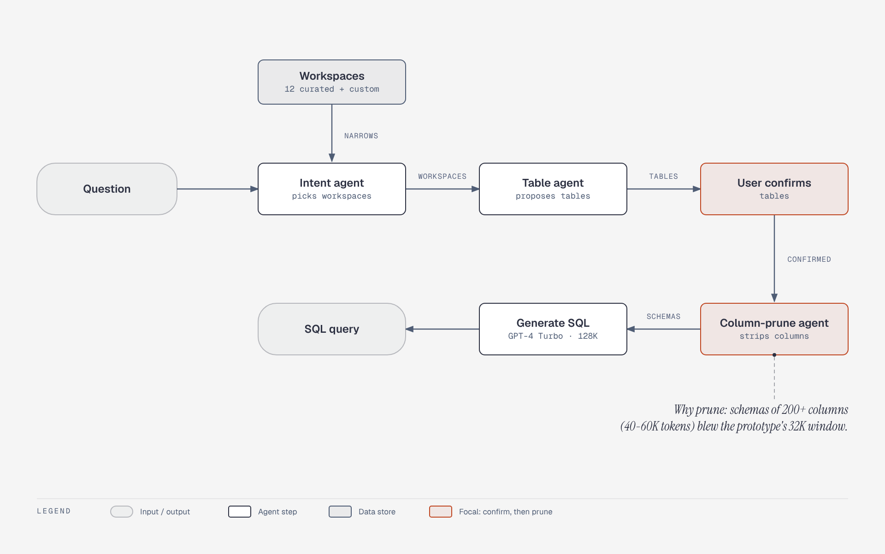

# Uber QueryGPT workflow of narrow agents

**What it shows:** Intent, table and column-prune agents run in sequence before SQL generation, with the user confirming tables before pruning.

**Diagram type:** Flowchart (no semantic pattern routed): a linear pipeline with one human step and one store input.

**What the budget forced out or merged:** The eval box (golden set, vanilla vs decoupled flows) was dropped; it stays in the prose. The "why pruning" red box became an italic callout. Accent: user confirmation and column-prune agent.

**Assumptions:** Doc-inline preset, mixed audience, balanced detail. The user confirmation is drawn as a step, not a decision diamond, because it has no branches in the source. Illustrates the matching entry in [`../case-studies.md`](../case-studies.md).

Source: `cs-uber-querygpt-workflow.html` (diagram-design skill, default skin, minimal light variant).
