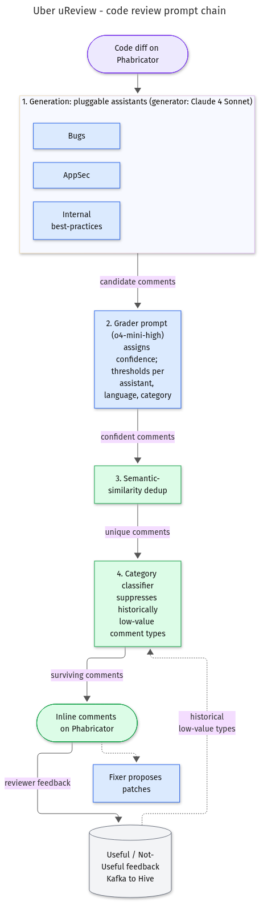

# Uber uReview - code review prompt chain

**What it shows:** A fixed chain: pluggable generator assistants, a grader prompt, semantic dedup, then a category classifier, with feedback and a Fixer off the output.

**Why this diagram type:** A flowchart shows that this is a deterministic chain of stages, not a free-roaming agent.

**Design decisions:** LLM stages are blue and code stages green; the feedback store is a cylinder. Colours follow the shared set: blue for model calls, green for deterministic code, orange for humans, red for failure causes, grey for data stores, purple for external inputs. Top-to-bottom layout keeps it narrow.

**Assumptions / source:** Every element comes from the text of the section named below; no new facts. Illustrates the "Uber — uReview (AI code review)" entry in [`../case-studies.md`](../case-studies.md).

Source script: `cs-uber-ureview-prompt-chain.mmd` (Mermaid, rendered via Kroki).
