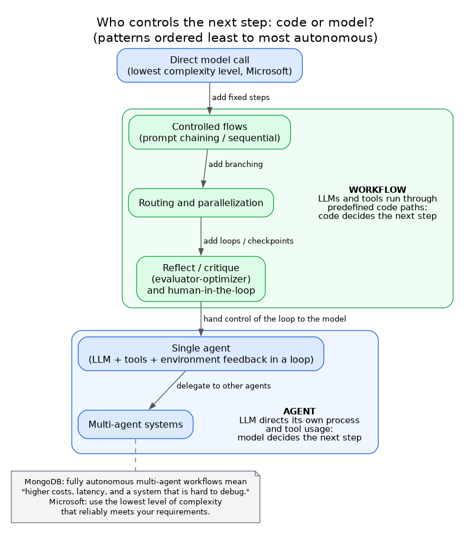

# Who controls the next step: code or model?

**What it shows:** Six patterns ordered from least to most autonomous, split at Anthropic's workflow/agent line where control of the next step passes from code to the model.

**Diagram type:** Layer stack (diagram-design). It is an ordered ladder of rows, and the thick divider plus the left-margin direction arrow carry the "more autonomy" reading.

**What the budget forced out:** The old figure's coloured clusters became the CODE / MODEL tags and two right-hand captions. The arrow labels between rungs ("add fixed steps", "add branching", ...) became a second sublabel line on each row. The MongoDB and Microsoft quotes are the two italic callouts. Accent is only on the Single agent row (where the model takes the loop).

**Assumptions:** Same ordering as before (MongoDB's least-to-most-autonomous list, with Microsoft's direct call as the lowest level); orchestrator-workers stays omitted because no source places it on that ordering. The tag "LOWEST" for the direct call is taken from Microsoft's "lowest complexity level".

**Source:** `fp-autonomy-spectrum.html` (diagram-design skill, default skin). Illustrates section 1.2 of foundations-and-patterns.md.
