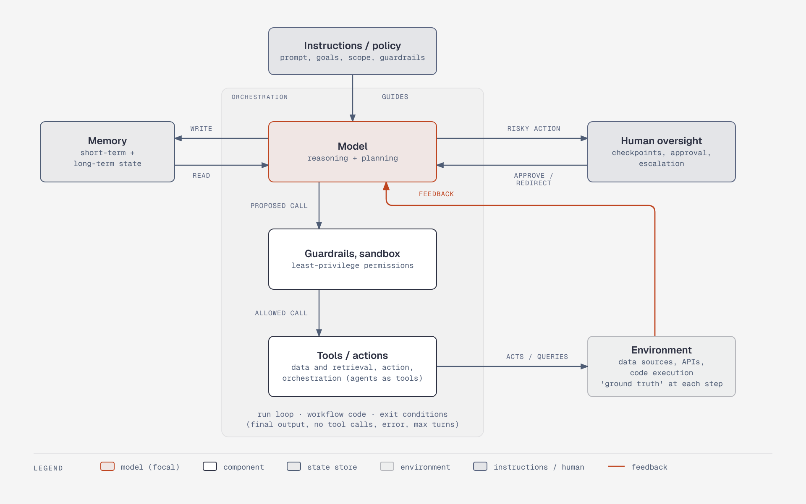

# Core components of an agentic system

**What it shows:** How instructions, model, memory, tools, environment, guardrails, orchestration and human oversight connect.

**Diagram type:** Architecture (diagram-design), with one flat zone for orchestration. Model, guardrails and tools run as a vertical chain inside the zone.

**What the budget forced out:** Nothing was removed: 7 nodes plus 1 zone, 9 arrows. The old memory cylinder and human two-way arrows became paired one-way arrows (WRITE / READ, RISKY ACTION / APPROVE / REDIRECT). The accent marks only the Model node and the environment feedback arrow (the ground-truth loop).

**Assumptions:** The "results = feedback for the next step" label is shortened to FEEDBACK (14-character label limit); the "ground truth at each step" text moved into the Environment node. "Guardrails, sandbox, least-privilege permissions" is split into node name and sublabel. A normalized synthesis of the vendor table, not any one vendor's layout.

**Source:** `fp-core-components.html` (diagram-design skill, default skin). Illustrates section 2 of foundations-and-patterns.md.
