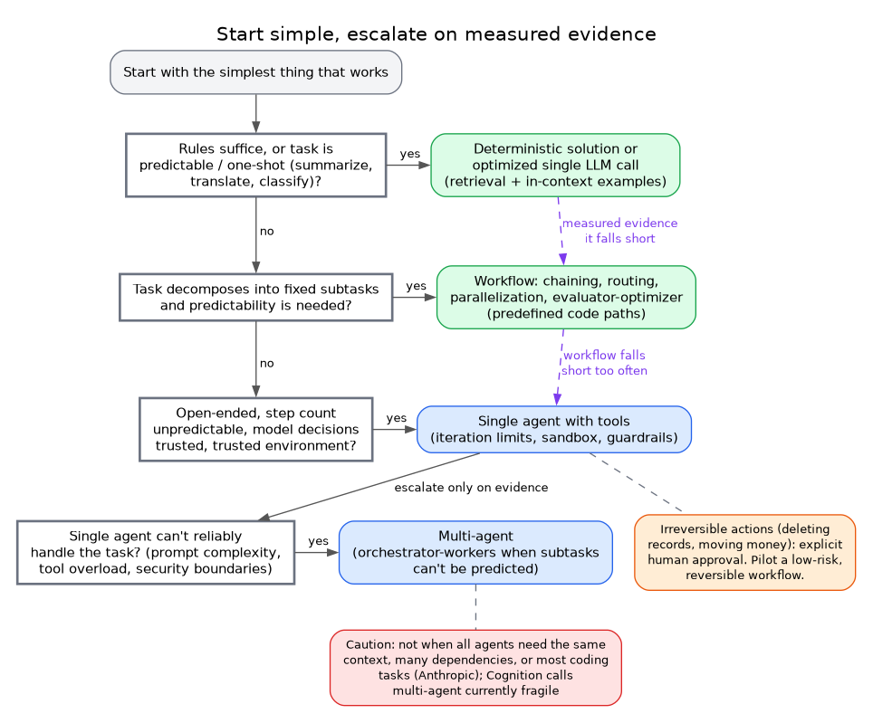

# Start simple, escalate on measured evidence

**What it shows:** Decision flow from plain call to workflow to single agent to multi-agent, with the cautions from the sources.

**Why this diagram type:** Graphviz flowchart with entry-point questions on the left and the escalation ladder on the right.

**Design decisions:** Purple dashed arrows mark escalation on evidence; orange = human approval note, red = multi-agent caution.

**Assumptions / source:** Illustrates section 4 (and section 6 agreement 1-2) of foundations-and-patterns.md; only criteria quoted there are used.
