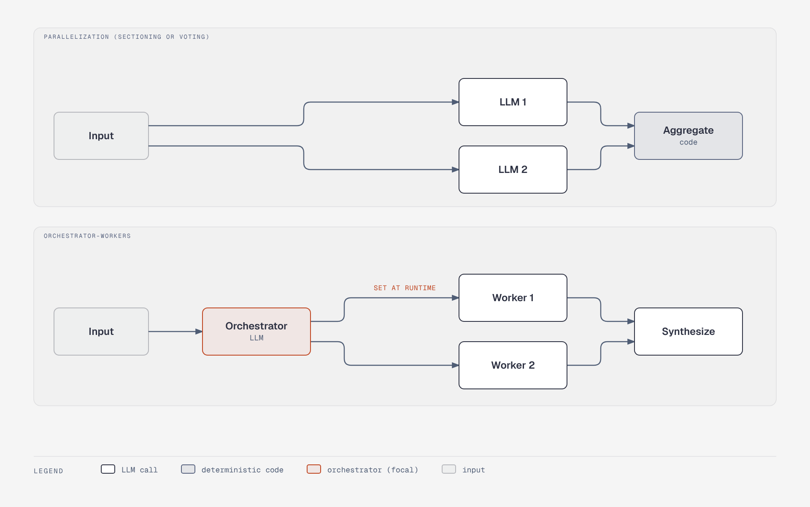

# Anthropic's workflow patterns: parallelization vs orchestrator-workers

**What it shows:** Part 2 of 2 (split from `fp-workflow-patterns`). Parallelization (fixed fan-out to LLMs, code aggregates) next to orchestrator-workers (an orchestrator LLM sets subtasks at runtime, workers run, an LLM synthesizes).

**Diagram type:** Architecture (diagram-design), two flat zones as stacked panels with the workers and the join aligned in the same columns, so the extra Orchestrator step is the visible difference.

**What the budget forced out:** Parallelization shows two LLMs (the old figure showed three) and orchestrator-workers two workers; counts are illustrative. 9 nodes, 9 arrows. Accent marks the Orchestrator and the SET AT RUNTIME label.

**Assumptions:** Content follows section 3.1 of foundations-and-patterns.md; "sectioning or voting" is kept in the panel title instead of arrow labels.

**Source:** `fp-workflow-patterns-fanout.html` (diagram-design skill, default skin).
