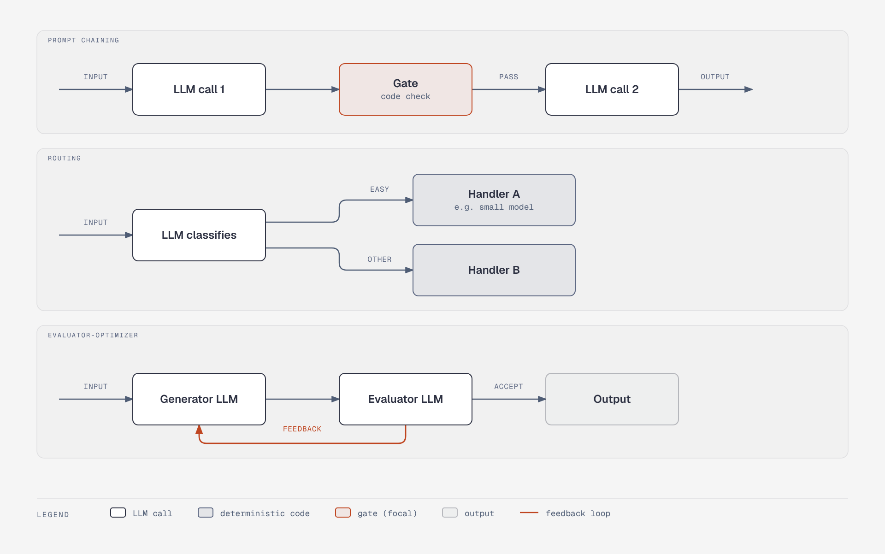

# Anthropic's five workflow patterns

**What it shows:** Small flow sketches of prompt chaining, routing, parallelization, orchestrator-workers and evaluator-optimizer.

**Why this diagram type:** Graphviz clusters allow five mini-flows in one figure, wrapped into two rows to stay narrow.

**Design decisions:** Blue = LLM call, green = deterministic code, white = input/output; labels (gate, easy, sectioning or voting, subtasks set at runtime, feedback/accept) come from section 3.1.

**Assumptions / source:** Illustrates section 3.1 (Anthropic catalog) of foundations-and-patterns.md; worker counts are illustrative.
