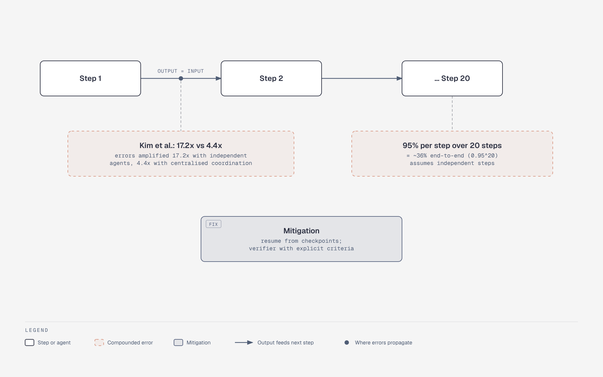

# Where errors compound along a chain

**What it shows:** The error-compounding half of section 10: each step's output is the next step's input, with the 0.95^20 arithmetic, the Kim et al. 17.2x vs 4.4x amplification figures, and the mitigations. Split off from `ma-handoff-failure-points`.

**Diagram type:** Architecture (a three-node chain with annotation boxes).

**What the budget forced out or split:** Steps 3 to 19 are not drawn; the third node reads "... Step 20", as in the original.

**Assumptions / notes:** Numbers are quoted from the topic file, not new. The 36% figure assumes independent steps, as the file states.

**Source:** `ma-error-compounding.html` (diagram-design skill, default skin, minimal light, doc-inline preset).

**Illustrates:** multi-agent-systems.md, section 10 (Failure modes, consolidated)
