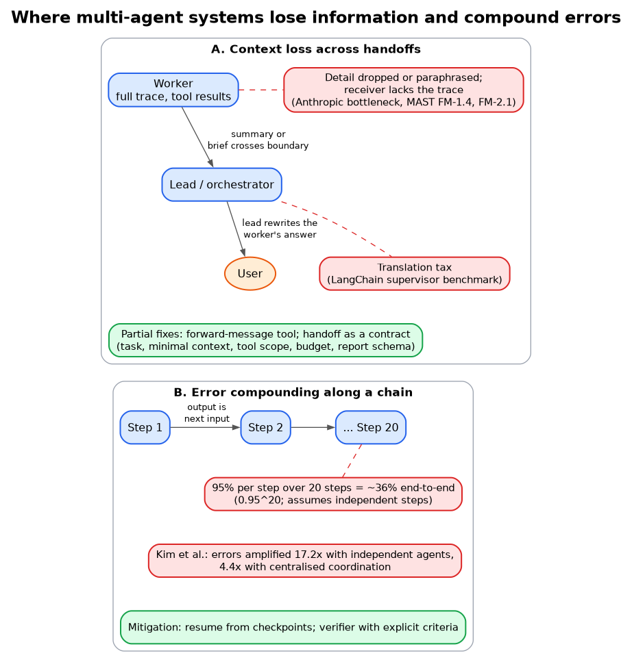

# Where handoffs lose context

**What it shows:** The context-loss half of section 10: detail dropped when a worker's result crosses a handoff, the translation tax when the lead rewrites it for the user, and the partial fixes.

**Diagram type:** Architecture (a three-node handoff chain with annotation boxes hung off the lossy handoffs).

**What the budget forced out or split:** Over budget as one figure, so the original panel B (error compounding) was split into `ma-error-compounding`.

**Assumptions / notes:** Failure boxes use the dashed accent treatment; the dots on the arrows mark where information is lost.

**Source:** `ma-handoff-failure-points.html` (diagram-design skill, default skin, minimal light, doc-inline preset).

**Illustrates:** multi-agent-systems.md, section 10 (Failure modes, consolidated)
