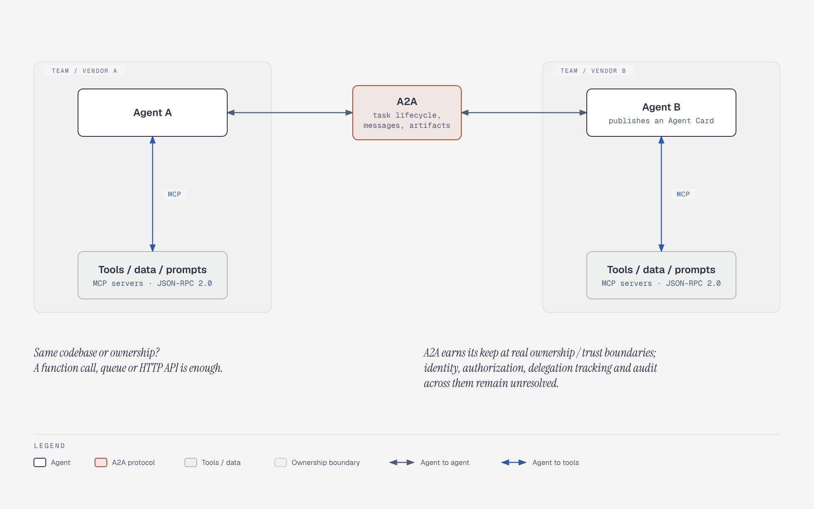

# Protocol layering: A2A between agents, MCP below to tools

**What it shows:** The layered framing: MCP connects an agent to tools, data and prompts; A2A connects agents across an ownership boundary. Two callouts carry the "overkill inside one codebase" caveat and the unresolved cross-boundary problems.

**Diagram type:** Architecture with two ownership zones; A2A sits outside both zones because it crosses the boundary.

**What the budget forced out or split:** The protocol status notes (MCP and A2A dates, AAIF, ACP merged into A2A, ANP) were dropped; they live in the section 9 table beside the figure.

**Assumptions / notes:** Two agents are shown across a vendor boundary because that is where A2A is argued to pay off. A2A is the single accent element.

**Source:** `ma-protocol-layers.html` (diagram-design skill, default skin, minimal light, doc-inline preset).

**Illustrates:** multi-agent-systems.md, section 9 (Inter-agent and agent-tool protocols)
