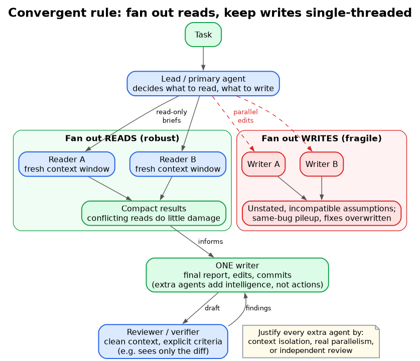

# Convergent rule: fan out reads, keep writes single-threaded

**What it shows:** The shared 2026 rule from Anthropic, Cognition and LangChain: parallel read-only workers feed one writer, a clean-context reviewer checks the draft, and parallel writers are the fragile path.

**Why this diagram type:** A top-down flow with a green (safe) branch and a red (fragile) branch makes the decision rule visible at a glance. (Rendered with graphviz via Kroki; source: `ma-reads-writes-rule.dot`.)

**Design decisions:** Green and red clusters side by side; the single writer sits below the reads branch. The note restates the three justifications for extra agents.

**Assumptions / notes:** Writer examples ("final report, edits, commits") generalise from Anthropic (one agent writes the report) and Cognition (writes stay single-threaded).

**Illustrates:** multi-agent-systems.md, section 1 (headline) with support from sections 4, 6 and 11
