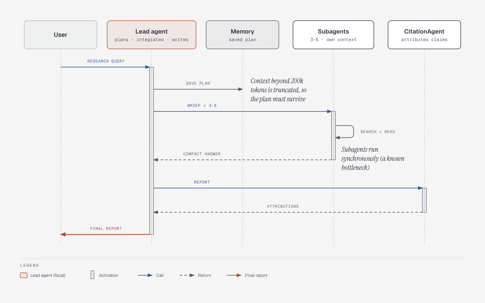

# Anthropic research system: orchestrator, subagents, citation pass

**What it shows:** Message order in Anthropic's multi-agent research system: the lead saves its plan, subagents run in parallel and return compact answers, the CitationAgent attributes claims, and the lead delivers the final report.

**Diagram type:** Sequence (5 lifelines). The sequence reference has no `par` fragment, so parallelism is carried by the "BRIEF x 3-5" label and the Subagents box ("3-5 - own context").

**What the budget forced out or split:** Budget is 5 lifelines, so the Search / tools lifeline became the "SEARCH + READ" self-message on Subagents, and the "plan" and "integrate" self-messages moved into the Lead agent's sublabel ("plans - integrates - writes"). The brief contents (objective, output format, tool guidance, task boundaries) are not drawn.

**Assumptions / notes:** The citation step follows integration, per "a separate CitationAgent attributes claims at the end". The two callouts are the 200k-token truncation and the synchronous-subagent bottleneck.

**Source:** `ma-research-system-sequence.html` (diagram-design skill, default skin, minimal light, doc-inline preset).

**Illustrates:** multi-agent-systems.md, section 4 (Anthropic research system)
