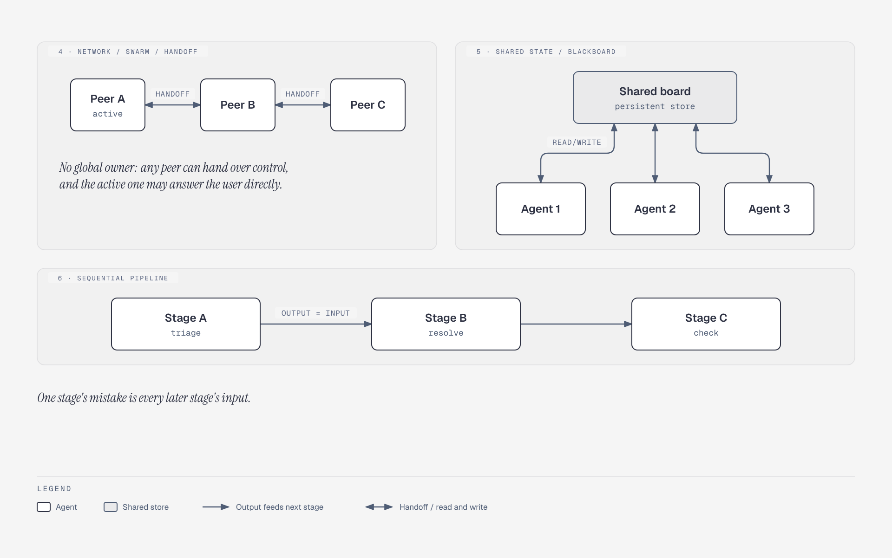

# Topologies without a lead: peers, board, chain

**What it shows:** The other three topologies: network/swarm handoff between peers, shared-state blackboard, and sequential pipeline. Split off from `ma-topologies`.

**Diagram type:** Architecture, three independent panels (zones) in one figure.

**What the budget forced out or split:** The separate User node of the swarm panel became text in the callout ("the active one may answer the user directly"). The pipeline callout repeats the table's failure mode ("one stage's mistake is every later stage's input").

**Assumptions / notes:** Panels are separate mini-diagrams, so the node budget is applied per panel (at most 4 nodes). The shared board is drawn as a store-style box rather than a cylinder.

**Source:** `ma-topologies-flat.html` (diagram-design skill, default skin, minimal light, doc-inline preset).

**Illustrates:** multi-agent-systems.md, section 2 (Topology catalogue)
