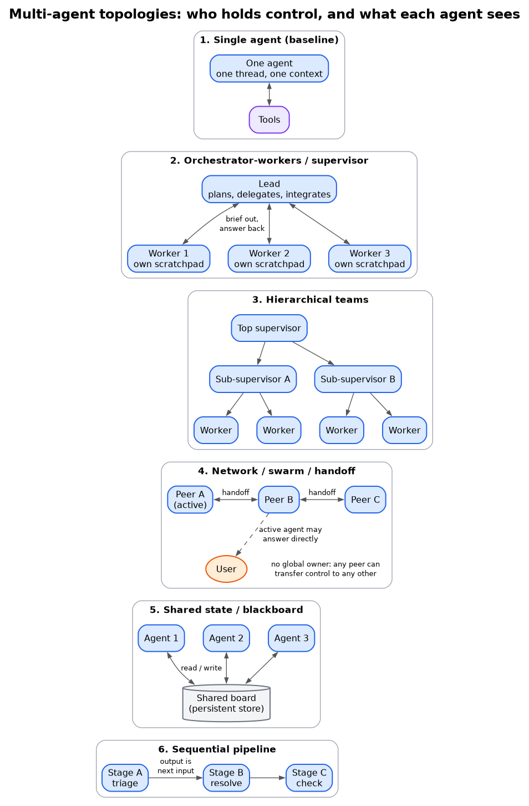

# Multi-agent topologies: who holds control, and what each agent sees

**What it shows:** Six of the section 2 topologies as small graphs stacked vertically: single agent, orchestrator-workers, hierarchical teams, network/swarm handoff, shared-state blackboard, and sequential pipeline.

**Why this diagram type:** Graphviz clusters stack several independent small graphs in one narrow figure; structure (fan-out, tree, cycle, hub) is the point, so a graph beats a table. (Rendered with graphviz via Kroki; source: `ma-topologies.dot`.)

**Design decisions:** Blue for agents, purple for tools, grey cylinder for the shared store, orange for the user. Control flow and context flow differ per panel: scratchpads are isolated in panel 2, shared in panel 5.

**Assumptions / notes:** Omits the other table rows (concurrent, generator-verifier, work queue, message bus, manager-led planning, debate); they are variations on these shapes.

**Illustrates:** multi-agent-systems.md, section 2 (Topology catalogue)
