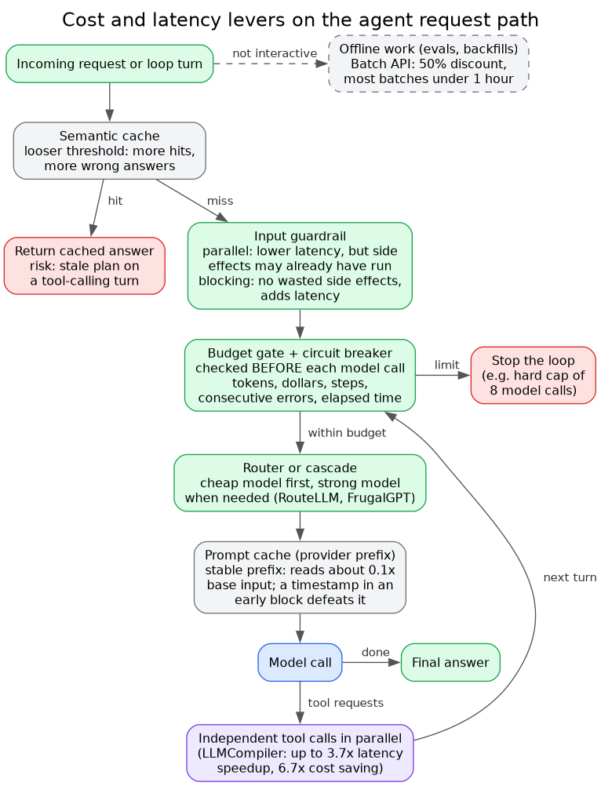

# Cost and latency levers on the request path

**What it shows:** Cost and latency techniques mapped onto one agent request and its loop: semantic cache, guardrail, budget gate, router, prompt cache, parallel tools, plus batch as an offline path.

**Why this diagram type:** A flowchart shows where each lever sits and what it can cut off.

**Design decisions:** Grey for caches and stores, red for the risky cache hit and the stop path, green for deterministic gates; loop edge returns to the budget gate.

**Assumptions / source:** Illustrates section 5 of production-and-operations.md. The order of levers on the path is illustrative; figures are those quoted in the file.
