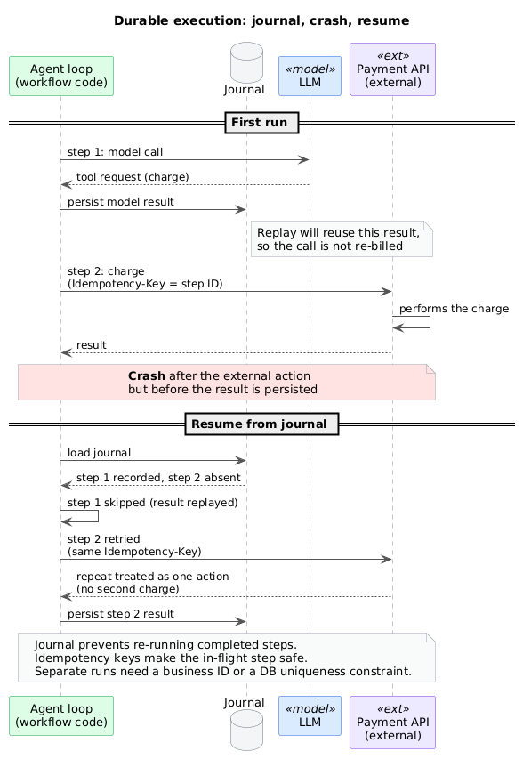

# Durable execution: journal, crash, resume

**What it shows:** A model call and a payment tool call journaled step by step, a crash after the external action, and resume from the journal with a retried step.

**Why this diagram type:** A sequence diagram makes the ordering of persist, act and crash explicit, which is the whole point.

**Design decisions:** Journal as a grey cylinder, model blue, external API purple, workflow code green, crash in red; notes carry the two lessons (journal prevents re-running completed steps; idempotency keys cover the in-flight step).

**Assumptions / source:** Illustrates section 1.4 of production-and-operations.md (and 1.1/1.3). The payment API is a stand-in for any mutating tool; no numbers beyond the file.
