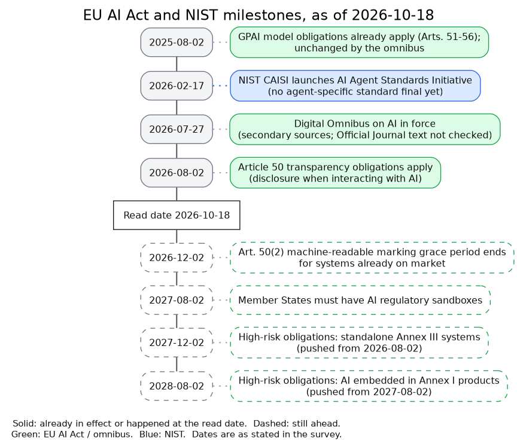

# EU AI Act and NIST milestones

**What it shows:** Dated governance milestones stated in the survey, split into already in effect and still ahead at the read date 2026-10-18.

**Why this diagram type:** A vertical spine timeline fits a narrow layout better than a Mermaid timeline or gantt, which render over 1900px wide.

**Design decisions:** Solid = already happened, dashed = ahead; green for EU, blue for NIST.

**Assumptions / source:** Illustrates sections 7.1 and 4.3 of production-and-operations.md. Only dates the file states; adoption dates are secondary-sourced per the file.
