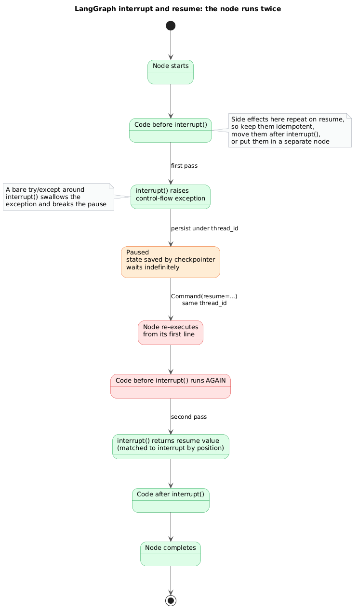

# LangGraph interrupt and resume

**What it shows:** Control flow of a LangGraph node that calls interrupt(): pause, persist, resume, and the re-execution of the node from its first line.

**Why this diagram type:** A state diagram fits a pause/resume lifecycle; the repeated state is the lesson.

**Design decisions:** Orange = paused awaiting a human, red = the re-executed code where duplicated side effects appear; notes give the documented mitigations and the try/except pitfall.

**Assumptions / source:** Illustrates section 1.4 (human-interrupt re-execution) and 2.1 of production-and-operations.md.
