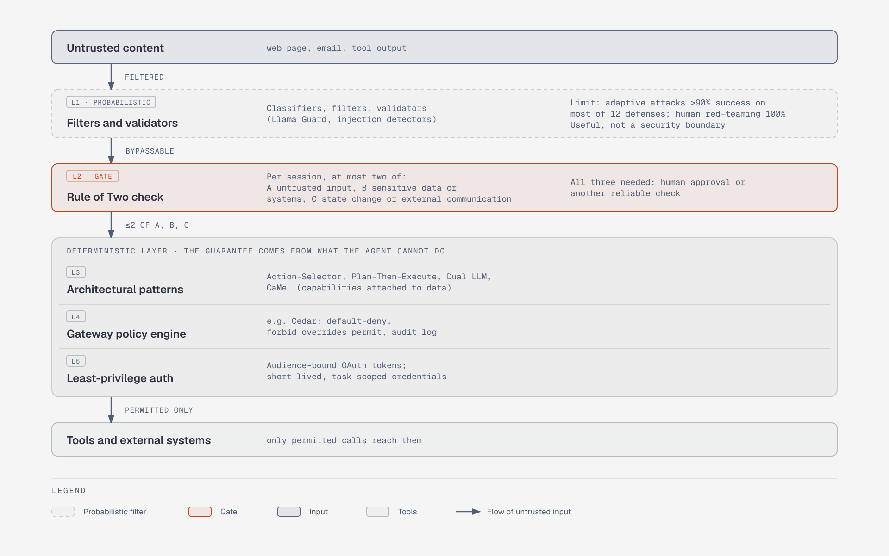

# Layered agent security

**What it shows:** Where probabilistic guardrails and deterministic boundaries sit on the path from untrusted input to tools, with the Rule of Two as the gate.

**Diagram type:** Layer stack, Compensating security layers pattern. Each layer's limitation or guarantee is stated; the risk thread runs top to bottom between layers.

**What the budget forced out or merged:** The 'Agent LLM' node was folded into the Rule of Two layer; the 'human approval' node became text in that layer; the three deterministic controls (patterns, policy engine, least-privilege auth) are three layers inside one labeled group with no arrows between them, because the source states no order among them. The 'approved' edge is carried by the L2 text. One accent element (the gate).

**Assumptions / source:** Illustrates sections 3.2 and 4.2-4.3 of production-and-operations.md. Ordering of layers is a conceptual arrangement, not a mandated architecture. Plan was recorded here rather than confirmed with the user (not reachable): doc-inline preset (960x600), minimal light, default skin, static.

Source: `ops-layered-security.html` (diagram-design skill, default skin). Exported to `.svg` and `.png` from it.
