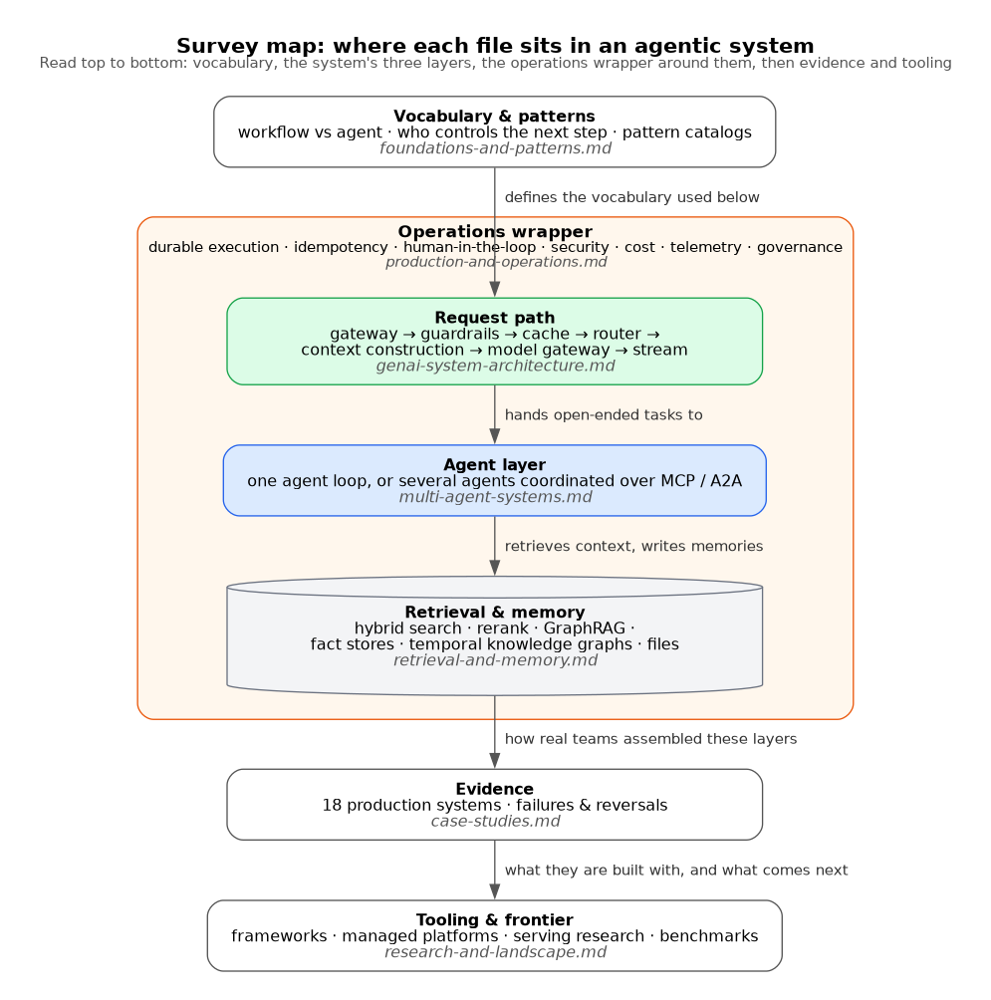

# Survey map: where each file sits in an agentic system

**What it shows.** How the seven topic files of this survey map onto the layers of a production
agentic system: the foundations file supplies the vocabulary; the request path, agent layer and
retrieval/memory layer are the system itself; operations wraps all three; case studies and the
landscape file sit outside as evidence and tooling. Illustrates the index in
[`../README.md`](../README.md).

**Why this type.** A layered GraphViz block diagram with one cluster reads as a stack top to bottom,
keeps the "wrapper" relationship visual instead of needing extra arrows, and stays narrow. A
Mermaid version was tried first; it rendered with crossing edges and squeezed node text, and later
attempts failed in Kroki's Mermaid PNG renderer.

**Design decisions.** Colours follow the survey-wide key: green for deterministic request-path code,
blue for model-driven agent behaviour, grey cylinder for data, orange for the operations/oversight
wrapper. File names are in italics inside each layer so the map doubles as a navigation aid.

**Assumptions.** The layering is a reading aid, not a claim that every system has all three layers;
many systems in the survey are pure workflows with no agent layer.
