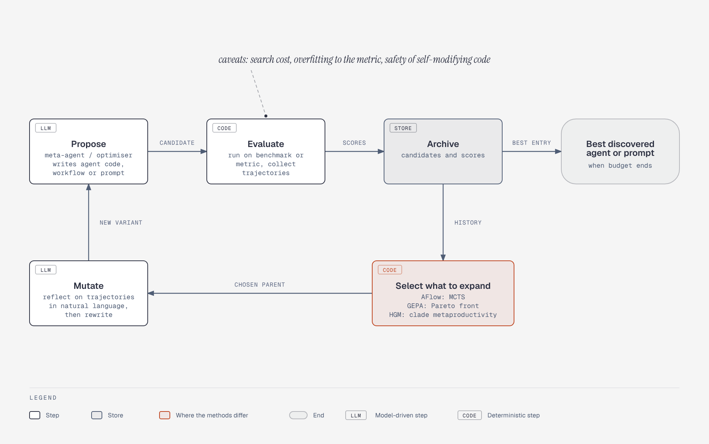

# Automated Agent Design Loop

**What it shows:** The generic propose, evaluate, archive, select, mutate loop shared by ADAS, AFlow, GEPA, DGM and HGM, with each method's selection rule.

**Why this diagram type:** A top-down flowchart expresses the cycle and its exit clearly.

**Design decisions:** Blue for model-driven steps, green for deterministic steps, grey cylinder for the archive, red for the recurring caveats.

**Assumptions / source:** This is a generalisation across the A3 table, not any one paper's exact algorithm. Illustrates section A3 of `../research-and-landscape.md`. Source script: `rl-agent-design-search-loop.mmd`.
