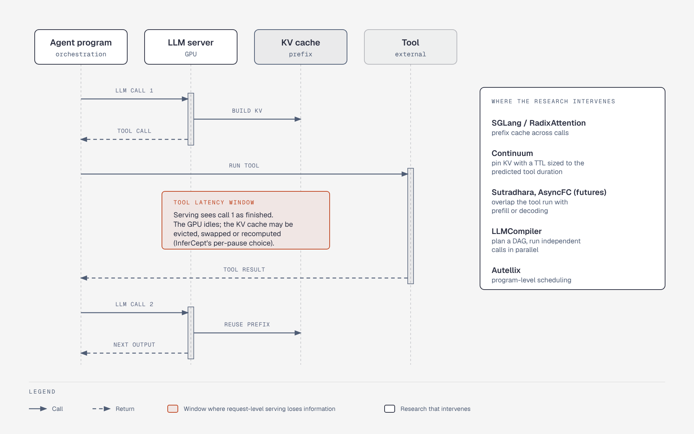

# Why Agent Workloads Stress LLM Serving

**What it shows:** One agent step across two LLM calls with a tool call between them, the idle window, and which systems intervene where.

**Why this diagram type:** A sequence diagram makes the timing gap between calls visible, which a table of systems cannot.

**Design decisions:** Four participants only; red note marks the tool-latency window (risk), green note lists the interventions from the A2 table.

**Assumptions / source:** The GPU-idle and eviction framing follows the A2 premise that request-level serving discards program structure and Continuum/InferCept's per-pause options; no numbers are shown. Illustrates section A2 of `../research-and-landscape.md`. Source script: `rl-agent-serving-pause.puml`.
