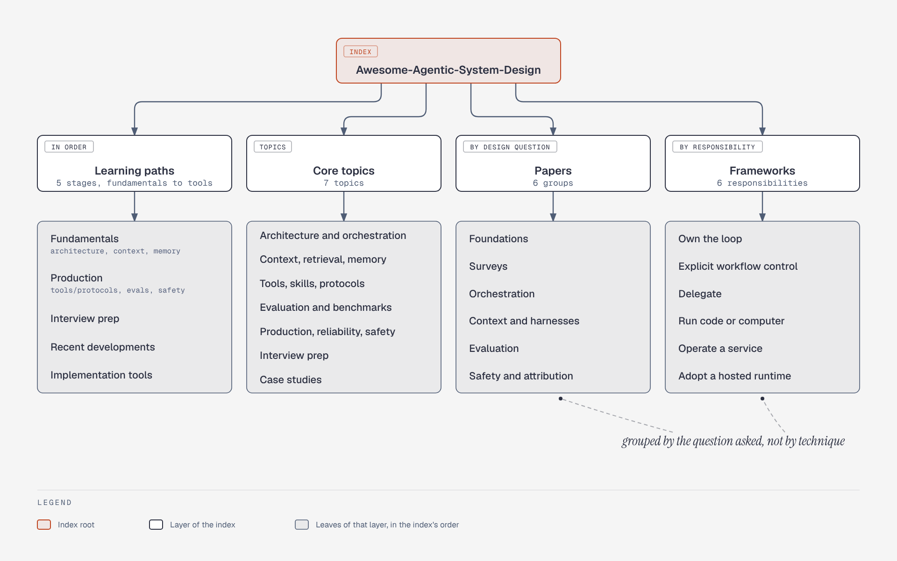

# Awesome-Agentic-System-Design: How the Index Is Organised

**What it shows:** The four layers of the awesome-list index: learning paths, seven core topics, papers grouped by design question, and frameworks grouped by responsibility.

**Why this diagram type:** A mind map suits a one-root, four-branch classification where hierarchy matters and there are no flows.

**Design decisions:** All branches extend to one side to keep the figure narrow and tall; neutral greys because colour carries no meaning here.

**Assumptions / source:** Labels are shortened from the table in A1; nothing added. Illustrates section A1 of `../research-and-landscape.md`. Source script: `rl-awesome-list-taxonomy.puml`.
