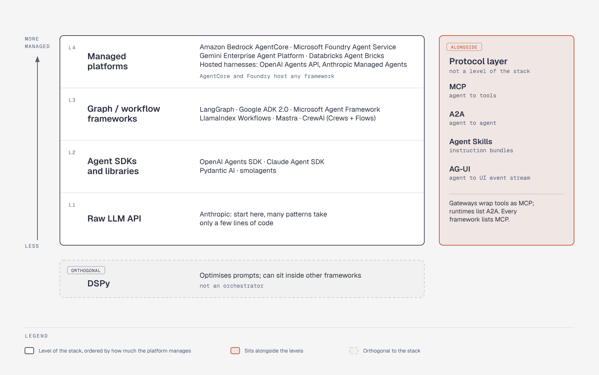

# Framework and Platform Landscape by Abstraction Level

**What it shows:** Frameworks and platforms profiled in B1 and B2 stacked by how much the platform manages, with the protocol layer (MCP, A2A, Agent Skills, AG-UI) alongside and DSPy shown as orthogonal.

**Diagram type:** Layer stack (diagram-design skill, default skin, minimal light, doc-inline). Stacked abstraction levels with a side band. 4 levels + protocol band + DSPy band = 6 nodes, no connectors.

**Budget handling:** The dashed relationship arrows of the old figure became text: "AgentCore and Foundry host any framework" on the managed row, and "Gateways wrap tools as MCP; runtimes list A2A. Every framework lists MCP" in the protocol band. The accent marks the protocol band, the one element that is not a level.

**Assumptions:** The level assignment of each product is a reading of the B1 "abstraction level" column. Only products named in the file are used. L1 to L4 index tags are ordering labels, not names from the sources.

Source: `rl-framework-landscape.html` (diagram-design skill, default skin). Illustrates sections B1, B2 and B4 of `../research-and-landscape.md`.
