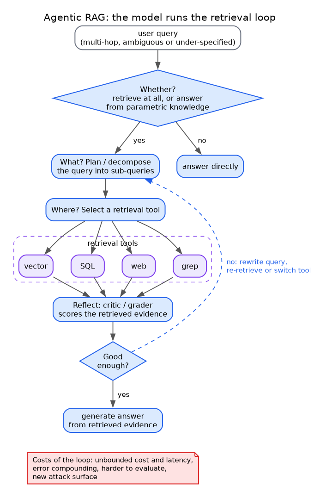

# Agentic RAG: the model runs the retrieval loop

**What it shows:** The agent-controlled retrieval loop: decide whether to retrieve, plan what, select where, retrieve, grade, and either answer or iterate.

**Why this diagram type:** Graphviz flowchart with decision diamonds and a dashed back-edge, the clearest way to show a loop with branching.

**Design decisions:** Blue = model decisions; purple = retrieval tools (vector, SQL, web, grep as listed in the section 2 table); red note = the costs the file attributes to this stage.

**Assumptions / source:** Section 2 of retrieval-and-memory.md (agentic RAG row and the Self-RAG/CRAG/Search-R1/DeepRAG lines). The single 'critic/grader' node abstracts the research lines.
