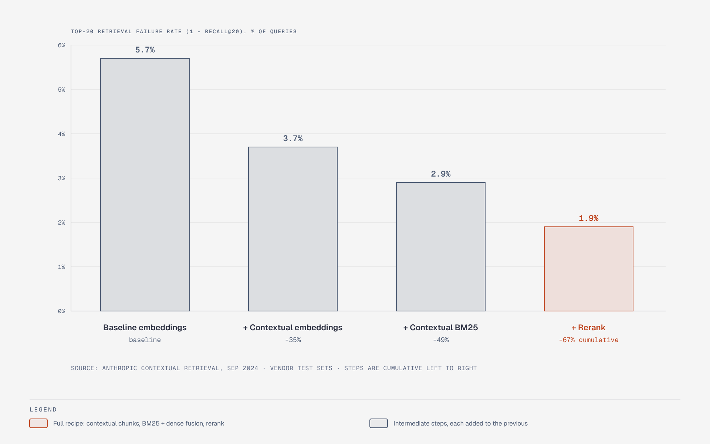

# Contextual retrieval: top-20 failure rate by step

**What it shows:** The cumulative top-20 retrieval failure rate (1 - recall@20) on Anthropic's test sets: 5.7% baseline embeddings, 3.7% with contextual embeddings, 2.9% adding contextual BM25, 1.9% adding rerank (-67% overall).

**Diagram type:** Bar chart (four columns, y-axis from 0), diagram-design skill, default skin, minimal light, `doc-inline`. Four values compared across categories is a bar chart; the old figure showed them as a text note inside the pipeline diagram.

**Why split out:** Moving the note out keeps the pipeline figure within the node and callout budget. This figure is new in the redraw (same `rm-` prefix) and uses only numbers already in sections 1 and 3.1-3.3. Accent: the final bar.

**Assumptions:** Vendor-authored numbers on Anthropic's own test sets; the percentage labels are cumulative against baseline.

**Source:** `rm-contextual-retrieval-failure.html` (diagram-design skill, default skin).
