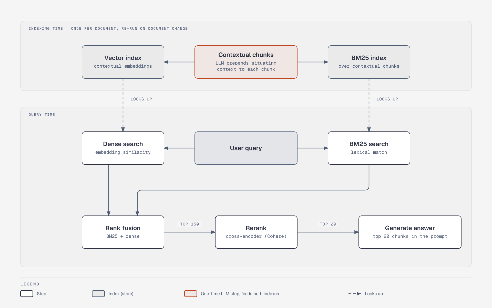

# Hybrid retrieval pipeline: indexing time vs query time

**What it shows:** Anthropic's contextual-retrieval recipe split into what runs once at indexing time (contextual chunks feeding a vector index and a BM25 index) and what runs per query (dense + BM25 search, rank fusion to 150 candidates, rerank, 20 chunks into the prompt).

**Diagram type:** Architecture (two flat zones, indexing and query, with dashed lookups across the boundary), diagram-design skill, default skin, minimal light, `doc-inline`.

**Budget:** The old figure had about 15 nodes. Dropped "documents" (implied by the zone label); merged "split into chunks" with "LLM writes context" into one node; folded the embedding and BM25 build steps into the two index nodes. The failure-rate note was split out into its own bar chart, [rm-contextual-retrieval-failure](./rm-contextual-retrieval-failure.md). Accent: the one-time contextualization step only.

**Assumptions:** Numbers (150 candidates, top 20) and the Cohere reranker are Anthropic's, as in section 3.3.

**Source:** `rm-hybrid-retrieval-pipeline.html` (diagram-design skill, default skin).
