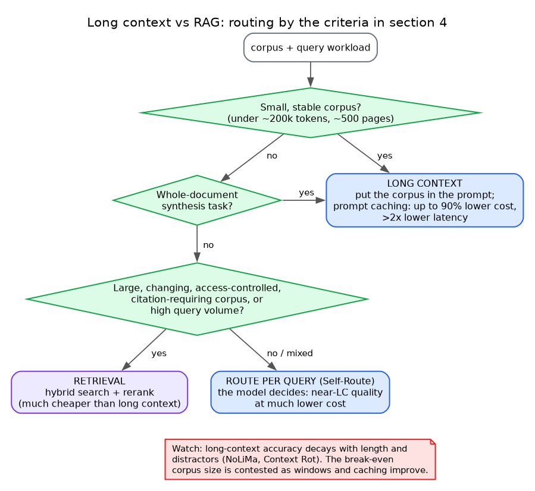

# Long context vs RAG: routing by the criteria in section 4

**What it shows:** A decision flow built only from the criteria in section 4 for choosing long context, retrieval, or per-query routing.

**Why this diagram type:** Graphviz flowchart with decision diamonds since the content is decision logic.

**Design decisions:** Colours follow the shared language. The ordering of the questions is illustrative: the file states the criteria and the consensus to route, not a strict sequence.

**Assumptions / source:** Section 4 of retrieval-and-memory.md.
