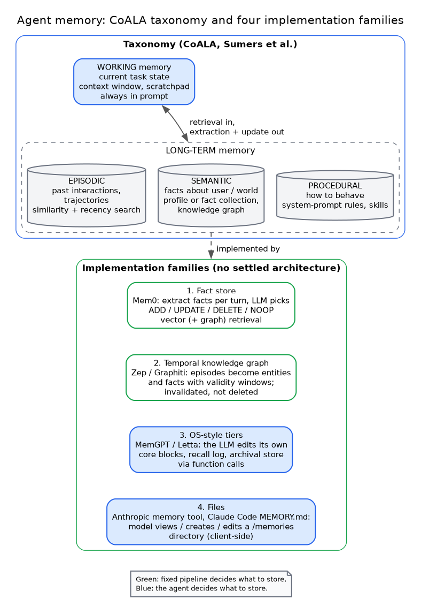

# Agent memory: CoALA taxonomy and four implementation families

**What it shows:** CoALA's working vs long-term (episodic/semantic/procedural) memory, and the four implementation families in the file's comparison.

**Why this diagram type:** Graphviz with two stacked clusters: conceptual taxonomy on top, concrete families below, so the reader sees that the taxonomy is not the architecture.

**Design decisions:** Grey cylinders are stores; green families use a fixed pipeline to decide writes, blue families let the agent decide (section 6.4 'who decides'). The 'implemented by' edge is cluster-level, not a per-type mapping.

**Assumptions / source:** Sections 6.1-6.2 of retrieval-and-memory.md. No mapping of each family to a specific memory type is claimed.
