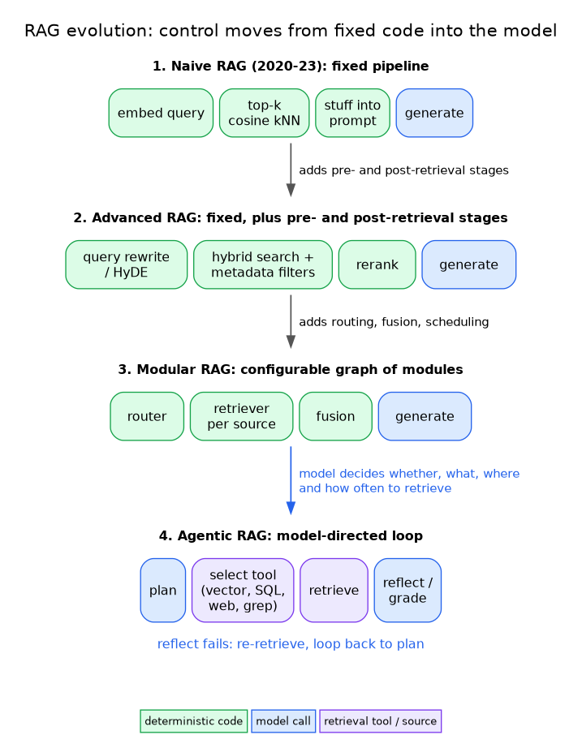

# RAG evolution: control moves from fixed code into the model

**What it shows:** The four RAG paradigms as a left-to-right sequence, with what each stage adds and where control sits: stages 1-3 are fixed or configured code ending in one generate call; stage 4 is a model-directed loop that decides whether, what, where and how often to retrieve.

**Diagram type:** Flowchart (horizontal stage sequence), diagram-design skill, default skin, minimal light, `doc-inline`. A flowchart fits because the claim is an ordered progression with one differing final stage; a table already carries the per-stage detail in section 2.

**Budget:** The old figure drew 16 step boxes (4 per stage). Each stage is now one node whose sublabel lists its components (degrade ladder: leaf clusters collapse to the container). The deterministic / model-call / retrieval-tool colour code is replaced by a single accent on the model-directed stage and its re-plan loop.

**Assumptions:** Stage contents come from the section 2 table; the loop back-edge is the "reflect fails: re-retrieve, loop back to plan" line of the old figure.

**Source:** `rm-rag-evolution.html` (diagram-design skill, default skin).
