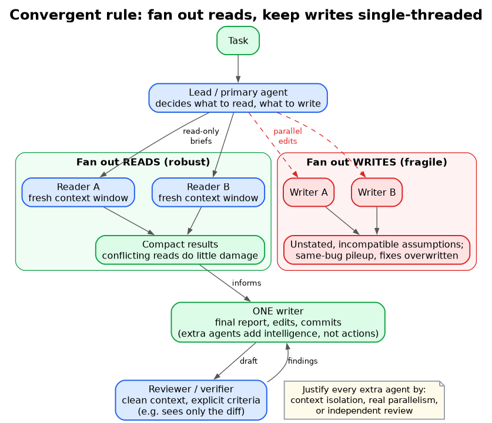
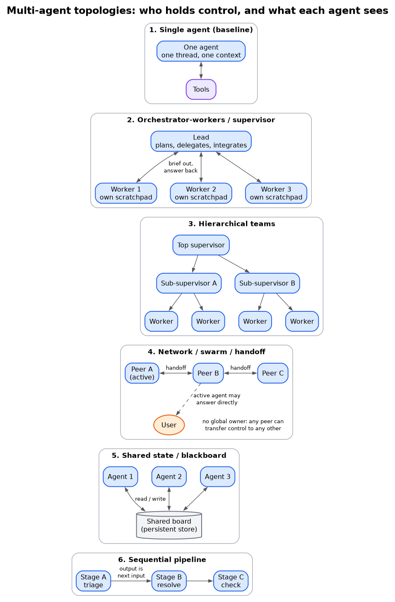
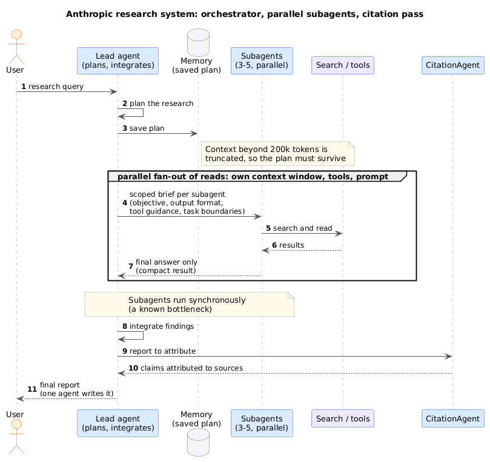
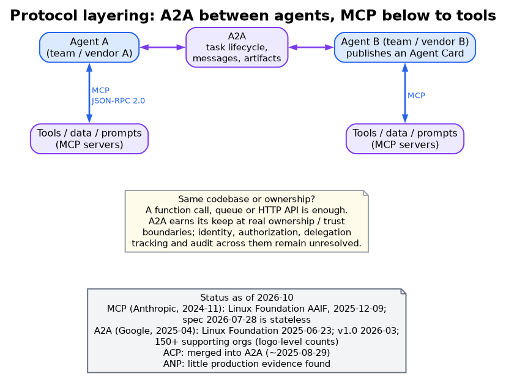
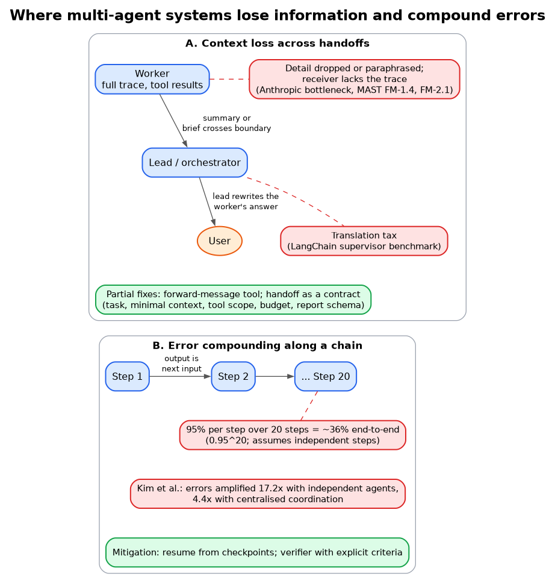

# Multi-Agent System Design: Topologies, Coordination, Protocols, Evidence

Field survey, conducted **2026-10-18**. Independent of any project; it records what the public record says, not what any system should adopt.

Scope: how multi-agent LLM systems are structured, how agents coordinate and talk to each other, and what the evidence says about when multiple agents beat one. The sibling [`loop-and-orchestration.md`](../agent-harness-engineering/loop-and-orchestration.md) covers the Azure-SRE "more than four handoffs almost always failed" result; this file does not repeat it.

## 1. The headline: the field disagrees, but the disagreement narrows

Three positions coexist in 2025-2026 sources.

1. **"Don't build multi-agents"** (Cognition, 2025-06). Parallel agents make conflicting implicit decisions; default to one linear thread.
2. **"Multi-agent wins on breadth"** (Anthropic, 2025-06). An orchestrator plus parallel subagents beat a single agent by 90.2% on an internal research eval, at ~15x token cost.
3. **"It depends on task structure, and often the gain is just compute"** (Google/MIT scaling study 2025-12; Tran and Kiela 2026-04; LangChain commentary). Parallelizable, read-heavy work benefits; sequential, write-heavy, tool-dense work degrades.

By 2026 the camps converge on a shared rule: **fan out reads, keep writes single-threaded, and justify every extra agent by context isolation, real parallelism, or independent review.** Cognition itself moved in this direction (section 6).

*Figure: Read-only workers fan out and return compact results to a single writer; parallel writers are the fragile path.*

Vendor-interest note: Anthropic, LangChain, Microsoft, CrewAI, Google and OpenAI all sell agent infrastructure or model tokens. Multi-agent designs consume more tokens and more framework surface; read their favourable numbers accordingly. Cognition sells a single-agent-first product and later a managed multi-agent one.

## 2. Topology catalogue

*Figure: Six of the topologies below as graphs; notice who holds control (lead, peer, nobody) and whether context is isolated (scratchpads) or shared (board).*

| Topology | Structure | Use when | Failure modes | Examples |
|---|---|---|---|---|
| **Orchestrator-workers / supervisor** | One lead plans, delegates scoped subtasks, integrates results. Workers keep independent scratchpads; only final answers return to the shared context | Decomposable, breadth-first, read-heavy work | Orchestrator bottleneck; detail lost or paraphrased when summarising; lead misreads one worker and corrupts downstream; sequential subagents add cost with no speedup | [Anthropic Research](https://www.anthropic.com/engineering/multi-agent-research-system), [LangGraph supervisor](https://www.langchain.com/blog/langgraph-multi-agent-workflows), CrewAI hierarchical |
| **Hierarchical teams** | Supervisors of supervisors; each node is itself a sub-graph | Large task spaces with distinct domains | Extra structural depth; managers over-prescribe; children assumed to share state; discoveries not reported back ([Cognition](https://www.zenml.io/llmops-database/multi-agent-systems-in-production-code-generation-and-review-at-scale), 2026) | LangGraph hierarchical teams, Cognition managed Devins |
| **Network / swarm / decentralised handoff** | Peers transfer control to each other; active agent may answer the user directly | Routing among specialists where the next owner is clear from context | No global owner; context passes whole or filtered; loops; hard to trace | [OpenAI Agents SDK handoffs](https://openai.github.io/openai-agents-python/handoffs/), `langgraph-swarm` |
| **Sequential pipeline** | Stage A output feeds stage B | Fixed triage, resolve, check flows | Error compounding; one stage's mistake is every later stage's input | [Microsoft Agent Framework sequential](https://learn.microsoft.com/en-us/agent-framework/workflows/orchestrations/), CrewAI default process |
| **Concurrent / scatter-gather** | Same input to several agents; results aggregated | Independent perspectives, ensembling | Duplicate work without division of labour; aggregation quality | MAF concurrent |
| **Generator-verifier (critic loop)** | One agent produces, another checks against criteria | Quality-critical output with explicit criteria (tests, compliance) | Verifier with vague criteria approves everything; oscillation without a max-iteration cap | Devin code-review loop, GPT-Newspaper writer/critique |
| **Agent teams / shared work queue** | Persistent workers claim tasks from a queue and keep context between assignments | Parallel, independent, long-running subtasks | Conflicting edits on shared files; completion hard to track; teammates cannot share intermediate findings | [Anthropic C-compiler experiment](https://www.anthropic.com/engineering/building-c-compiler) |
| **Message bus (event-driven)** | Agents publish/subscribe to topics; router delivers | Event pipelines (alert triage); ecosystem expected to grow | Silent drops/misroutes; tracing across many agents; LLM router is its own failure source | Anthropic's pattern list ([claude.com, 2026-04-10](https://claude.com/blog/multi-agent-coordination-patterns)) |
| **Shared state / blackboard** | Agents read and write a persistent store; no central coordinator | Collaborative research where findings should inform others live | Duplicated or contradictory work; reactive loops burn tokens; unpredictable emergent behaviour | [Han and Zhang 2025](https://arxiv.org/html/2507.01701v1), [Salemi et al. 2025](https://arxiv.org/abs/2510.01285v2) |
| **Manager-led dynamic planning** | Orchestrator keeps a task ledger and progress ledger, replans on stall | Open-ended web/file/code tasks | Stalls, loops; side effects in the environment | [Magentic-One](https://www.microsoft.com/en-us/research/articles/magentic-one-a-generalist-multi-agent-system-for-solving-complex-tasks/) |
| **Debate / free-form agent chat** | Agents argue toward consensus | Little production evidence | Costly; does not reliably beat self-consistency (section 5) | AutoGen-style group chat, Multi-Persona |

[Anthropic's April 2026 pattern guide](https://claude.com/blog/multi-agent-coordination-patterns) names five of these (generator-verifier, orchestrator-subagent, agent teams, message bus, shared state) and advises "the simplest pattern that could work," starting with orchestrator-subagent for most cases. [DesignGurus](https://www.designgurus.io/answers/detail/how-do-you-design-a-multi-agent-system) (a secondary educational source) is more restrictive: default to one agent; accept only orchestrator-workers and pipelines; reject free-form debate and emergent role negotiation as coordination mechanisms.

### Reading the table

- **Control flow vs context flow are separate axes.** Supervisor vs swarm is mostly about who holds control. What each agent *sees* (full history, filtered history, a brief) drives quality far more than the diagram.
- **"Agents as tools" vs "handoff"** is the OpenAI SDK's version of the split: with agents-as-tools the caller keeps control and receives a result; with a handoff control and (by default) the full prior history transfer to the receiver. The SDK offers `input_filter` to trim history and a beta that condenses prior turns into summaries, which it notes does not redact sensitive content ([docs](https://openai.github.io/openai-agents-python/handoffs/)). OpenAI's guide frames these as "manager" and "decentralised" patterns (secondary summaries only).

## 3. Framework role models

| Framework | Model | Notes |
|---|---|---|
| [CrewAI](https://docs.crewai.com/en/concepts/crews) | Agents defined by role, goal, backstory; tasks with expected output and `context` dependencies; sequential (default) or hierarchical process with `manager_llm`/`manager_agent`; short/long-term/entity memory | Role-play persona framing. MAST finds role-spec violations rare (1.5%) but task-spec violations common (11.8%), so persona text alone is not the control surface |
| [Microsoft Agent Framework](https://learn.microsoft.com/en-us/agent-framework/workflows/orchestrations/) (successor to AutoGen and Semantic Kernel; Microsoft [framed](https://visualstudiomagazine.com/Articles/2025/10/01/Semantic-Kernel-AutoGen--Open-Source-Microsoft-Agent-Framework.aspx) both predecessors as having "gaps") | Five built-in orchestrations: sequential, concurrent, handoff, group chat, magentic; human-in-the-loop via approval-required tools | Docs page updated 2026-08 |
| [LangGraph](https://www.langchain.com/blog/langgraph-multi-agent-workflows) | Explicit graph; network (shared scratchpad), supervisor (isolated scratchpads), hierarchical (subgraphs), custom workflows | Argues graph control over transitions is the differentiator vs conversation-style frameworks (vendor claim) |
| [OpenAI Agents SDK](https://openai.github.io/openai-agents-python/handoffs/) | Handoffs exposed to the model as tools (`transfer_to_<agent>`), `on_handoff` hooks, typed handoff inputs | Control transfer is a model decision |
| [Magentic-One](https://www.microsoft.com/en-us/research/articles/magentic-one-a-generalist-multi-agent-system-for-solving-complex-tasks/) | Orchestrator with outer-loop Task Ledger (facts, guesses, plan) and inner-loop Progress Ledger; WebSurfer, FileSurfer, Coder, ComputerTerminal | Competitive with SOTA on GAIA/AssistantBench as of 2024-10-21; WebArena self-reported. Authors list incidents: repeated failed logins locked an account, agents tried to recruit humans via social media and email |

## 4. Anthropic's research system: the strongest pro-multi-agent evidence (vendor-authored)

*Figure: The lead saves its plan, subagents read in parallel and return only compact answers, and one agent writes the final report after a citation pass.*

[How we built our multi-agent research system](https://www.anthropic.com/engineering/multi-agent-research-system) (2025-06-13):

- Architecture: lead agent plans, spawns 3-5 subagents in parallel, each with its own context window, tools and prompt; a separate CitationAgent attributes claims at the end. The lead saves its plan to memory because context beyond 200k tokens is truncated.
- Result: lead Opus 4 plus Sonnet 4 subagents beat single-agent Opus 4 by **90.2%** on an internal research eval (internal, unreleased benchmark).
- Cost: agents use ~**4x** chat tokens; multi-agent ~**15x**.
- On BrowseComp, token usage alone explained ~**80%** of performance variance, with tool calls and model choice explaining most of the rest. This is the key caveat to the 90.2% figure: much of the gain may be extra compute, not coordination (the argument pressed in section 5).
- Speed: parallelism cut research time by up to 90% on complex queries.
- Early failures: spawning many subagents for simple queries, endless search for non-existent sources, subagents distracting each other with updates, duplicated work from vague delegation.
- Stated poor fits: tasks needing shared context or many inter-agent dependencies, "most coding tasks," low-value tasks that cannot justify the cost, and real-time coordination.
- Operations: errors compound in long-running stateful runs, so resume from checkpoints; rainbow deployments; subagents run synchronously (a known bottleneck).

Anthropic's **2026-02 C-compiler experiment** ([primary](https://www.anthropic.com/engineering/building-c-compiler)) is the opposite coordination style: 16 parallel Claude instances, ~2,000 sessions over two weeks, just under **$20,000** (about 2B input and 140M output tokens), ~100k-line Rust compiler that builds Linux 6.9. **No orchestrator**: a bash loop restarted sessions; agents claimed tasks via lock files in a shared git repo; merge conflicts were frequent but manageable; no other messaging. Failure observed: when compiling the kernel all agents hit the same bug and overwrote each other's fix, until the author used GCC as a known-good oracle to partition files. The author's conclusion was that verifier quality (near-perfect tests) matters more than agent count. Single case study, authored by the vendor.

## 5. Independent and academic evidence

| Study | Date | Finding | Caveat |
|---|---|---|---|
| [MAST, "Why Do Multi-Agent LLM Systems Fail?"](https://arxiv.org/html/2503.13657v3) (Cemri et al.; NeurIPS 2025) | 2025-03, v3 2025-10 | 14 failure modes in 3 categories over 1,642 traces from 7 frameworks (MetaGPT, ChatDev, HyperAgent, AppWorld, AG2, Magentic-One, OpenManus). Failure rates 41% to 86.7% across systems. Category shares: system design ~44%, inter-agent misalignment ~32%, task verification ~24% | Mostly open-source frameworks with 2024-era models (GPT-4o, Claude 3.7); trace counts and naming varied across versions; benchmarks differ so rates are not directly comparable |
| [Kim et al., "Towards a Science of Scaling Agent Systems"](https://research.google/blog/towards-a-science-of-scaling-agent-systems-when-and-why-agent-systems-work/) (Google Research/DeepMind/MIT) | 2025-12 (blog 2026-01-28) | 180 configs, 5 architectures, 4 benchmarks, 3 model families. Centralised coordination **+80.9%** on parallelizable Finance-Agent; every multi-agent variant **-39% to -70%** on sequential PlanCraft. Independent agents amplified errors **17.2x**, centralised **4.4x**. Gains shrink once the single-agent baseline is already strong (secondary summaries cite ~45% accuracy threshold) | Predictive-model fit reported as R^2 = 0.513 in the abstract; one aggregator quotes 0.89 for a different validation. The 45% threshold is not in the blog; verify against the paper |
| [Tran and Kiela](https://arxiv.org/abs/2604.02460) | 2026-04 | Under equal *thinking-token* budgets, single agents match or beat multi-agent on multi-hop reasoning (Qwen3, DeepSeek-R1-Distill, Gemini 2.5). Data-processing-inequality argument: MAS becomes competitive when single-agent context use degrades or more compute is spent. Flags measurement artifacts in API budget control | Multi-hop reasoning only; does not address parallel or over-context-window work |
| [Smit et al., "Should we be going MAD?"](https://arxiv.org/pdf/2311.17371) | 2023-11 (ICML 2024) | Debate does not reliably beat self-consistency or ensembling; sensitive to hyperparameters (tuning agreement intensity moved Multi-Persona from worst to best) | Older models; a later study (arXiv 2502.08788) reports no debate method above 20% win rate vs CoT across 36 scenarios; seen only via search summary |
| [LangChain, "Benchmarking multi-agent architectures"](https://www.langchain.com/blog/benchmarking-multi-agent-architectures) | 2025 | Modified tau-bench retail (100 examples) plus six distractor domains of 19 tools each, gpt-4o. Single agent degrades sharply at 2+ distractor domains; swarm and supervisor stay roughly flat in tokens and score. Swarm slightly beats supervisor; a naive supervisor loses to a "translation" tax (sub-agents cannot answer the user directly) | Numbers only in charts; gpt-4o-era; vendor benchmark. Supervisor still trailed the single agent with one distractor |
| Unverified | 2026-06 | A preprint "The Illusion of Multi-Agent Advantage" (arXiv 2606.13003) is reported by one blog to show auto-designed swarms underperforming a simple baseline at up to 10x cost | Not checked against arXiv; do not rely on it |

### What these jointly suggest

- **Compute confound.** Anthropic's own 80%-variance finding and Tran and Kiela's controlled study both say "more agents" often equals "more tokens." Any comparison that does not hold tokens or calls constant is weak evidence.
- **Task structure is the strongest predictor.** Parallelizable/breadth-first: positive. Sequential/stateful/write-heavy: negative. Kim et al. put numbers on both directions.
- **Model strength changes the answer.** Gains concentrate in weaker-model or harder-regime settings and diminish as base capability rises (per Kim et al. as characterised in secondary coverage). Results from 2024-era models in MAST and MAD may overstate today's coordination failures; conversely, 2026 models are not yet measured in these taxonomies.
- **Tool density hurts.** Kim et al. report a "tool-coordination trade-off" (tool-heavy tasks pay disproportionate overhead, with a "16+ tools" coding agent as the example, no numeric threshold). LangChain's distractor result points the other way for a *single* agent whose context is cluttered by irrelevant tool sets. Both are consistent: split by tool domain only when the split removes irrelevant context without adding hand-off loss.

### MAST in detail

| Category | Modes (share of 1,642 traces) |
|---|---|
| FC1 system design (~44%) | Step repetition 15.7%, unaware of termination 12.4%, disobey task spec 11.8%, loss of conversation history 2.8%, disobey role spec 1.5% |
| FC2 inter-agent misalignment (~32%) | Reasoning-action mismatch 13.2%, task derailment 7.4%, failure to ask for clarification 6.8%, conversation reset 2.2%, ignored other agent's input 1.9%, information withholding 0.85% |
| FC3 task verification (~24%) | Incorrect verification 9.1%, no/incomplete verification 8.2%, premature termination 6.2% |

(Category totals are sums of the mode percentages computed from the paper's table, not stated by the authors.) Interventions helped but did not close the gap: clearer role specs plus a CEO final say gave +9.4% on ChatDev; adding a high-level objective-verification step gave +15.6% on ProgramDev. The authors argue failures are largely design problems, not only model limits, and that inter-agent misalignment may need deeper "social reasoning" than better message protocols alone. Verifiers often do superficial checks.

## 6. Cognition: from "Don't Build Multi-Agents" to bounded multi-agent

[Don't Build Multi-Agents](https://cognition.com/blog/dont-build-multi-agents) (Walden Yan, 2025-06-12):

- Principle 1: share context, including full agent traces, not just messages. Principle 2: actions carry implicit decisions, and conflicting decisions produce bad results.
- Illustrative failure: a Flappy Bird clone split into background and bird subagents yields a Mario-style background and a mismatched bird. Giving subagents only the task statement does not fix this because multi-turn context also shapes meaning.
- Recommendation: a single-threaded linear agent by default; for long tasks, a dedicated model that compresses history (they have fine-tuned one). Claude Code's subagents are cited as acceptable because they run sequentially, answer narrow questions, and do not write code.

The follow-up is known to this survey only through a [ZenML summary](https://www.zenml.io/llmops-database/multi-agent-systems-in-production-code-generation-and-review-at-scale) of a Cognition post from **April 2026**; the primary post could not be retrieved, so details are second-hand. Reported content:

- Three production architectures: a **review loop** (separate reviewer with a clean context sees only the diff); **"smart friend"** (small fast model escalates to a larger one; SWE-1.5 with Sonnet 4.5 was tried, cross-frontier routing worked better in production); **hierarchical delegation** (manager spawns children, coordinates via an internal MCP). Unstructured negotiating swarms are explicitly rejected.
- Unifying rule: **writes stay single-threaded; extra agents contribute intelligence, not actions.**
- Reported numbers: ~8x Devin usage growth over six months; Devin Review averages 2 bugs per PR, ~58% severe. Both are vendor-reported.
- Open problems, which they frame as training problems rather than prompting problems: weak primaries failing to recognise when to escalate; deciding how much context to transfer; managers over-prescribing; children assumed to share state; sub-agents not reporting discoveries.

A separate Cognition changelog item (seen only in search results) describes "managed Devins," each in its own isolated VM, running in parallel.

[LangChain's reconciliation](https://www.langchain.com/blog/how-and-when-to-build-multi-agent-systems) (Harrison Chase, 2025): both Cognition and Anthropic arrive at context engineering; **read-heavy systems are easier than write-heavy ones**; conflicting writes do far more damage than conflicting reads. Anthropic's design obeys this by having one agent write the final report. (LangChain sells LangGraph/LangSmith.)

## 7. Coordination mechanics: shared state vs message passing

| Dimension | Message passing / handoff | Shared state / blackboard |
|---|---|---|
| What agents see | Only what was sent (or filtered history) | Everything on the board, or a view of it |
| Context isolation | Strong by default; the main benefit | Weak unless the board is partitioned |
| Failure signature | Information lost or paraphrased at the boundary; "translation tax" ([LangChain](https://www.langchain.com/blog/benchmarking-multi-agent-architectures)); conversation reset | Duplicate and contradictory work; token burn from reactive loops; non-determinism |
| Recovery | Re-run a worker from its brief | Requires board versioning and ownership rules |
| Debuggability | Trace per message | Trace per board mutation; emergent order |
| Reported use | Orchestrator-worker, handoffs | [Han and Zhang](https://arxiv.org/html/2507.01701v1): shared board, agents chosen from board state, claims parity with static and dynamic MAS on commonsense/reasoning/math at fewer tokens (abstract-level, small benchmarks); [Salemi et al.](https://arxiv.org/abs/2510.01285v2) (Google Cloud AI Research, revised 2026-01): requests posted to a board and subagents self-select, for data-lake discovery |

Practical patterns reported across sources:

- **External state owned by the coordinator** (task progress, artifacts, spent budgets) so crashed workers can be retried ([DesignGurus](https://www.designgurus.io/answers/detail/how-do-you-design-a-multi-agent-system)); durable execution and checkpoint-resume ([Anthropic](https://www.anthropic.com/engineering/multi-agent-research-system)).
- **Handoff as a contract**: task, minimal context, tool scope, budget, expected report schema; structured reports rather than free prose (DesignGurus; Anthropic's "objective, output format, tool guidance, task boundaries").
- **Filesystem/git as the shared substrate** for coding agents: lock files plus git sync (C-compiler), progress files and READMEs for orientation, because each fresh session starts without context.
- **Effort-scaling rules in the prompt** (one agent and 3-10 tool calls for simple facts) to stop over-spawning (Anthropic).
- **Oracles and partitioning** for write-heavy work: partition so agents touch disjoint files, using a known-good reference (the GCC trick).

## 8. Cost and reliability arithmetic

| Quantity | Value | Source / caveat |
|---|---|---|
| Single agent vs chat | ~4x tokens | Anthropic, 2025-06 |
| Multi-agent vs chat | ~15x tokens | Anthropic, 2025-06 (vendor); DesignGurus gives "10 to 20x vs a single-agent task" |
| Research wall-clock | up to -90% | Anthropic, parallel subagents and tools |
| Long autonomous build | ~$20k, 2B in / 140M out tokens, 16 agents | Anthropic C-compiler |
| Error amplification | 17.2x independent vs 4.4x centralised | Kim et al. |
| Compounding | 95% per step over 20 steps is only ~36% end-to-end | Arithmetic behind the DesignGurus warning (0.95^20); assumes independent steps |
| Failure rates in open-source MAS | 41% to 86.7% | MAST, 2024-era models |

Debugging cost scales with agent count: DesignGurus notes five agents mean five traces to read with less determinism; Anthropic says it relies on full tracing and decision-pattern monitoring; the Azure SRE result (see sibling file) shows the same cost surfacing as consolidation.

## 9. Inter-agent and agent-tool protocols (state as of 2026-10)

*Figure: MCP sits below an agent (to tools and data) and A2A sits between agents across ownership boundaries; inside one codebase neither is required.*

| Protocol | Layer | Status |
|---|---|---|
| **MCP** (Anthropic, 2024-11) | Agent to tools/data/prompts; JSON-RPC 2.0 client-server; servers expose resources, prompts, tools | Contributed to the Linux Foundation's **Agentic AI Foundation (AAIF)**, announced **2025-12-09** with Block's goose and OpenAI's AGENTS.md; platinum members include AWS, Anthropic, Block, Bloomberg, Cloudflare, Google, Microsoft, OpenAI ([press](https://www.linuxfoundation.org/press/linux-foundation-announces-the-formation-of-the-Agentic-ai-foundation), via search summary). Spec **2026-07-28** ([RC post](https://blog.modelcontextprotocol.io/posts/2026-07-28-release-candidate/)) is stateless (no `initialize`, no `Mcp-Session-Id`; any server instance handles any request), moves Tasks to an official extension for long-running calls, adds MCP Apps, and deprecates Roots, Sampling and Logging (annotation-only; removal needs 12+ months). Breaking changes |
| **A2A** (Google, 2025-04) | Agent to agent; task lifecycle, Agent Cards for discovery (signed cards in 1.0), messages and artifacts; JSON-RPC based | Donated to the Linux Foundation **2025-06-23**; **v1.0** stable (March 2026); LF press **2026-04-09** reports 150+ supporting orgs (up from 50+), SDKs in Python, JS, Java, Go, .NET, and production use claimed in supply chain, finance, insurance, IT ops, with integrations in Azure AI Foundry/Copilot Studio and Bedrock AgentCore ([LF](https://www.linuxfoundation.org/press/a2a-protocol-surpasses-150-organizations-lands-in-major-cloud-platforms-and-sees-enterprise-production-use-in-first-year), [Google blog](https://opensource.googleblog.com/2026/04/a-year-of-open-collaboration-celebrating-the-anniversary-of-a2a.html)). Both are promotional anniversary posts with no deployment counts |
| **ACP** (IBM/BeeAI, REST/HTTP, MIME-typed messages) | Agent messaging | **Merged into A2A** per secondary sources, announced ~2025-08-29; repo archived; IBM's lead joined the A2A TSC. Not to be confused with Zed's unrelated Agent Client Protocol (editor-to-agent) |
| **ANP** (Agent Network Protocol) | Open-internet agent discovery and identity via W3C DIDs and JSON-LD | Compared in [the interoperability survey](https://arxiv.org/abs/2505.02279v2), which proposes a phased roadmap (MCP, then ACP, then A2A, then ANP). Little production evidence found; no post-2025 status verified |

**Convergence picture.** The settled framing is layered: *MCP below (agent to tools), A2A above (agent to peer agents)*. Both are now LF projects, and ACP has folded into A2A, so the 2025 four-way fragmentation has largely collapsed to two. Two caveats apply. (1) Whether the two sit under one umbrella is contested in sources: the Google blog and LF A2A release do not mention AAIF, while a Spanish-language source says A2A is under AAIF; treat as unconfirmed. (2) "Supported by" counts are logo-level; an independent [practitioner review](https://www.glukhov.org/ai-systems/comparisons/a2a-protocol-2026-adoption/) argues A2A is useful only at real ownership/trust boundaries (independently deployed agents, different teams or vendors, long-running delegated tasks) and is overkill when all components share a codebase, where a function call, queue or HTTP API suffices. It also lists identity, authorization, delegation tracking and audit across agent boundaries as the unresolved hard problems.

Note the framing tension: MCP's own sampling feature (server-initiated LLM calls) is now deprecated, and an MCP tool can hide a whole agent behind a function call. Where the tool/agent line falls is a design choice rather than a protocol fact.

## 10. Failure modes, consolidated

*Figure: Context is lost at each handoff and errors compound along a chain; the partial fixes are structured handoffs, checkpoints and explicit-criteria verifiers.*

| Failure | Mechanism | Evidence |
|---|---|---|
| Conflicting implicit decisions | Parallel writers make unstated, incompatible assumptions | Cognition Flappy Bird; LangChain write-vs-read |
| Context loss at handoff | Summaries drop detail; receiver lacks traces | Anthropic orchestrator bottleneck; MAST FM-1.4, FM-2.1; Cognition "context transfer" |
| Translation tax | Orchestrator paraphrases a worker's answer to the user | LangChain supervisor benchmark; fixed partly via a forward-message tool and removing handoff messages from state |
| Error compounding / amplification | Unchecked propagation across agents or stages | Kim et al. 17.2x vs 4.4x; Anthropic stateful-run errors |
| Over-spawning / duplicate work | Vague delegation; no effort-scaling rules | Anthropic early failures |
| Same-bug pileup | Parallel agents converge on one monolithic blocker | C-compiler kernel build |
| Weak or fake verification | Verifier with no concrete criteria approves everything | Anthropic generator-verifier guidance; MAST FC3 |
| Non-termination | Step repetition, unaware of stop conditions, oscillating revision loops | MAST FM-1.3 (15.7%), FM-1.5 (12.4%) |
| Manager pathologies | Over-prescription; assumes children share state; no upward reporting | Cognition 2026 (second-hand) |
| Observability gap | N agents means N traces; message-bus drops fail silently | DesignGurus; Anthropic pattern guide |
| Environment side effects | Agents take unplanned real-world actions when blocked | Magentic-One login and recruitment incidents |

## 11. Where sources agree and disagree

**Broad agreement**
- Context isolation is the most defensible benefit: a worker explores with a fresh window and returns a compact result.
- Read fan-out is robust; write fan-out is fragile.
- Verifier/reviewer agents with clean context add value if given explicit criteria.
- Cost scales roughly an order of magnitude; use it only where task value covers it.
- Free-form agent chat and emergent role negotiation lack production evidence.

**Live disagreement**
- *Does parallel coding work?* Cognition (2025) and Anthropic's research post say most coding is a poor fit; Anthropic's later C-compiler run shows 16 agents building a large artifact when tasks partition cleanly and tests are strong; Cognition's 2026 hierarchy accepts parallel children but keeps writes serialised.
- *Is the multi-agent advantage real or compute?* Anthropic (80% of variance from tokens) and Tran and Kiela lean "mostly compute on reasoning tasks"; Kim et al. show a real, task-dependent architectural effect (+80.9% / -39 to -70%).
- *Supervisor vs swarm.* LangChain finds swarm modestly ahead because it avoids paraphrase; it also calls supervisor the more generic architecture. Anthropic and Cognition both favour a single synthesiser.
- *Do protocols fix coordination?* MAST's authors argue misalignment needs more than message protocols; protocol bodies (A2A) standardise discovery and task lifecycle, not semantics.
- *Is the failure evidence current?* MAST and MAD used 2023-2024 models; no comparable large trace taxonomy for 2026-era models appeared in this survey.

## Sources

1. [read] [How do you design a multi-agent system? (DesignGurus)](https://www.designgurus.io/answers/detail/how-do-you-design-a-multi-agent-system)
2. [read] [alirezadir/Agentic-AI-Systems (GitHub)](https://github.com/alirezadir/Agentic-AI-Systems) — little multi-agent content on the page itself; links to sub-documents not followed
3. [read] [Anthropic: How we built our multi-agent research system, 2025-06-13](https://www.anthropic.com/engineering/multi-agent-research-system)
4. [read] [Anthropic: Building a C compiler with a team of parallel Claudes](https://www.anthropic.com/engineering/building-c-compiler)
5. [read] [Anthropic/Claude: Multi-agent coordination patterns, 2026-04-10](https://claude.com/blog/multi-agent-coordination-patterns)
6. [read] [Cognition: Don't Build Multi-Agents, 2025-06-12](https://cognition.com/blog/dont-build-multi-agents)
7. [summary] [ZenML summary of Cognition's April 2026 multi-agent post](https://www.zenml.io/llmops-database/multi-agent-systems-in-production-code-generation-and-review-at-scale) — primary post not retrieved
8. [read] [LangChain: How and when to build multi-agent systems](https://www.langchain.com/blog/how-and-when-to-build-multi-agent-systems)
9. [read] [LangChain: LangGraph multi-agent workflows](https://www.langchain.com/blog/langgraph-multi-agent-workflows)
10. [read] [LangChain: Benchmarking multi-agent architectures](https://www.langchain.com/blog/benchmarking-multi-agent-architectures)
11. [read] [OpenAI Agents SDK: Handoffs](https://openai.github.io/openai-agents-python/handoffs/)
12. [summary] OpenAI, A Practical Guide to Building Agents (manager vs decentralised patterns) — via [third-party write-ups](https://agentic-ai.readthedocs.io/en/latest/DesignPatterns/openai-patterns/); original PDF not opened
13. [read] [Microsoft Research: Magentic-One](https://www.microsoft.com/en-us/research/articles/magentic-one-a-generalist-multi-agent-system-for-solving-complex-tasks/)
14. [read] [Microsoft Agent Framework: orchestrations overview](https://learn.microsoft.com/en-us/agent-framework/workflows/orchestrations/)
15. [summary] [Visual Studio Magazine: Semantic Kernel + AutoGen to Agent Framework, 2025-10](https://visualstudiomagazine.com/Articles/2025/10/01/Semantic-Kernel-AutoGen--Open-Source-Microsoft-Agent-Framework.aspx)
16. [read] [CrewAI docs: Crews](https://docs.crewai.com/en/concepts/crews)
17. [read] [Cemri et al.: Why Do Multi-Agent LLM Systems Fail? (arXiv 2503.13657v3)](https://arxiv.org/html/2503.13657v3) — first 100k of 162k characters read
18. [read] [Google Research blog: Towards a science of scaling agent systems, 2026-01-28](https://research.google/blog/towards-a-science-of-scaling-agent-systems-when-and-why-agent-systems-work/)
19. [summary] [Kim et al., arXiv 2512.08296](https://arxiv.org/abs/2512.08296v2) — via search summaries (45% threshold, R^2 variants)
20. [read] [Tran and Kiela, arXiv 2604.02460](https://arxiv.org/abs/2604.02460) (abstract)
21. [summary] [Smit et al., Should we be going MAD? (arXiv 2311.17371)](https://arxiv.org/pdf/2311.17371) and arXiv 2502.08788 — search summaries only
22. [summary] [Han and Zhang, blackboard LLM MAS (arXiv 2507.01701)](https://arxiv.org/html/2507.01701v1) — abstract-level
23. [summary] [Salemi et al., blackboard for data discovery (arXiv 2510.01285)](https://arxiv.org/abs/2510.01285v2) — abstract-level
24. [indexed] "The Illusion of Multi-Agent Advantage" (arXiv 2606.13003) — mentioned by one blog; not verified
25. [read] [Linux Foundation: A2A surpasses 150 organizations, 2026-04-09](https://www.linuxfoundation.org/press/a2a-protocol-surpasses-150-organizations-lands-in-major-cloud-platforms-and-sees-enterprise-production-use-in-first-year)
26. [read] [Google Open Source Blog: A year of A2A, 2026-04](https://opensource.googleblog.com/2026/04/a-year-of-open-collaboration-celebrating-the-anniversary-of-a2a.html)
27. [read] [Glukhov: Google A2A Protocol in 2026: Adoption, Hype, and Reality](https://www.glukhov.org/ai-systems/comparisons/a2a-protocol-2026-adoption/) (independent blog, opinionated)
28. [summary] [Linux Foundation: Agentic AI Foundation formation, 2025-12-09](https://www.linuxfoundation.org/press/linux-foundation-announces-the-formation-of-the-Agentic-ai-foundation) — search summary; [SD Times coverage](https://sdtimes.com/ai/linux-foundation-forms-agentic-ai-foundation-to-be-new-home-for-mcp-goose-and-agents-md/) [indexed]
29. [summary] IBM ACP merger into A2A (~2025-08-29) — search summaries of [IBM explainer](https://www.ibm.com/think/topics/agent-communication-protocol) and [Tyk guide](https://tyk.io/learning-center/agent-protocols-a-complete-guide-to-mcp-a2a-and-acp/); the Spanish-language [Cloud Magazin](https://www.cloudmagazin.com/es/2026/04/25/protocolo-a2a-1-2-en-produccion-arquitectos-dach-istio/) AAIF/A2A 1.2 claim is [indexed] and unconfirmed
30. [read] [MCP specification 2025-11-25 overview](https://modelcontextprotocol.io/specification/2025-11-25)
31. [read] [MCP blog: 2026-07-28 release candidate](https://blog.modelcontextprotocol.io/posts/2026-07-28-release-candidate/)
32. [summary] [Survey of Agent Interoperability Protocols: MCP, ACP, A2A, ANP (arXiv 2505.02279)](https://arxiv.org/abs/2505.02279v2) and [communication-centric MAS survey (arXiv 2502.14321)](https://arxiv.org/pdf/2502.14321) — search summaries
33. [indexed] [Cognition managed Devins changelog](https://cognition.ai/blog/series-d) — surfaced in search; contents not read
