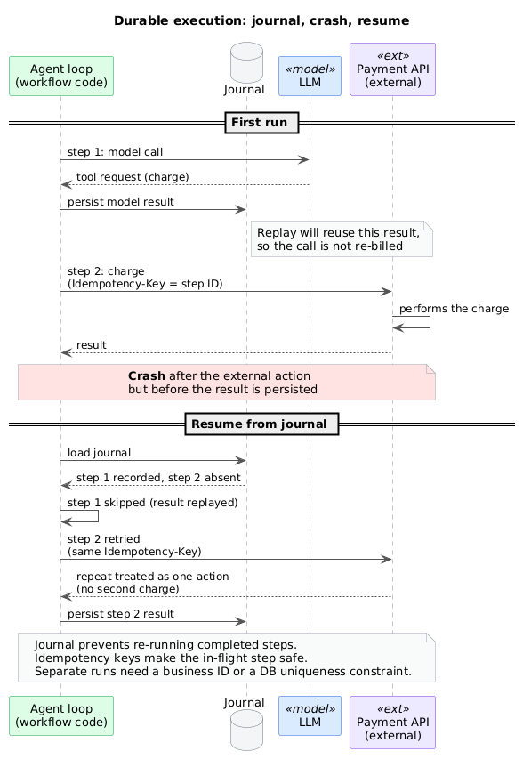
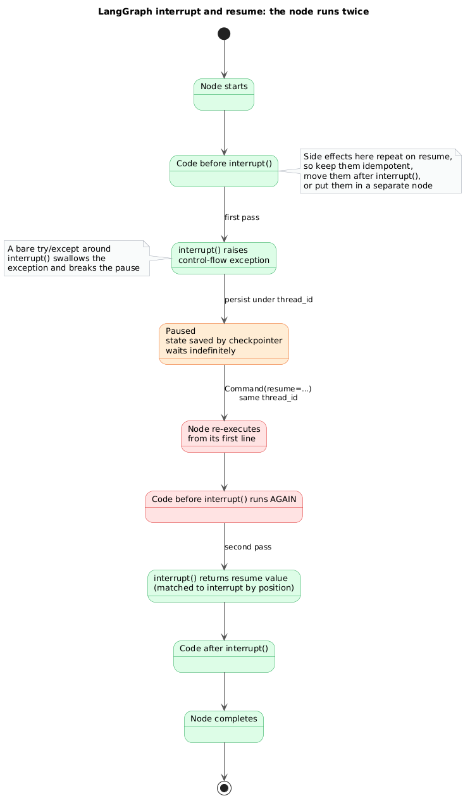
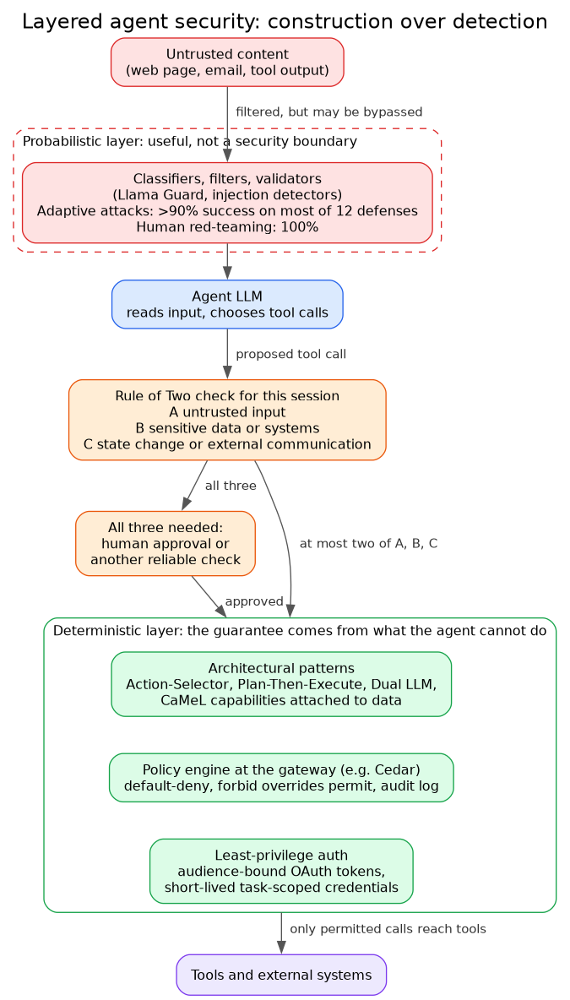
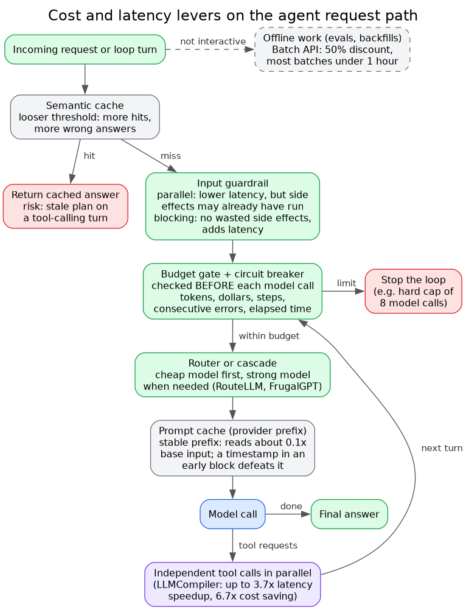
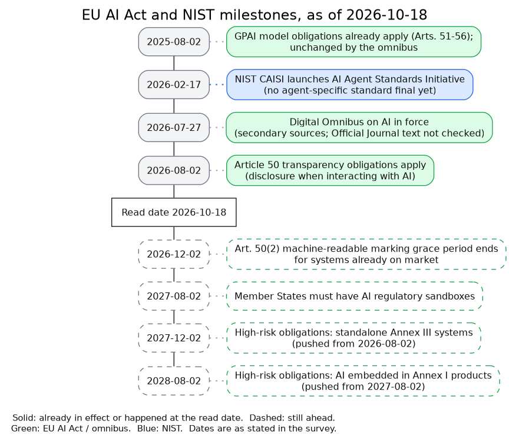

# Production and Operations for Agentic Systems

Field survey of system- and infrastructure-level production concerns for LLM agents, conducted **2026-10-18**. Slice: reliability and state, human-in-the-loop, guardrails, system-level security, cost and latency, observability and evaluation, governance.

**Independent of any project.** This records what exists, what it costs, and where the evidence is thin. It makes no recommendations for any particular build.

Scope boundaries: container/OS sandboxing, permission-prompt fatigue and the harness-level view of prompt injection are covered in [`../agent-harness-engineering/security.md`](../agent-harness-engineering/security.md). Eval fundamentals (grader types, `pass@k` vs `pass^k`, dataset sizing) are in [`../agent-harness-engineering/evals-and-observability.md`](../agent-harness-engineering/evals-and-observability.md). This file picks up where those stop.

**Source hygiene.** Most infrastructure and guardrail material is vendor-authored (Temporal, Restate, DBOS, Inngest, Confluent, NVIDIA, Redis, Braintrust, Arize, Langfuse). Where a number is vendor-reported it is flagged. Every URL in [Sources](#sources) is tagged `[read]` (page fetched and read), `[summary]` (only a search-result summary seen) or `[indexed]` (appeared in results, not opened). Several model names in vendor docs below (Claude Opus 5.5, GPT-5.6 and similar) are quoted as the docs list them on the read date.

---

## Key findings

1. **Durable execution has converged on one idea: journal every non-deterministic step.** Temporal, Restate, DBOS, Inngest and Vercel's Workflow SDK all persist model-call and tool-call results so a crash resumes instead of restarting. They differ in backing store (own cluster vs Postgres vs hosted) and in whether workflow code must be deterministic. LangGraph's checkpointer is the in-framework equivalent, but resuming after a human interrupt **re-executes the node from its start**, so side effects need to be idempotent.
2. **Idempotency, not durability, is the actual side-effect safety mechanism.** A journal prevents re-running completed steps, but a step that performed an external action and crashed before recording its result will be retried. Every source that addresses this lands on idempotency keys. Saga-style compensation for agents is described mostly in vendor blogs; no primary or empirical source was found.
3. **Guardrail classifiers are not a security boundary.** An Oct 2025 paper by 14 authors across OpenAI, Anthropic and Google DeepMind tested 12 published injection defenses with adaptive attacks and reported >90% attack success on most of them; human red-teaming reached 100%. The security literature has moved to architectural constraint: the lethal trifecta, Meta's Rule of Two, CaMeL and the six design patterns.
4. **Prompt-cache economics dominate agent cost.** Cache reads are billed at 0.1x base input (0.05x on some current Anthropic models; up to 0.05x on OpenAI's newest), so a long, stable prefix across many agent turns is cheap. Multi-agent designs cost roughly 15x chat tokens by Anthropic's own measurement.
5. **OpenTelemetry's GenAI conventions are the only cross-vendor telemetry standard, and are still in "Development" status**, having moved to a dedicated repository. They define `invoke_agent`, `invoke_workflow`, `execute_tool` and `plan` spans. Content capture is opt-in because it carries PII.
6. **Benchmarks and evals drift.** OpenAI stopped reporting SWE-bench Verified on 2026-02-23 after finding at least 59.4% of an audited hard subset had flawed tests and all tested frontier models showed contamination. Anthropic's Sept 2025 postmortem documents three infrastructure bugs that its own evals failed to catch, one affecting up to 16% of Sonnet 4 requests at peak.
7. **Governance clock moved.** The EU Digital Omnibus on AI (in force 2026-07-27 per secondary sources) pushed standalone high-risk obligations to **2027-12-02** and embedded ones to **2028-08-02**; Article 50 transparency still applies from **2026-08-02**. No agent-specific EU or US standard is final; NIST launched an AI Agent Standards Initiative on 2026-02-17.

---

## 1. Durable execution and state

### 1.1 Why agents need it

Agent runs are long (minutes to days), expensive per step, and side-effecting. Vercel's October 2026 guide lists the failure modes without durability: an interruption cancels work in progress; a step can complete an external action before its result is saved so a retry repeats it; and if the whole agent loop is one step, its result is saved only at the end, forcing the entire loop to rerun ([Vercel](https://vercel.com/kb/guide/durable-ai-agents) [read]). Anthropic's multi-agent research system reports the same class of problem: "errors compound in long-running stateful agents," so the team built resume-from-error-point, retries and regular checkpoints rather than restart-from-scratch ([Anthropic](https://www.anthropic.com/engineering/multi-agent-research-system) [read]).

### 1.2 Options

| Option | Execution model | State backend | Agent-specific integration | Trade-offs / caveats |
|---|---|---|---|---|
| **Temporal** | Workflow code (deterministic) orchestrates Activities (non-deterministic I/O); history replay | Temporal cluster or Cloud | OpenAI Agents SDK integration: swaps in a Runner so each agent invocation runs as an Activity; announced 2025-07-30 as public preview, post updated 2026-03-23 says Python integration is GA ([blog](https://temporal.io/blog/announcing-openai-agents-sdk-integration) [read]). TypeScript variant and sandbox-agent demo (Apr 2026) reported by [search summary](https://temporal.io/blog/introducing-temporal-and-agentic-sandboxes-openai-agents-sdk) [summary] | Heaviest operational footprint; determinism constraints on workflow code. Vendor claims ("crash-proof") are unquantified. The announcement post does not discuss human-in-the-loop |
| **Restate** | Journal of steps; `ctx.run()` persists results; handlers replay after crash | Restate server (self-host or cloud), services run anywhere (Lambda, Cloudflare, Vercel, k8s) | Vercel AI SDK: `durableCalls(ctx)` middleware wraps the model so LLM responses are journaled; tools use `ctx.run()` ([docs](https://docs.restate.dev/ai/patterns/durable-agents.md) [summary]) | Does not need an up-front workflow graph, so fits dynamically composed agent loops ([vendor blog](https://restate.dev/blog/building-durable-agents-with-vercel-and-restate) [summary]) |
| **DBOS** | Library; workflows are deterministic, steps do I/O; checkpoint each step | Postgres only | Native Pydantic AI integration ([DBOS](https://dbos.dev/blog/durable-execution-crashproof-ai-agents) [summary]); a third-party runtime notes prompt caching and memory auto-injection do not work on its DBOS backend | Single dependency is a selling point; no separate orchestrator server. Scale claims are vendor-reported |
| **Inngest** | Event-driven functions with `step.run`, `step.ai`, `step.waitForEvent`, `step.invoke` | Inngest platform | AgentKit; model calls through `step.ai` get durable retry and result caching; `waitForEvent` suspends with no process held ([docs](https://www.inngest.com/docs/learn/durable-agents) [indexed]; behaviour as described by community skill pages [summary]) | Primary docs were not opened; API detail unverified |
| **Vercel Workflow SDK** | `'use workflow'` coordinator plus `'use step'` functions; hooks and durable timers | Vercel-managed | `WorkflowAgent` in `@ai-sdk/workflow`; example caps loop at 8 model calls ([Vercel](https://vercel.com/kb/guide/durable-ai-agents) [read]) | Platform-coupled; guide dated 2026-10-15 so API is new |
| **LangGraph checkpointers** | Graph state saved per super-step under a `thread_id` | `InMemorySaver` (lost on restart), `SqliteSaver` (dev), `PostgresSaver`/`AsyncPostgresSaver` (prod); Agent Server manages persistence | Native: supports HITL, time travel, fault tolerance ([docs](https://docs.langchain.com/oss/python/langgraph/persistence) [read]) | Checkpoints accumulate on long threads (prune or set retention); `thread_id` under 255 chars for Postgres; subgraphs keep separate checkpoint namespaces, so cross-graph data needs a store. Durability-mode and pending-writes sections were empty in the fetched text |
| **Kafka / event log** | Agents as consumers of topics; state is the log | Kafka | Confluent patterns (below) | Replay and decoupling, but you build the idempotency and workflow semantics |

### 1.3 Step granularity and checkpoint cost

The design variable common to all of these is where step boundaries sit. Vercel's guidance: put model calls and external tool calls in separate steps so intermediate progress survives, and pass identifiers between steps rather than live clients ([read](https://vercel.com/kb/guide/durable-ai-agents)). Finer steps mean cheaper recovery but more journal writes. LangGraph notes checkpoint growth raises latency and storage cost over long conversations. Temporal's post claims a restart "saves compute and token costs" because completed LLM calls are not re-billed, which is plausible by construction but unquantified.

### 1.4 Idempotent tool calls and retries

*Figure: A journal skips completed steps on resume, but the step that was in flight at the crash is retried, so the external call needs an idempotency key.*

- **Replay safety is not exactly-once.** A step that performs a charge and crashes before its result is persisted will run again. Vercel: use an `Idempotency-Key` header so the receiver treats repeats as one action; the step ID is stable across retries within one run, but **separate runs** need a business identifier or a database uniqueness constraint ([read](https://vercel.com/kb/guide/durable-ai-agents)).
- **Human-interrupt re-execution.** LangGraph's `interrupt()` resumes by re-running the node from its beginning; code before the interrupt runs again, resume values are matched to interrupts **by position**, and a bare `try/except` around `interrupt()` swallows the control-flow exception. Guidance: keep pre-interrupt side effects idempotent or move them after the interrupt or into a separate node ([docs](https://docs.langchain.com/oss/python/langgraph/interrupts) [read]).
- **Retry classes.** Read-only tools are generally safe to retry; mutating tools need dedup. Temporal retries rate-limit and network failures on LLM calls "until they succeed" ([read](https://temporal.io/blog/announcing-openai-agents-sdk-integration)); the corresponding failure mode (retry storms against a degraded provider, and unbounded spend) is a budget problem, see section 5.5.

*Figure: On resume the node restarts from its first line, so everything before interrupt() runs twice.*

### 1.5 Sagas and compensation

Sources agree on the shape and disagree on nothing, but all are practitioner or vendor material rather than evaluation:

- Compensation is a business-level undo, not a byte-level rollback; "send email" cannot be unsent ([Gravitee](https://gravitee.io/corpus/gen-1019/online-transaction-processing/compensating-transactions.html) [indexed]).
- Order steps so irreversible ones run last; prefer reservations over commits early; gate high-impact actions behind human review; make compensations idempotent ([search summary of Gravitee/ZimaSpace posts](https://gravitee.io/corpus/gen-1286/workflow-engine/workflow-engine-patterns-for-long-running-ai-agent-orchestration-and-compensation-sagas.html) [summary]).
- A 2026 arXiv paper proposes a "five-plane" runtime-governance architecture (a reasoning plane deciding whether an intended action is acceptable plus network, identity, endpoint and data enforcement planes). Its abstract reports single-digit-microsecond policy adjudication and tamper-evident audit on a reference implementation of the policy core, and states full-system evaluation against a live agent benchmark is future work ([arXiv:2606.12320](https://arxiv.org/abs/2606.12320) [read]). A search summary attributed a "weak on external rollback" finding to this paper; the fetched abstract page did not support it, so it is not relied on.

### 1.6 Event-driven and long-running agents

Confluent's blog (Falconer and Sellers, published 2025-02-19, originally InfoWorld 2025-01-28; authors work for a Kafka vendor and the piece cites no benchmarks) maps four multi-agent patterns onto Kafka ([read](https://www.confluent.io/blog/event-driven-multi-agent-systems/)):

| Pattern | Kafka mapping |
|---|---|
| Orchestrator-worker | Keyed command topic; workers as a consumer group; results to a second topic |
| Hierarchical | Topics as swimlanes per workload; sibling agents as consumer groups |
| Blackboard | Shared knowledge base is a topic that agents produce to and consume from |
| Market-based | Bid and ask topics plus a market-maker service; removes quadratic point-to-point links |

Claimed benefits: durable immutable log as source of truth, replay "from a given partition for a saved offset" after worker failure, consumer-group rebalancing as workers join or leave, no bespoke agent-to-agent channels. What it does not address: exactly-once effects on the outside world, agent-state schema evolution, or ordering across partitions.

For deploys of long-running agents, Anthropic uses **rainbow deployments**, gradually shifting traffic from old to new versions with both running so updates do not disrupt agents mid-process ([read](https://www.anthropic.com/engineering/multi-agent-research-system)). This is the same versioning problem durable-workflow systems face when workflow code changes under in-flight executions.

---

## 2. Human-in-the-loop (HITL)

### 2.1 Mechanisms

| Mechanism | How it works | Notes |
|---|---|---|
| LangGraph `interrupt()` / `Command(resume=...)` | Pauses graph, persists state, waits indefinitely; resume with same `thread_id`; patterns: approve/reject routing, review-and-edit state, tool-level approval with argument override, multi-interrupt parallel resume | Needs a checkpointer; re-execution caveats in 1.4 ([read](https://docs.langchain.com/oss/python/langgraph/interrupts)) |
| Workflow hooks (Vercel) | Workflow creates a hook with unique token, races the decision against a durable **seven-day timer**; a server-side `resumeHook()` submits after the reviewer is authenticated and authorised; no process held while suspended | Explicitly separates identity of reviewer from the agent ([read](https://vercel.com/kb/guide/durable-ai-agents)) |
| Inngest `step.waitForEvent` | Match on event, with timeout; community example uses a 3-day timeout falling back to manual review | Described via third-party skill pages ([summary](https://www.inngest.com/docs/learn/durable-agents)) |
| 12-Factor Agents (Horthy/HumanLayer) | Factor 6: launch/pause/resume with simple APIs; Factor 7: contact humans with tool calls, so approval is just another tool | A design document, not a framework ([summary](https://github.com/sahanatvessel/12-factor-agents)) |
| Policy engine escalation | A deterministic gate (e.g. Cedar policy at an MCP gateway) returns allow/deny; deny paths can route to review | See 3.4 |

### 2.2 Autonomy sliders and evidence on how people use them

- Karpathy's "autonomy slider" (YC AI Startup School, June 2025) frames partial autonomy as a user-controlled dial, with Cursor as the example; the wording comes from secondary write-ups of the talk, not the transcript ([summary](https://www.latent.space/p/s3)).
- Anthropic's "Measuring AI agent autonomy in practice" is the only large-scale behavioural dataset found. Per secondary coverage of it: new Claude Code users fully auto-approve about 20% of sessions, rising past 40% after roughly 750 sessions; interruptions rise only from about 5% to about 9% of steps; the longest-running sessions roughly doubled from under 25 to over 45 minutes in three months; on the API, 87% of tool calls on simple tasks involve some human oversight vs 67% on complex ones ([the-decoder summary](https://the-decoder.com/ai-agents-are-thriving-in-software-development-but-barely-exist-anywhere-else-anthropic-study-finds/) [summary]; [primary page](https://www.anthropic.com/research/measuring-agent-autonomy) [indexed]). Anthropic is measuring its own product, and figures here are second-hand.
- The 93% prompt-approval figure and its architectural response (sandboxing rather than more prompts) are covered in the sibling `security.md`; it reinforces that per-action approval degrades into click-through at high volume.

### 2.3 Triggers for escalation

Sources describe, but none quantify, the usual trigger classes: action class (irreversible, external write, spend, destructive), data class (secrets, PII), accumulated failures or retries, and policy-engine denials. Meta's Rule of Two (4.3) turns this into a rule: if a session would combine untrustworthy input, sensitive access and state change, it should not run autonomously and needs human approval or another reliable check ([Willison summary](https://simonw.substack.com/p/new-prompt-injection-papers-agents) [read]).

**Gap:** no source was collected on confidence-threshold escalation (using model-reported or calibrated confidence as a trigger) or on its calibration. Treat it as unsupported by this survey.

### 2.4 Regulatory framing

EU AI Act Article 14 (high-risk systems) requires oversight measures "proportionate to the risks, level of autonomy and context of use." Assigned overseers must be able to understand capacities and limits, monitor anomalies, remain aware of **automation bias**, interpret outputs, decide not to use or to override/reverse output, and halt the system (a "stop button or similar procedure"). For one biometric category, two competent people must separately verify before action ([Art. 14](https://artificialintelligenceact.eu/article/14/) [read]). OWASP lists **human-agent trust exploitation** (ASI09) as a distinct agentic risk: confident agent output persuading people into harmful actions ([Teleport summary](https://goteleport.com/blog/owasp-top-10-agentic-applications) [read]).

---

## 3. Guardrails

### 3.1 Placement

Guardrails differ mainly in **where they sit in the run and what they can stop**.

| Tool | Scope | Mechanics | Caveats |
|---|---|---|---|
| **OpenAI Agents SDK guardrails** | Input guardrails run only for the **first** agent; output guardrails only for the agent producing the **final** output; tool guardrails wrap function tools before and after each call | Guardrail returns `tripwire_triggered`; runner raises `*TripwireTriggered` exceptions. Input guardrails run **parallel** by default (lower latency, but the agent may already have spent tokens or run tools before cancellation) or **blocking** (no wasted side effects, adds latency) | Tool guardrails do not cover handoffs, hosted tools, built-in execution tools or `Agent.as_tool()`; multi-agent chains need tool guardrails for coverage ([docs](https://openai.github.io/openai-agents-python/guardrails/) [read]) |
| **NVIDIA NeMo Guardrails** | Five rail types: input, retrieval, dialog, execution (tool), output | Two engines on the same config: `LLMRails` (full Colang 1.0/2.x runtime) and `IORails` (low-latency input/output/tool rails, no dialog runtime, no retrieval, no custom actions, Colang 1.0 only) | No vendor latency numbers found; a third-party comparison says flow routing adds an LLM call ([docs](https://docs.nvidia.com/nemo/guardrails/reference/engine-feature-support) [summary]) |
| **Llama Guard 4** | Safety classifier on prompts or responses | 12B multimodal model pruned from Llama 4 Scout; labels S1-S14 based on MLCommons taxonomy plus **Code Interpreter Abuse** (text-only) ([model card mirror](https://huggingface.co/project-free-llama/Llama-Guard-4-12B) [summary]) | Content-safety taxonomy, not injection or authorisation; a 12B model on every call is non-trivial GPU cost |
| **Guardrails AI** | Output validators from a hub (regex, PII, toxicity, topic, schema) | Docs say a guard generally runs in under 10 ms, validators roughly 100 ms when well configured; ML validators can take seconds on cold CPU, under 100 ms on GPU; streaming validation and OpenTelemetry supported ([docs](https://guardrailsai.com/docs/concepts/performance) [summary]) | Vendor-reported latency |
| **Structured outputs / constrained decoding** | Token-level grammar masks (XGrammar, llguidance, Outlines) | One 2026 paper reports XGrammar and llguidance add negligible latency over unconstrained vLLM while Outlines runs about 2x slower ([arXiv:2605.08737](https://arxiv.org/pdf/2605.08737) [indexed]). On JSONSchemaBench, per a secondary blog, all frameworks exceed 86% on simple schemas but on hard nested/recursive schemas XGrammar falls to about 28% and Outlines to about 3% (unverified against original) | Guarantees syntax, not truth; the "Let Me Speak Freely?" study found stricter format constraints degrade reasoning-task accuracy ([search summary](https://tensoria.fr/blog/structured-output-json-slm-constrained-decoding) [summary]) |
| **Policy engines (Cedar, OPA, Cerbos)** | Deterministic allow/deny on tool calls outside the agent's code | AWS AgentCore Policy (Cedar) intercepts requests at the gateway, GA 2026-03-03 per search results; default-deny, forbid-overrides-permit, log-only mode for rollout, decisions written to an audit log ([AWS docs](https://docs.aws.amazon.com/bedrock-agentcore/latest/devguide/policy-getting-started.md) [summary]) | Policy-as-code cannot express "is this instruction legitimate"; it constrains the tool surface, which is the point |

A common layered arrangement described by third-party comparisons is a cascade: cheap rules on every request, small classifiers next, LLM judges only when flagged ([PremAI comparison](https://blog.premai.io/production-llm-guardrails-nemo-guardrails-ai-llama-guard-compared) [indexed]). No production case study with measured end-to-end overhead was found.

### 3.2 How well do filters work?

"The Attacker Moves Second" (Nasr, Carlini, Tramèr and 11 others, 2025-10-10) applied gradient, RL and search-based adaptive attacks to 12 published defenses. Attack success exceeded 90% for most, many of which had reported near-zero success under static attacks ([Willison summary](https://simonw.substack.com/p/new-prompt-injection-papers-agents) [read]):

| Defense | Static attack success | Adaptive (automated) |
|---|---|---|
| Spotlighting | 28% | 99% |
| Prompt Sandwich | 21% | 95% |
| ProtectAI classifier | 15% | 90% |
| PromptGuard | 26% | 94% |
| PIGuard | 0% | 71% |
| Model Armor | 0% | 90% |
| MELON | 0% | 89% |

A human red-teaming competition (500 participants, $20,000 prize pool) reached 100% against all defenses. The tested defenses are a mix of prompting tricks, fine-tuned models and detectors; the table is a subset. Simon Willison's framing: a detector that catches 95% of attacks is "very much a failing grade" in web security terms ([lethal trifecta post](https://simonwillison.net/2025/Jun/16/the-lethal-trifecta/) [read]). The sibling `security.md` makes the same point about "83% catch rate" tools being useful behind, not instead of, a sandbox.

### 3.3 Where guardrails still earn their keep

Content safety and format validation (Llama Guard, Guardrails AI validators, structured output) address a different problem from adversarial injection: accidental policy violations, PII leakage, malformed tool arguments. The evidence above argues against treating them as the **only** control on a path where untrusted content meets sensitive tools.

---

## 4. System-level security

### 4.1 Taxonomies

**OWASP Top 10 for LLM Applications 2025:** LLM01 Prompt Injection, 02 Sensitive Information Disclosure, 03 Supply Chain, 04 Data and Model Poisoning, 05 Improper Output Handling, 06 **Excessive Agency**, 07 System Prompt Leakage, 08 Vector and Embedding Weaknesses, 09 Misinformation, 10 **Unbounded Consumption** ([OWASP](https://genai.owasp.org/llm-top-10/) [read]). LLM06 and LLM10 are the agent-relevant entries; LLM10 is the cost-and-denial-of-wallet risk addressed in 5.5.

**OWASP Top 10 for Agentic Applications for 2026** (released 2025-12-09; more than 100 contributors; the OWASP landing page exposes only a download link, so the list below is from a vendor summary, [Teleport](https://goteleport.com/blog/owasp-top-10-agentic-applications) [read]):

| ID | Risk |
|---|---|
| ASI01 | Agent Goal Hijack |
| ASI02 | Tool Misuse and Exploitation |
| ASI03 | Identity and Privilege Abuse |
| ASI04 | Agentic Supply Chain Vulnerabilities (runtime-loaded plugins, tool descriptors, MCP servers) |
| ASI05 | Unexpected Code Execution |
| ASI06 | Memory and Context Poisoning |
| ASI07 | Insecure Inter-Agent Communication |
| ASI08 | Cascading Failures |
| ASI09 | Human-Agent Trust Exploitation |
| ASI10 | Rogue Agents |

The summary applies least privilege per risk: bounded identity with short-lived credentials (ASI03), scoped tools with limits on permissions, rates and data (ASI02), one-time task-scoped credentials (ASI08). Note ASI08 (cascading failures) is the security framing of the reliability problem in section 1.

### 4.2 Architectural constraint instead of detection

*Figure: Filters sit on the probabilistic side; the guarantees come from the deterministic layer behind the Rule of Two gate.*

- **Lethal trifecta** (Willison, 2025-06-16): access to private data + exposure to untrusted content + external communication. An agent with all three can be tricked into exfiltrating. His advice: "avoid that lethal trifecta combination entirely" ([read](https://simonwillison.net/2025/Jun/16/the-lethal-trifecta/)). He lists dated real-world instances from ChatGPT plugins (May 2023) through Microsoft 365 Copilot, GitHub's MCP server and GitLab Duo (2025).
- **Agents Rule of Two** (Meta, 2025-10-31): within one session, an agent should have **at most two** of (A) untrustworthy inputs, (B) sensitive systems or private data, (C) ability to change state or communicate externally. If all three are needed, no autonomous operation without human approval or another reliable check. Willison likes it and notes it extends the trifecta from exfiltration to state change ([read](https://simonw.substack.com/p/new-prompt-injection-papers-agents)). Critiques: it is a single-session frame and does not address cross-session memory leakage ([summary](https://kenhuangus.substack.com/p/the-rule-of-two-vs-reality-why-metas)).
- **Six design patterns** (arXiv:2506.08837, June 2025; ETH Zurich, Google, Microsoft, IBM, Invariant Labs and others; ten case studies). Pattern list from the HTML paper ([read](https://arxiv.org/html/2506.08837v3)):

| Pattern | Principle | Cost |
|---|---|---|
| Action-Selector | LLM only maps request to a predefined action; results never return to the agent | Only what the fixed list allows |
| Plan-Then-Execute | Commit to the tool sequence before reading untrusted data | Plan cannot adapt; parameters can still be poisoned |
| LLM Map-Reduce | Isolated LLM per untrusted item, constrained outputs aggregated | Task must be decomposable |
| Dual LLM | Privileged LLM has tools but never sees untrusted data; quarantined LLM reads it with no tools | Orchestration complexity; quarantined output can still mislead |
| Code-Then-Execute | LLM writes a program that calls tools and sub-LLMs | Needs reliable codegen and sandboxing |
| Context-Minimization | Drop untrusted/user content from context after initial step | Loses context |

- **CaMeL** (Google DeepMind, arXiv:2503.18813): separates control flow and data flow from the trusted query so untrusted data "can never impact the program flow," and attaches capabilities to data so policies are enforced at tool-call time. On AgentDojo it solves **77% of tasks with provable security** vs **84%** undefended, roughly a 7-point utility cost ([read](https://arxiv.org/abs/2503.18813)). The abstract does not give deployment cost or engineering complexity.

The pattern across all four: the guarantee comes from what the agent **cannot** do after reading untrusted input, not from detecting the attack. Sandbox and egress layers that enforce the "cannot" are in the sibling `security.md`.

### 4.3 Least-privilege tool auth and agent identity

**MCP authorization (draft specification, read 2026-10-18)** ([spec](https://modelcontextprotocol.io/specification/draft/basic/authorization) [read]):
- Authorization is optional; for HTTP transports it is OAuth 2.1-based. STDIO servers should take credentials from the environment instead.
- MCP server = OAuth resource server; **MUST** implement Protected Resource Metadata (RFC 9728); clients **MUST** use it for authorization-server discovery.
- Clients **MUST** send the RFC 8707 `resource` parameter in both authorization and token requests; servers **MUST** validate tokens were issued for them as audience, and **MUST NOT** accept or transit any other tokens (the anti-token-passthrough / confused-deputy rule).
- Client registration: Client ID Metadata Documents are the SHOULD; Dynamic Client Registration is "deprecated and retained for backwards compatibility"; pre-registration also allowed.
- Scopes: least privilege via `WWW-Authenticate` scope hints; runtime `insufficient_scope` 403 triggers a step-up flow with retry limits; RFC 9207 `iss` validation to defend against mix-up attacks.

**Delegation patterns.** Practitioner and vendor material converges on OAuth 2.0 Token Exchange (RFC 8693): token `sub` is the delegating user and an `act` claim names the agent. Microsoft Entra Agent ID documents an on-behalf-of flow for agent identity blueprints (using the jwt-bearer grant with `requested_token_use=on_behalf_of`, a Microsoft-specific variant); Auth0 and Ping describe agent-as-principal token claims ([Entra](https://docs.azure.cn/en-us/entra/agent-id/agent-on-behalf-of-oauth-flow) [indexed]; [Auth0](https://auth0.com/docs/ai-agents-mcp/agents-as-principal/agent-identity-in-tokens) [indexed]). An IETF individual draft extending the authorization-code flow to carry agent identity through consent was at revision -02 (Aug 2025) and not adopted by the OAuth WG at last report ([search summary](https://workos.com/blog/oauth-on-behalf-of-ai-agents) [summary]).

**Standards bodies.** NIST's CAISI launched an AI Agent Standards Initiative on 2026-02-17 (industry standards, open protocols, federally funded agent security and identity research); an NCCoE concept paper proposes extending OAuth, OIDC and SPIFFE to agents as non-human principals with scoped permissions and auditable trails; CAISI's January 2026 RFI (docket NIST-2025-0035) names "agent hijacking." Sources are secondary and CSA notes are labelled AI-assisted; no final standard existed in the latest source ([CSA note](https://labs.cloudsecurityalliance.org/research/csa-research-note-nist-ai-agent-standards-initiative-governa/) [summary]). A cited "81% hijacking success" figure could not be traced to NIST.

---

## 5. Cost and latency engineering

*Figure: Each lever acts at a different point: caches before or around the model, budgets before each call, parallel tools after it.*

### 5.1 Prompt caching

| | Anthropic | OpenAI |
|---|---|---|
| Read price | 0.1x base input for most models; **0.05x** for Opus 5.5 and Sonnet 5.5; **0.025x** for Fable 5.1 and Mythos 5.1 | 0.1x on GPT-5.6 and later (0.05x on GPT-6.1 Sol), "discounted up to 95%" |
| Write price | 1.25x (5-min), 2x (1-hour) | 1.25x on GPT-5.6 and later |
| TTL | 5 min default (refreshed free on each hit), 1 h optional; measured from request start | GPT-5.6+: 30 min only; earlier models: `in_memory` (typically 5-10 min idle, up to 1 h) or `24h` |
| Minimum prefix | 512 to 4,096 tokens depending on model | 1,024 visible tokens (GPT-5.6+) |
| Control | Automatic (top-level `cache_control`) or up to 4 explicit breakpoints | Automatic; optional `prompt_cache_key` for routing and per-customer billing separation |
| Notable | Cache hits not deducted from rate limits; entry available only after first response begins (parallel requests wait); `max_tokens: 0` pre-warms | Worked example: 1 write + 9 reads = 2.15x uncached cost vs 10x without caching; example hit rates ~70% and >90% described as illustrative |

Sources: [Anthropic](https://platform.claude.com/docs/en/build-with-claude/prompt-caching) [read, first 100k of 160k chars]; [OpenAI](https://developers.openai.com/api/docs/guides/prompt-caching) [read]. Both are vendor price lists read on 2026-10-18 and change often. Operational implications stated by the docs: cache hits need an identical prefix, so timestamps in early blocks defeat caching; for agent loops with gaps over 5 minutes the 1-hour TTL trades higher write cost for hit rate (the Agent SDK exposes `ENABLE_PROMPT_CACHING_1H`, and notes Bedrock/API-key setups default to 5 minutes; [SDK cost doc](https://code.claude.com/docs/en/agent-sdk/cost-tracking) [read]). OpenAI organisations under Zero Data Retention default to `in_memory` retention, so retention policy and cache TTL interact.

### 5.2 Batch

Anthropic Message Batches: **50% discount**, most batches finish under 1 hour, results available when all complete or at 24 hours (expired otherwise), up to 100,000 requests or 256 MB per batch. Caching stacks with batching; because batches can exceed 5 minutes, the docs recommend the 1-hour TTL ([batch docs](https://platform.claude.com/docs/en/build-with-claude/batch-processing) [read]). Suited to offline evals and backfills, not interactive agents.

### 5.3 Routing, cascades, distillation

| Technique | Evidence | Limits |
|---|---|---|
| **FrugalGPT** (Chen, Zaharia, Zou 2023): prompt adaptation, LLM approximation (including caching), LLM cascade | Matches best single LLM (e.g. GPT-4) with **up to 98% cost reduction**, or +4% accuracy at equal cost ([arXiv:2305.05176](https://arxiv.org/abs/2305.05176) [read]) | 2023 model landscape; classification and QA tasks, not multi-step tool use |
| **RouteLLM**: routers trained on preference data choose strong vs weak model per query | "Over 2 times" cost reduction in certain cases without quality loss; routers transfer when the model pair is swapped ([arXiv:2406.18665](https://arxiv.org/abs/2406.18665) [read]) | Abstract gives no quantified quality retention; routes single queries, not trajectories |
| **Small models for agent subtasks**: position paper arguing SLMs are sufficiently capable, better suited and more economical for the repetitive specialised calls inside agents; proposes heterogeneous systems and an LLM-to-SLM conversion algorithm ([arXiv:2506.02153](https://arxiv.org/abs/2506.02153) [read]) | Argument from architecture and economics; abstract page only | Position paper, not an empirical production study |
| **Mixed models inside one agent** | Anthropic's multi-agent system used Opus 4 lead + Sonnet 4 subagents ([read](https://www.anthropic.com/engineering/multi-agent-research-system)); Agent SDK reports per-model cost via `modelUsage` ([read](https://code.claude.com/docs/en/agent-sdk/cost-tracking)) | Cost attribution across subagents is easy to undercount: SDK `usage` excludes subagents but `total_cost_usd` includes them |

No independent measurement of router quality on agentic (multi-turn, tool-using) workloads was found.

### 5.4 Semantic caching

Caches responses by embedding similarity. The core trade-off is threshold: looser means more hits and more wrong answers. Redis LangCache defaults to 0.85 similarity with a suggested 0.8-0.9 starting range and advises starting tight ([Redis](https://redis.io/docs/latest/develop/ai/context-engine/langcache/concepts/) [indexed]). A blog table from unspecified deployments reports ~35-55% hit rate with 7-15% false positives at 0.90, and ~15-25% hit with 1-3% false positives at 0.95; these figures are unverified ([Respan](https://respan.ai/articles/semantic-cache-llm) [indexed]). Vendor savings claims (40-70%) are best-case. For agents, a semantic hit on a tool-calling turn can replay a stale or wrong action plan; most descriptions treat provider-side prefix caching as the lower-risk option.

### 5.5 Parallelism, streaming, token budgets

- **Parallel tool calls:** LLMCompiler (ICML 2024) plans and dispatches independent function calls in parallel; vs ReAct reports up to **3.7x latency speedup, 6.7x cost saving, ~9% accuracy gain** ([arXiv:2312.04511](https://arxiv.org/abs/2312.04511) [read]).
- **Parallel sub-agents:** Anthropic reports multi-agent beat single-agent Opus 4 by 90.2% on its internal research eval and cut research time by up to 90% on complex queries, at **~4x chat tokens for agents and ~15x for multi-agent**; it adds that token usage alone explained about 80% of variance in browse-eval performance (secondary summary) and that multi-agent suits breadth-first parallel work more than tightly coupled tasks like coding ([read](https://www.anthropic.com/engineering/multi-agent-research-system); [summary](https://blog.bytebytego.com/p/how-anthropic-built-a-multi-agent)).
- **Guardrail latency:** the OpenAI SDK's parallel-vs-blocking input guardrail choice (3.1) is a direct latency-vs-side-effect trade. Guardrails AI recommends streaming validation for user-facing apps.
- **Budgets and circuit breakers:**
  - The Claude Agent SDK exposes `max_budget_usd`/`maxBudgetUsd`, but `total_cost_usd` is explicitly a **client-side estimate, not billing data**; on `error_max_budget_usd`, `usage` omits the response that crossed the budget; the budget counts only the call's own spend, excludes totals restored from a resumed session, and restarts after `/clear`; subagent depth, concurrency and spend limits are configurable separately ([read](https://code.claude.com/docs/en/agent-sdk/cost-tracking)).
  - Practitioner guidance (vendor blogs, unverified): check budget **before** each model call, enforce in code or at a gateway rather than in the prompt, and combine signals (tokens, dollars, step count, consecutive errors, elapsed time) because any single one misses a failure shape ([futureagi](https://futureagi.com/blog/loop-engineering/ai-agent-loop-cost-control/) [summary]). A third-party tool README claims Claude Code's `--max-budget-usd` overshoots by 8x; that is a competitor-adjacent claim and was not verified.
  - Vercel's example hard-caps a loop at 8 model calls ([read](https://vercel.com/kb/guide/durable-ai-agents)).
- **Data residency pricing:** the Agent SDK multiplies list price by **1.1** when a response reports `inference_geo: "us"` ([read](https://code.claude.com/docs/en/agent-sdk/cost-tracking)), so residency is a cost line, not only a compliance one.

---

## 6. Observability and evaluation at system level

### 6.1 Telemetry standard: OpenTelemetry GenAI

The GenAI semantic conventions, in **Development** status, no longer live in the main spec: the old docs page now redirects to [`open-telemetry/semantic-conventions-genai`](https://github.com/open-telemetry/semantic-conventions-genai) [read] (Apache-2.0, repo notes spans, metrics and events for GenAI clients, MCP and provider-specific conventions). A mid-2026 secondary guide says there is no public stabilisation timeline ([search summary](https://greptime.com/blogs/2026-05-09-opentelemetry-genai-semantic-conventions) [summary]).

From the agent-spans page ([raw doc](https://raw.githubusercontent.com/open-telemetry/semantic-conventions-genai/main/docs/gen-ai/gen-ai-agent-spans.md) [read, first 100k of ~148k chars]):

| Span | Kind | Meaning |
|---|---|---|
| `create_agent` | CLIENT | Creating a remote agent |
| `invoke_agent` | CLIENT (remote, e.g. OpenAI Assistants, Bedrock Agents) or INTERNAL (in-process, e.g. LangChain, CrewAI) | One agent run; name `invoke_agent {gen_ai.agent.name}` |
| `invoke_workflow` | INTERNAL | Coordinated multi-agent / multi-step process; not for standalone agent calls |
| `plan` | INTERNAL | Planning or task decomposition, only when reliably identifiable |
| `execute_tool` | (not fully read) | One tool call, nested under the chat span that requested it |

Key attributes: `gen_ai.agent.id` (stable provider ID, not transient instance IDs), `gen_ai.agent.name`, `gen_ai.conversation.id` (only if readily available; do not invent a fallback). **Opt-in** content attributes (`gen_ai.input.messages`, `gen_ai.output.messages`, `gen_ai.system_instructions`, `gen_ai.tool.definitions`) are off by default and flagged as likely to contain user data or PII.

### 6.2 Tracing and eval platforms

| Platform | Positioning (per comparison sources) | OTel | Notes |
|---|---|---|---|
| **Langfuse** | Open-source (MIT) self-hostable; one source says now owned by ClickHouse | OTel-based | Online evaluators with filters and sampling; alerts cloud-only per one review |
| **Arize Phoenix** | OTel-native via OpenInference; runs in a notebook or one container | OpenInference extends OTel | A competitor (Laminar) critiques its span-tree rendering for very long agent runs |
| **LangSmith** | Managed-first, self-host as enterprise add-on, best on LangChain/LangGraph | SDK can send spans to custom OTLP endpoint or fan out | Closed source per one source |
| **Braintrust** | Evaluation-first; GitHub Action blocks merges below score thresholds | Not established in sources | Self-hosting not confirmed |

All rows come from vendor-adjacent 2026 comparison pages ([Arize](https://arize.com/resources/arize-alternatives/), [MorphLLM](https://www.morphllm.com/ai-agent-observability-tools), [Laminar](https://laminar.sh/article/arize-phoenix-alternatives-2026)), all [indexed] only; weigh as marketing. The one hard fact worth carrying: OpenInference (Arize) and the OTel GenAI conventions are overlapping attribute vocabularies, so cross-tool trace portability is partial.

Anthropic's own practice: full production tracing to diagnose failures while monitoring decision patterns and interaction structure **without reading individual conversation contents** to protect privacy ([read](https://www.anthropic.com/engineering/multi-agent-research-system)). The opt-in content attributes in the OTel spec encode the same tension.

### 6.3 Online evals, drift and silent regressions

- **Online evaluation.** Langfuse's design: rules choose which incoming observations to score (filters, sampling rate, evaluators), with a 7-day volume preview to estimate judge cost; observation-level evaluators are recommended; code evaluators for deterministic checks (JSON validity, required fields) are separated from LLM-judge evaluators; the dev/prod split is experiments before release, live evaluators after ([Langfuse](https://langfuse.com/docs/evaluation/get-started/online.md) [summary]). Drift-alerting design (baseline comparison, score-shift thresholds) was not covered by sources found.
- **Provider-side drift.** Chen, Zaharia and Zou compared GPT-3.5/GPT-4 March vs June 2023 and found large behaviour changes in months (e.g. prime-number identification accuracy for GPT-4 falling from 84% to 51% in the published version; earlier drafts reported different figures), concluding LLM services need continuous monitoring ([HDSR/arXiv:2307.09009](https://arxiv.org/pdf/2307.09009.pdf) [indexed]).
- **Infrastructure bugs that evals missed.** Anthropic's postmortem (published 2025-09-17) describes three overlapping bugs: a context-window routing error (started at 0.8% of Sonnet 4 requests, hit **16% in the worst hour on 2025-08-31**, about 30% of Claude Code users had at least one message misrouted), output corruption from a TPU misconfiguration (Opus 4.1/4, Sonnet 4; 2025-08-25 to 09-02), and an approximate top-k XLA:TPU miscompilation (Haiku 3.5 confirmed). Why it went undetected, in Anthropic's words: evals "didn't capture" the degradation partly because Claude often recovers from isolated mistakes; privacy controls limited access to non-feedback interactions; symptoms varied by platform; and the team "relied too heavily on noisy evaluations." Remedies: more sensitive evals, continuous quality evals on production systems, privacy-preserving debugging tools, detection tests for unexpected-character output in deploys ([read](https://www.anthropic.com/engineering/a-postmortem-of-three-recent-issues)). Vendor self-report.
- **Version lifecycle.** Anthropic gives customers with active deployments at least 60 days' notice before retiring publicly released models and offers a usage export to find calls to deprecated models; OpenAI recommends pinning dated snapshots but retires them, and its docs say outputs remain variable even when pinned ([search summary](https://platform.claude.com/docs/en/about-claude/model-deprecations) [summary]). Shutdown-date details differ across secondary sources and were not verified.

### 6.4 LLM-as-judge pitfalls

From the original MT-Bench paper (Zheng et al., 2023; [read](https://arxiv.org/html/2306.05685v4)): GPT-4 pairwise agreement with humans was 85% on MT-bench non-tie votes vs 81% human-human; 87% single-answer on Arena. But: position consistency when swapping answer order was only 65% for GPT-4, 46.2% for GPT-3.5 and 23.8% for Claude-v1 (default prompt); on a "repetitive list" verbosity attack, Claude-v1 and GPT-3.5 failed 91.3% of the time vs GPT-4 8.7%; self-enhancement showed ~10% (GPT-4) and ~25% (Claude-v1) higher self-win rates, though the authors say data is too limited to conclude. These are 2023 models; current judges are better but the bias categories persist. Operationally: Anthropic found a single LLM call with one prompt scoring 0.0-1.0 plus pass/fail was the most consistent against human judgment, and that human testers still caught failures automation missed (e.g. preference for SEO content farms) ([read](https://www.anthropic.com/engineering/multi-agent-research-system)); CI write-ups report that a model-graded assertion in the blocking path caused flaky builds ([search summary](https://www.braintrust.dev/articles/llm-eval-pipeline-github-actions) [summary]).

### 6.5 Benchmarks as monitoring instruments

| Benchmark | What is established |
|---|---|
| **tau-bench** (Sierra, arXiv:2406.12045, Jun 2024) | Simulated users plus domain APIs and policy documents; success judged by final database state vs goal state; introduces `pass^k`; GPT-4o-class agents succeeded on under half of tasks and scored **pass^8 below 25% in retail** ([read](https://arxiv.org/abs/2406.12045)). Later 2025-26 variants were not surveyed |
| **SWE-bench Verified** | OpenAI (2026-02-23) stopped reporting it: SOTA only moved 74.9% to 80.9% in six months; audit of 138 tasks o3 did not consistently solve found **59.4%** had material test/description flaws (35.5% overly narrow tests, 18.8% overly wide, 5.1% other); all frontier models tested could reproduce gold patches or problem specifics for some tasks, i.e. contamination; recommends SWE-bench Pro public split ([read](https://openai.com/index/why-we-no-longer-evaluate-swe-bench-verified/)). OpenAI authored the original Verified set and sells models, so both the benchmark and the critique have interests. A secondary source puts leading-model Pro scores near 23% vs ~80% on Verified (unverified) |
| **GAIA** | No source collected in this survey |

The lesson relevant to operations: a public benchmark number is a point-in-time, contamination-exposed instrument; a private, regularly refreshed task set drawn from production traces is the monitoring-grade alternative (OpenAI cites privately authored tasks as one remedy).

### 6.6 Regression gating in CI

Braintrust's `eval-action` runs evals per PR, comments scores and can block merges below thresholds; promptfoo is open-source and CLI-first, with a documented pass-rate gate (example: exit non-zero below 95%) and a PR before/after diff action ([promptfoo CI docs](https://promptfoo.dev/docs/integrations/ci-cd/) [indexed]). Practitioner notes (vendor-adjacent): keep deterministic checks as hard gates, give judge scores a tolerance band, cache responses for unchanged cases, path-filter runs to prompt/config changes, and include trajectory evals for agents. No independent comparison of gating effectiveness was found.

---

## 7. Governance and compliance

### 7.1 EU AI Act timeline as of 2026-10-18

| Date | Item | Source quality |
|---|---|---|
| 2025-08-02 | GPAI model obligations (Arts. 51-56) already apply; unchanged by the omnibus | [Gibson Dunn, 2026-05-27](https://www.gibsondunn.com/eu-ai-act-omnibus-agreement-postponed-high-risk-deadlines-and-other-key-changes/) [read] |
| 2026-08-02 | Article 50 transparency obligations apply (disclosure when interacting with AI) | same |
| 2026-12-02 | Article 50(2) machine-readable marking grace period ends for systems already on market; new Art. 5 ban on non-consensual intimate imagery/CSAM generators after transition | same; [Holistic AI](https://www.holisticai.com/blog/eu-ai-acts-deadline-moved-2027) [read] |
| 2027-08-02 | Member States must have AI regulatory sandboxes | same |
| **2027-12-02** | High-risk obligations for **standalone Annex III** systems (previously 2026-08-02) | same |
| **2028-08-02** | High-risk obligations for AI **embedded in regulated products (Annex I)** (previously 2027-08-02) | same |

Adoption status: Gibson Dunn (May 2026) described a provisional political agreement of 2026-05-06, so its dates were conditional. A later blog reports Parliament backed it 2026-06-16, Council sign-off 2026-06-29, signature 2026-07-08, Official Journal publication 2026-07-24 and entry into force 2026-07-27. These adoption dates rest on secondary sources; the Official Journal text was not checked. The omnibus also softens the Article 4 AI-literacy duty, extends the special-category-data legal basis for bias detection to all AI systems, and strengthens AI Office competence over GPAI-based systems and AI in very large platforms.

Penalty tiers (Art. 99): up to EUR 35M or 7% of worldwide turnover for prohibited practices; EUR 15M or 3% for other operator obligations (including Arts. 16, 26, 50); EUR 7.5M or 1% for misleading information; for SMEs the **lower** of the two applies ([Art. 99](https://artificialintelligenceact.eu/article/99/) [read]).

**Agents are not a legal category.** Obligations attach to risk class and role (provider, deployer) by use case. Whether an agent falls under Annex III depends on what it decides, which is a legal assessment this survey does not make.

*Figure: Solid milestones are already in effect at the read date; dashed ones are still ahead.*

### 7.2 Audit trails and logging

- **Article 12** (high-risk systems): automatic recording of events over the system's lifetime, supporting risk identification, post-market monitoring (Art. 72) and deployer monitoring (Art. 26(5)); minimum content specified only for Annex III point 1(a) biometric systems (period of each use, reference database, matching input, identity of verifiers per Art. 14(5)) ([read](https://artificialintelligenceact.eu/article/12/)). Applies from the delayed dates above.
- **Engineering sources of an audit trail:** durable-workflow histories (Section 1) are inherently replayable records of model inputs and outputs and tool results; policy engines write allow/deny decisions to an audit log (AgentCore Policy, [summary]); OTel spans carry the structure, with message content opt-in. The five-plane paper claims tamper-evident audit substrates in its reference implementation ([read](https://arxiv.org/abs/2606.12320)).
- **Tension:** complete logs conflict with data minimisation. OTel flags message and system-prompt content as sensitive; Anthropic's postmortem shows privacy controls that block engineers from reading interactions also slowed incident diagnosis.

### 7.3 NIST

- **AI RMF 1.0 and the Generative AI Profile (NIST AI 600-1, July 2024):** voluntary; 12 risks unique to or exacerbated by generative AI (including confabulation, data privacy, information security, human-AI configuration, value-chain integration, harmful bias, IP); suggested actions each carry an ID (e.g. GV-1.1-001) tagged to the Govern/Map/Measure/Manage functions; four cross-cutting considerations: governance, pre-deployment testing, content provenance, incident disclosure ([summary](https://www.anaconda.com/blog/nist-ai-600-1-generative-ai-profile-guide); [NIST PDF](https://nvlpubs.nist.gov/nistpubs/ai/NIST.AI.600-1.pdf) [indexed]). One secondary source notes a Texas statute links a liability defense to the profile.
- **Agent-specific work** (4.3): the 2026 CAISI initiative and NCCoE concept paper are in progress; sector-specific SP 800-53 agent overlays were not expected until late 2026-2027 per a CSA note. Nothing agent-specific is final in the sources found.

### 7.4 Model and prompt versioning, data residency

- **Model pinning:** pin dated snapshots, expect finite lifetimes (6.3). Aliases that float can change behaviour silently.
- **Prompt/config versioning:** the observability platforms in 6.2 advertise prompt registries, but none were evaluated here; not surveyed.
- **Residency and retention knobs found:** Anthropic response `inference_geo` with a 1.1x price multiplier for US inference ([read](https://code.claude.com/docs/en/agent-sdk/cost-tracking)); OpenAI `prompt_cache_key` to separate cache usage and billing per customer and to limit cache-hit probing across users, and a retention default that varies with Zero Data Retention status ([read](https://developers.openai.com/api/docs/guides/prompt-caching)). Cross-border transfer analysis and provider DPAs were out of scope.

---

## Cross-cutting tensions

| Tension | Where it shows |
|---|---|
| Durability vs prompt caching | Journals replay recorded results (no re-billing); resumed sessions rebuild context and may miss cache TTL. A DBOS-backend runtime reports caching does not work there (single third-party source) |
| Parallel guardrail vs side effects | Parallel input guardrails cut latency but permit tool calls before tripwire (OpenAI SDK docs) |
| Logging vs privacy | Full audit trails and content-aware debugging vs PII minimisation (OTel opt-in, Anthropic postmortem) |
| Per-action approval vs fatigue | HITL gates (Art. 14, Rule of Two) vs observed auto-approve growth; the answer in the sources is fewer, higher-value gates plus architectural limits |
| Detection vs construction | Classifier guardrails are cheap to add but defeated by adaptive attacks; construction (Rule of Two, CaMeL, Dual LLM) costs utility (CaMeL 7 points) |
| Benchmarks vs production | Public benchmarks contaminate; production monitoring needs sampling cost and privacy-compatible content access |

## Gaps in this survey

Not collected: confidence-threshold escalation evidence; GAIA and tau2-bench status; prompt-registry products; independent routing quality on agentic workloads; empirical data on saga/compensation in LLM agents; Official Journal text of the omnibus; NIST primary pages; OWASP agentic PDF itself; Restate, DBOS and Inngest primary docs beyond search summaries; Temporal signal/update patterns for HITL. Several pricing and TTL figures are vendor price lists that change frequently.

---

## Sources

### Durable execution, state, events
- https://temporal.io/blog/announcing-openai-agents-sdk-integration [read]
- https://temporal.io/blog/introducing-temporal-and-agentic-sandboxes-openai-agents-sdk [summary]
- https://docs.temporal.io/develop/python/integrations/openai-agents [indexed]
- https://restate.dev/blog/building-durable-agents-with-vercel-and-restate [summary]
- https://docs.restate.dev/ai/patterns/durable-agents.md [summary]
- https://dbos.dev/blog/durable-execution-crashproof-ai-agents [summary]
- https://www.inngest.com/docs/learn/durable-agents [indexed]
- https://vercel.com/kb/guide/durable-ai-agents [read]
- https://docs.langchain.com/oss/python/langgraph/persistence [read]
- https://docs.langchain.com/oss/python/langgraph/durable-execution [read]
- https://docs.langchain.com/oss/python/langgraph/interrupts [read]
- https://www.confluent.io/blog/event-driven-multi-agent-systems/ [read]
- https://www.anthropic.com/engineering/multi-agent-research-system [read]
- https://gravitee.io/corpus/gen-1019/online-transaction-processing/compensating-transactions.html [indexed]
- https://gravitee.io/corpus/gen-1286/workflow-engine/workflow-engine-patterns-for-long-running-ai-agent-orchestration-and-compensation-sagas.html [summary]
- https://arxiv.org/abs/2606.12320 [read]

### Human-in-the-loop
- https://github.com/sahanatvessel/12-factor-agents [summary]
- https://www.latent.space/p/s3 [summary]
- https://www.anthropic.com/research/measuring-agent-autonomy [indexed]
- https://the-decoder.com/ai-agents-are-thriving-in-software-development-but-barely-exist-anywhere-else-anthropic-study-finds/ [summary]
- https://artificialintelligenceact.eu/article/14/ [read]

### Guardrails
- https://openai.github.io/openai-agents-python/guardrails/ [read]
- https://docs.nvidia.com/nemo/guardrails/reference/engine-feature-support [summary]
- https://huggingface.co/project-free-llama/Llama-Guard-4-12B [summary]
- https://guardrailsai.com/docs/concepts/performance [summary]
- https://blog.premai.io/production-llm-guardrails-nemo-guardrails-ai-llama-guard-compared [indexed]
- https://arxiv.org/pdf/2605.08737 [indexed]
- https://tensoria.fr/blog/structured-output-json-slm-constrained-decoding [summary]
- https://docs.aws.amazon.com/bedrock-agentcore/latest/devguide/policy-getting-started.md [summary]

### Security
- https://genai.owasp.org/llm-top-10/ [read]
- https://genai.owasp.org/resource/owasp-top-10-for-agentic-applications-for-2026/ [read]
- https://goteleport.com/blog/owasp-top-10-agentic-applications [read]
- https://simonwillison.net/2025/Jun/16/the-lethal-trifecta/ [read]
- https://simonw.substack.com/p/new-prompt-injection-papers-agents [read]
- https://kenhuangus.substack.com/p/the-rule-of-two-vs-reality-why-metas [summary]
- https://arxiv.org/abs/2506.08837 [read]
- https://arxiv.org/html/2506.08837v3 [read]
- https://arxiv.org/abs/2503.18813 [read]
- https://modelcontextprotocol.io/specification/draft/basic/authorization [read]
- https://docs.azure.cn/en-us/entra/agent-id/agent-on-behalf-of-oauth-flow [indexed]
- https://auth0.com/docs/ai-agents-mcp/agents-as-principal/agent-identity-in-tokens [indexed]
- https://workos.com/blog/oauth-on-behalf-of-ai-agents [summary]
- https://labs.cloudsecurityalliance.org/research/csa-research-note-nist-ai-agent-standards-initiative-governa/ [summary]

### Cost and latency
- https://platform.claude.com/docs/en/build-with-claude/prompt-caching [read]
- https://developers.openai.com/api/docs/guides/prompt-caching [read]
- https://platform.claude.com/docs/en/build-with-claude/batch-processing [read]
- https://code.claude.com/docs/en/agent-sdk/cost-tracking [read]
- https://arxiv.org/abs/2305.05176 [read]
- https://arxiv.org/abs/2406.18665 [read]
- https://arxiv.org/abs/2506.02153 [read]
- https://arxiv.org/abs/2312.04511 [read]
- https://redis.io/docs/latest/develop/ai/context-engine/langcache/concepts/ [indexed]
- https://respan.ai/articles/semantic-cache-llm [indexed]
- https://blog.bytebytego.com/p/how-anthropic-built-a-multi-agent [summary]
- https://futureagi.com/blog/loop-engineering/ai-agent-loop-cost-control/ [summary]

### Observability and evaluation
- https://github.com/open-telemetry/semantic-conventions-genai [read]
- https://raw.githubusercontent.com/open-telemetry/semantic-conventions-genai/main/docs/gen-ai/gen-ai-agent-spans.md [read]
- https://opentelemetry.io/docs/specs/semconv/gen-ai/gen-ai-agent-spans [read]
- https://greptime.com/blogs/2026-05-09-opentelemetry-genai-semantic-conventions [summary]
- https://arize.com/resources/arize-alternatives/ [indexed]
- https://www.morphllm.com/ai-agent-observability-tools [indexed]
- https://laminar.sh/article/arize-phoenix-alternatives-2026 [indexed]
- https://langfuse.com/docs/evaluation/get-started/online.md [summary]
- https://www.anthropic.com/engineering/a-postmortem-of-three-recent-issues [read]
- https://arxiv.org/pdf/2307.09009.pdf [indexed]
- https://platform.claude.com/docs/en/about-claude/model-deprecations [summary]
- https://arxiv.org/html/2306.05685v4 [read]
- https://arxiv.org/abs/2406.12045 [read]
- https://openai.com/index/why-we-no-longer-evaluate-swe-bench-verified/ [read]
- https://www.braintrust.dev/articles/llm-eval-pipeline-github-actions [summary]
- https://promptfoo.dev/docs/integrations/ci-cd/ [indexed]

### Governance
- https://www.gibsondunn.com/eu-ai-act-omnibus-agreement-postponed-high-risk-deadlines-and-other-key-changes/ [read]
- https://www.holisticai.com/blog/eu-ai-acts-deadline-moved-2027 [read]
- https://artificialintelligenceact.eu/article/12/ [read]
- https://artificialintelligenceact.eu/article/99/ [read]
- https://www.anaconda.com/blog/nist-ai-600-1-generative-ai-profile-guide [summary]
- https://nvlpubs.nist.gov/nistpubs/ai/NIST.AI.600-1.pdf [indexed]
