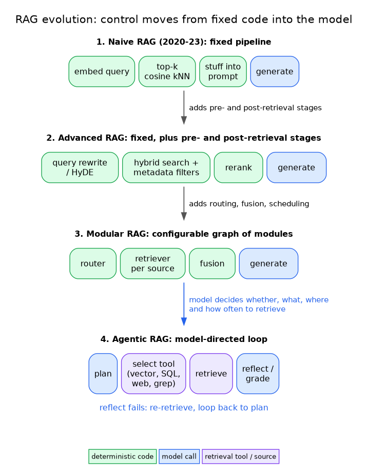
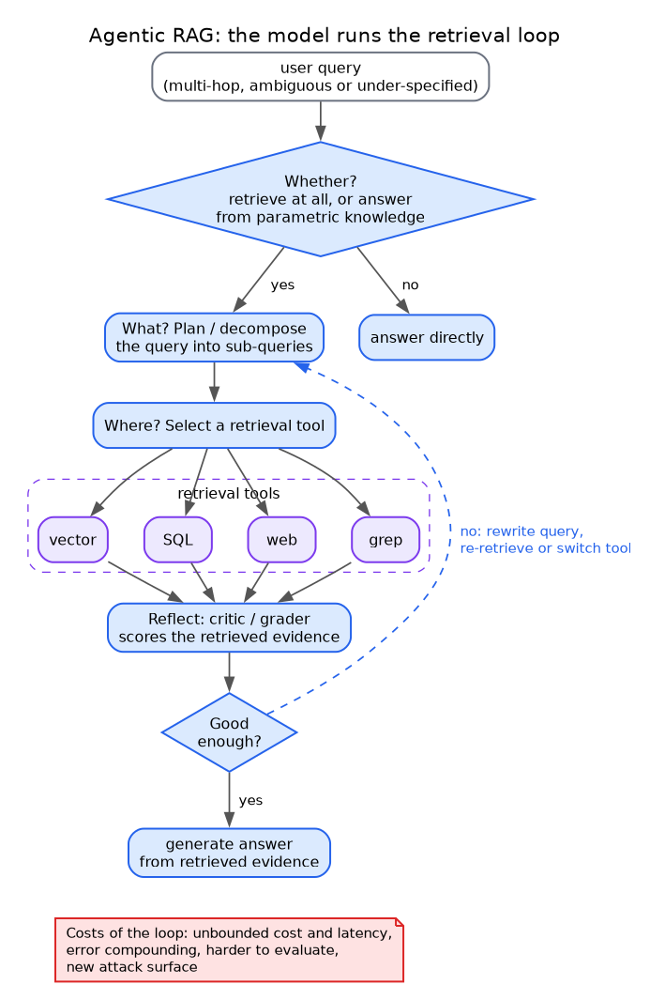
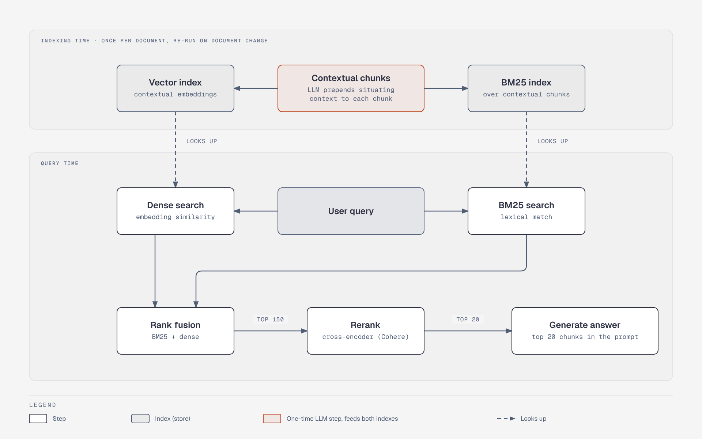
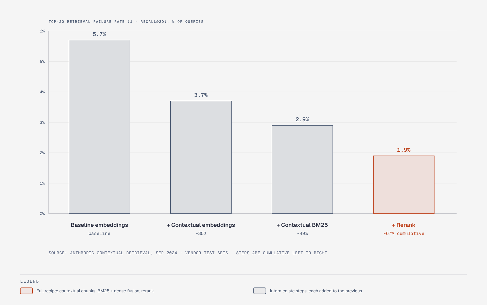
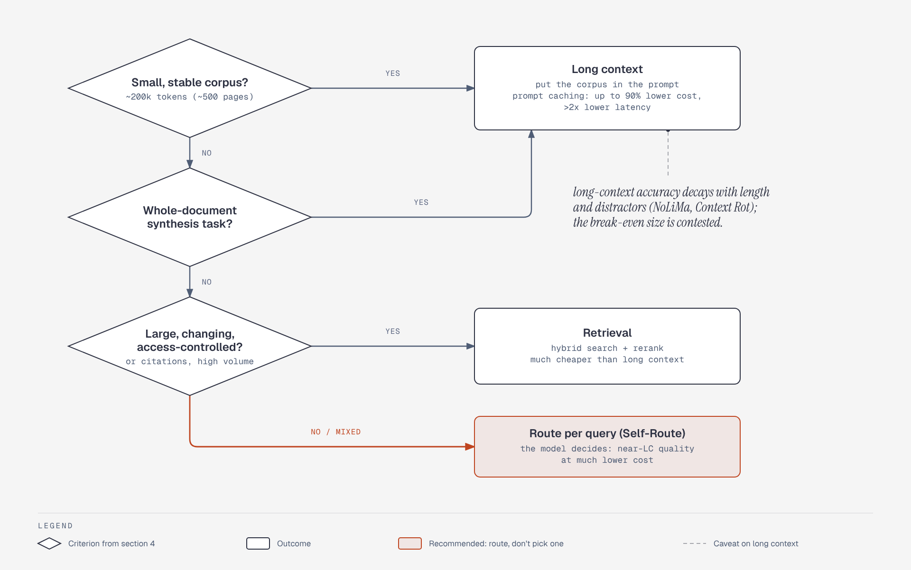
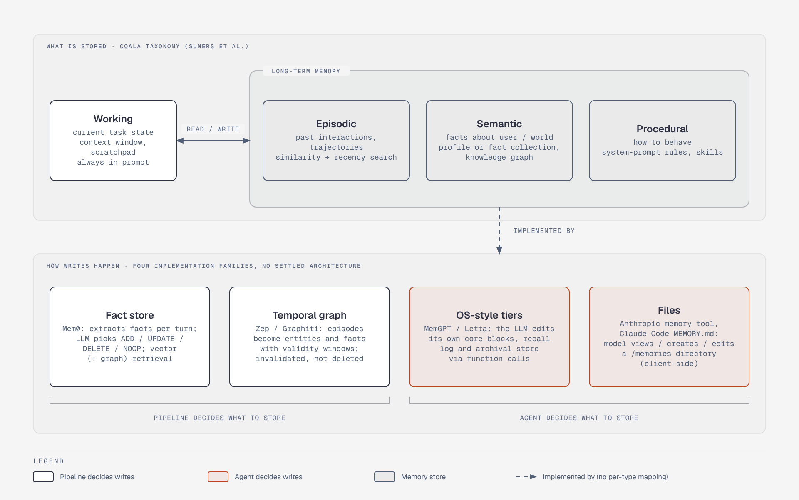

# Retrieval, RAG and Memory Architecture for Agentic Systems

Field survey, conducted **2026-10-18**. Independent of any project; records what the field has built and measured, not what any system should adopt. Context-window management (compaction, note-taking, sub-agents, context rot as a harness concern) is covered in [`../agent-harness-engineering/context-engineering.md`](../agent-harness-engineering/context-engineering.md) and is not repeated; this file is about **retrieval systems** and **persistent memory stores**.

Source-tag legend (see [Sources](#sources)): **[read]** = page fetched and read this session; **[summary]** = claim taken from a search-engine summary only; **[indexed]** = URL seen in results, content not inspected. Vendor-authored numbers are flagged as such inline. Many fetches returned abstract pages only, so paper-internal claims not visible on an abstract are marked.

## 1. Executive summary

1. **RAG has moved from a pipeline to a tool.** The sequence naive RAG → advanced RAG → modular RAG → agentic RAG is mostly a story of control moving from fixed code into the model: the agent decides whether, what, where and how often to retrieve ([Agentic RAG survey, arXiv 2501.09136, v4 Apr 2026](https://arxiv.org/abs/2501.09136)). The survey's own list of open problems is evaluation, coordination, memory management, efficiency and governance.
2. **The single best-quantified retrieval recipe is still "contextualize chunks, fuse BM25 + dense, rerank."** Anthropic's Contextual Retrieval (Sep 2024) cut top-20 retrieval failure from 5.7% to 1.9% (-67%) on its own test sets ([Anthropic](https://www.anthropic.com/news/contextual-retrieval)). Everything else in retrieval is a variation on, or an alternative to, that pipeline.
3. **"RAG is dead" is half right.** For small corpora (Anthropic's rule of thumb: under ~200k tokens) just put it in the prompt; for coding agents, grep-style agentic search displaced embedding indexes in at least Claude Code. But long-context accuracy decays with length and distractors (NoLiMa, Chroma "Context Rot"), cost scales per query, and retrieval remains the only option for large or permissioned corpora. Consensus: *route*, don't pick one.
4. **Graph-based retrieval is real but narrow.** GraphRAG wins on corpus-level "global sensemaking" questions (72-83% LLM-judged comprehensiveness win rate vs vector RAG on ~1M-token corpora, [Edge et al.](https://arxiv.org/html/2404.16130v2)), at heavy indexing cost; Microsoft's own LazyGraphRAG (Nov 2024) exists mainly to avoid that cost. For point lookups, plain hybrid retrieval is the baseline to beat.
5. **Agent memory has no settled architecture and the benchmarks are contested.** Designs split into (a) extract-and-consolidate fact stores (Mem0), (b) temporal knowledge graphs (Zep/Graphiti), (c) OS-style tiers where the agent edits its own memory (MemGPT/Letta), and (d) plain files the agent reads and writes (Anthropic memory tool, Claude Code `MEMORY.md`, Letta's filesystem result). Vendor-published LoCoMo/LongMemEval numbers conflict by tens of points; the one independent-ish reproduction found -28 to +3 points versus published claims.
6. **Structured-data retrieval is the least-solved enterprise retrieval problem.** Text-to-SQL scores collapse from ~91% (Spider 1.0) to ~21% (Spider 2.0, o1-preview agent) when schemas and dialects become realistic; semantic layers claim near-100% *on the questions they cover* and error out on the rest (dbt Labs, vendor, small sample).

## 2. RAG evolution: naive → advanced → modular → agentic

*Figure: Stages 1-3 are fixed or configured code ending in one generate call; only stage 4 hands the whether/what/where/how-often decisions, and the loop, to the model.*

| Paradigm | Control flow | Typical components | Failure it addresses | New failure it adds |
|---|---|---|---|---|
| **Naive RAG** (2020-23) | Fixed: embed → top-k → stuff → generate | Fixed-size chunks, one embedding model, cosine kNN | Parametric knowledge staleness | Lost context in chunks, low precision/recall, one-shot retrieval |
| **Advanced RAG** | Fixed, with pre- and post-retrieval stages | Query rewriting/HyDE, hybrid search, reranking, metadata filters, contextual chunks | Poor recall, noisy context | More stages to tune; latency; still one pass |
| **Modular RAG** | Configurable graph of modules (routing, fusion, scheduling) | Routers, retrievers per source, fusion, memory module | Heterogeneous sources, task-specific flows | Orchestration complexity; evaluation per module |
| **Agentic RAG** | Model-directed loop: plan, retrieve, reflect, re-retrieve, tool-select | Planner, retrieval tools (vector, SQL, web, grep), critic/grader, memory | Multi-hop, ambiguous or under-specified queries | Unbounded cost/latency, harder to evaluate, error compounding, new attack surface |

The Agentic RAG survey ([Singh et al., arXiv 2501.09136](https://arxiv.org/abs/2501.09136), v1 Jan 2025, v4 Apr 2026) organizes the space along four dimensions: agent cardinality, control structure, autonomy, and knowledge representation, and names reflection, planning, tool use and multi-agent collaboration as the agentic ingredients. (The abstract page did not expose the per-architecture taxonomy; treat finer categories - single-agent router, hierarchical, corrective, adaptive, graph-based - as the survey body's, not verified here.)

*Figure: The dashed back-edge is what distinguishes agentic RAG from advanced RAG: the model can re-plan, rewrite or switch tools, which is also the source of unbounded cost.*

Three research lines made the "agentic" step concrete:

| Work | Idea | Reported effect | Caveat |
|---|---|---|---|
| **Self-RAG** ([Asai et al., 2023](https://arxiv.org/pdf/2310.11511)) | Model emits reflection tokens to decide retrieval and critique passages/outputs | Large gains on PopQA-style tasks vs standard RAG per authors | Requires fine-tuning; specific figures not verified here |
| **CRAG** ([Yan et al., 2024](https://arxiv.org/pdf/2401.15884)) | Lightweight retrieval evaluator triggers correct/ambiguous/incorrect paths, falling back to web search | PopQA accuracy +4 to +7 points over RAG depending on base model; Self-CRAG larger | Results reported on text-davinci-003 per the repo README; stale model baseline |
| **Search-R1** ([Jin et al., 2025](https://arxiv.org/html/2503.09516v5)) | RL trains the model to issue multiple searches interleaved with reasoning, outcome-only reward | "41% (Qwen2.5-7B), 20% (Qwen2.5-3B)" over RAG baselines on 7 QA sets in latest abstract; **24%** for 7B in earlier versions | Headline changed between revisions; small open models, QA datasets |
| **DeepRAG** ([2502.01142](https://arxiv.org/abs/2502.01142)) | MDP: per sub-query, decide retrieve vs parametric | +26.4% answer accuracy (abstract) | Academic QA benchmarks |

**Where practice diverges from research.** Production coding agents mostly skip embeddings: Boris Cherny (Claude Code) has said early versions used a local vector DB and agentic search "outperformed everything, by a lot"; a developer inspection reported Claude Code searches via Grep/Glob/Read with no built-in embedding index (secondary reports, no Anthropic write-up; [search summary](https://www.mindstudio.ai/blog/is-rag-dead-what-ai-coding-agents-use-instead)). Counter-evidence: Cursor, which does index codebases, reported a 12.5% average answer-accuracy gain from semantic search (vendor, benchmark pre-dates its Composer 2, per the same summaries). Reading: for code, where exact identifiers dominate and the agent can iterate cheaply, lexical search plus a loop is competitive; semantic indexes still add measurable recall on vague queries.

## 3. The retrieval stack: design decisions and trade-offs

*Figure: Contextualization happens once at indexing and feeds both indexes; query time is search, fusion (150 candidates), rerank, then 20 chunks into the prompt.*

*Figure: Cumulative top-20 retrieval failure rate on Anthropic's test sets (vendor numbers): 5.7% baseline, 3.7% with contextual embeddings, 2.9% adding contextual BM25, 1.9% adding rerank (-67%).*

### 3.1 Chunking and indexing

| Decision | Options | Evidence | Trade-off |
|---|---|---|---|
| Chunk boundary | Fixed-size/recursive vs semantic (similarity breakpoints) vs LLM-based | Vectara/NAACL 2025 ([arXiv 2410.13070](https://arxiv.org/html/2410.13070v1)): semantic chunking helps on some synthetic "stitched" sets (Miracl F1@5 81.89 vs 69.45) but fixed-size wins on natural sets (HotpotQA 90.59 vs 87.37); authors conclude fixed-size is "more efficient and reliable". Embedding-model choice mattered more (+7.44% evidence retrieval for best embedder) | Semantic chunking costs embedding passes at index time for inconsistent gain |
| Chunk context | Prepend LLM-generated situating context ("contextual chunks") | Anthropic: contextual embeddings alone -35% failure (5.7%→3.7%); +contextual BM25 -49% (→2.9%) | One-time LLM cost: **$1.02 per million document tokens** (Anthropic's assumptions: 800-token chunks, 8k-token docs, prompt caching); must re-run on document change |
| Granularity | Small chunks for precision vs large for context; parent-document / hierarchical retrieval | Secondary: best-vs-worst chunker spread up to ~9% recall on one corpus (unverified Chroma figure, [summary](https://blog.premai.io/rag-chunking-strategies-the-2026-benchmark-guide)) | Small chunks lose antecedents; large chunks dilute embeddings |
| Modality | Text extraction/OCR vs page-image embeddings (ColPali) | [ColPali](https://arxiv.org/abs/2407.01449) (ICLR 2025): embeds page images with a VLM + late interaction; authors claim it "largely outperforms" OCR+chunk pipelines on their ViDoRe benchmark; M3DocRAG extends to multi-page | Multi-vector storage is heavy; benchmark is the authors' own |

### 3.2 Retrieval and fusion

| Decision | Options | Evidence | Trade-off |
|---|---|---|---|
| Lexical vs dense vs hybrid | BM25; dense bi-encoder; learned sparse (SPLADE, Elastic ELSER); fusion by RRF or weighted scores | Elastic (vendor): on BEIR, RRF of BM25 + learned sparse = +1.4% avg nDCG@10 vs sparse alone, +18% vs BM25 alone ([Elastic](https://www.elastic.co/search-labs/de/blog/improving-information-retrieval-elastic-stack-hybrid), [summary]); Anthropic: BM25 + embeddings via rank fusion beat embeddings alone | Gains vary by domain: on an e-commerce set RRF added only ~1.3-1.7% nDCG; an untuned fusion weight produced MRR 0.390, *below* a 0.410 dense-only baseline (secondary roundup) |
| Dense-only | Single embedding model | Anthropic: Gemini and Voyage embeddings performed best of those tested | Misses exact identifiers, rare terms |
| Late interaction | ColBERT-style per-token vectors | [ColBERT](https://arxiv.org/abs/2004.12832) (SIGIR 2020) claims ~100x faster, ~10,000x fewer FLOPs per query than BERT cross-encoders at competitive quality | Index size several-fold larger; fewer managed-DB options |
| Query transformation | Rewrite, decompose, HyDE (generate hypothetical answer, embed that) | [HyDE](https://arxiv.org/abs/2212.10496) (Dec 2022): beats unsupervised Contriever and rivals fine-tuned retrievers on web search/QA | Adds an LLM call per query; hypothetical text "may contain false details"; agentic loops make query rewriting implicit |
| Time awareness | Time-aware query expansion | LongMemEval authors recommend it for memory retrieval | Needs timestamps in the index |

### 3.3 Reranking and context budget

Anthropic's pipeline retrieved 150 chunks, reranked (Cohere), kept 20; reranking took failure from 2.9% to **1.9%** (the cumulative -67%). Passing 20 chunks beat 10 or 5. Trade-off: cross-encoder rerankers add 100s of ms to seconds of latency and per-call cost, in exchange for the largest single precision gain after contextualization; they do not fix recall misses upstream. Note that numbers are Anthropic's on codebases, fiction, arXiv and science papers, metric 1 - recall@20, with a vendor-chosen embedding (Gemini Text 004) and reranker.

### 3.4 Graph retrieval: GraphRAG, LightRAG, LazyGraphRAG

| System | Mechanism | Reported numbers | Notes |
|---|---|---|---|
| **GraphRAG** ([Microsoft, Apr 2024](https://arxiv.org/html/2404.16130v2)) | LLM extracts entity graph, detects communities, pre-summarizes each; query = map-reduce over community summaries | vs vector RAG: comprehensiveness 72-83% (podcast) / 72-80% (news) win rate; diversity 75-82% / 62-71%. Root-level summaries use ~2.3-2.6% of the tokens of map-reduce over source text. Indexing the podcast set (~1M tokens) took 281 min with gpt-4-turbo | LLM-judged, 125 questions per dataset, two ~1-1.7M-token corpora; fabrication not measured; authors list limited generalization |
| **LightRAG** ([Guo et al., Oct 2024](https://arxiv.org/abs/2410.05779)) | Graph-augmented text index, dual-level (entity/theme) retrieval, incremental updates | Abstract claims "considerable improvements" with no figures visible | Cheaper update path than GraphRAG's rebuild; detailed numbers not verified |
| **LazyGraphRAG** ([Microsoft Research blog, Nov 2024; note Jun 2025](https://www.microsoft.com/en-us/research/blog/lazygraphrag/)) | Defers LLM use to query time; NLP-based concept graph, best-first + breadth-first | Indexing cost identical to vector RAG and 0.1% of full GraphRAG; global-query quality comparable to GraphRAG Global at >700x lower query cost; benchmark = 5,590 AP articles, 100 synthetic queries | Vendor self-evaluation, LLM-judged; no independent replication found |
| **RAG vs GraphRAG** ([arXiv 2502.11371, v3 Mar 2026](https://arxiv.org/abs/2502.11371)) | Systematic comparison on QA and query-focused summarization | Abstract: "distinct strengths" per task, hybrid selection/integration helps; no figures visible | Third-party framing: graph for summarization/multi-hop, vector for detail lookup |

Consensus: graphs pay off for *corpus-level* questions ("what are the main themes?") and entity-relationship-heavy domains; they are over-built for lookups. Controversy: whether the extraction cost is justified, and whether LLM-as-judge win rates on synthetic questions transfer.

## 4. Long context vs RAG

*Figure: The file's consensus is to route, not pick one; long-context accuracy decay and the contested break-even size are the caveats on the long-context branch.*

| Evidence | Finding | Source type |
|---|---|---|
| Li et al., EMNLP 2024 industry ([arXiv 2407.16833](https://arxiv.org/abs/2407.16833)) | "When resourced sufficiently, LC consistently outperforms RAG" on average, but RAG is much cheaper; **Self-Route** lets the model decide per query and keeps near-LC quality at much lower cost | Academic (Google-affiliated authors per secondary reports) |
| NoLiMa ([arXiv 2502.05167](https://arxiv.org/abs/2502.05167), ICML 2025) | With little lexical overlap between question and needle, 11 of 13 models (all claiming >=128K) fall below 50% of their short-context baseline at 32K; GPT-4o 99.3% → 69.7% | Academic |
| Chroma "Context Rot" ([Jul 2025](https://www.trychroma.com/research/context-rot)) | 18 models; degradation with length in every experiment, faster with lower needle-question similarity and with distractors; on LongMemEval, ~300-token focused prompts beat ~113k-token full prompts; Claude models abstained most, GPT models hallucinated most | Vendor (Chroma sells a vector DB) - qualitative, no headline percentages |
| Anthropic, Sep 2024 | Under ~200k tokens (~500 pages) skip RAG and put the corpus in the prompt, using prompt caching to cut cost up to 90% and latency >2x | Vendor guidance |
| Cost-per-query arguments | Retrieval wins at high query volume (one practitioner claims 1,250x; unverified) | Secondary |

Where consensus sits: long context for whole-document synthesis and small stable corpora; retrieval for large, changing, access-controlled, citation-requiring corpora; routing between them. Where the controversy sits: how fast "small enough to stuff" grows as windows and caching improve, and whether retrieval quality or reasoning quality is the binding constraint. Note most "RAG is dead" claims originate from vendors with long-context or agentic products; most "RAG is not dead" claims from vector DB vendors.

## 5. Vector stores: integrated vs specialized

| Option | Positioning | Strengths | Costs / risks | Evidence quality |
|---|---|---|---|---|
| **pgvector (+ pgvectorscale)** | Extension to existing Postgres | One system: transactions, joins with relational data, backups/PITR, SQL filtering, existing ops | You tune HNSW/IVF and memory yourself; scale ceiling lower | Vendor: Timescale (sells Postgres) reported 471 QPS at 99% recall on 50M 768-d vectors vs Qdrant 41 QPS, and 28x lower p95 latency / 16x throughput / 75% lower self-hosted cost vs Pinecone s1 (Pinecone p2 at 90% recall: only 1.4x / 1.5x). Separate posts, EC2 self-hosted costs vs managed prices ([summary](https://www.tigerdata.com/blog/pgvector-vs-pinecone)) |
| **MongoDB Atlas Vector Search** | Vector index inside the operational document DB | Vectors live beside documents; `$vectorSearch` inside `$rankFusion` hybrid pipelines (MongoDB 8.1+); automated Voyage embeddings at ingest and query (8.3 announcement) | Tied to Atlas for managed features; vendor-authored docs | Docs/announcement only ([MongoDB docs](https://www.mongodb.com/docs/vector-search/hybrid-search/vector-search-with-rankfusion/), [summary]) |
| **Pinecone** | Managed, purpose-built | Serverless ops, scaling, simple API | Separate system to sync; cost at scale; data duplication | Mostly seen through competitors' benchmarks |
| **Qdrant / Weaviate / Milvus** | Purpose-built, self-host or cloud | Rich filtering, hybrid search built in (Weaviate), scale-out | Another datastore, consistency with source of truth | Same |

Common reading of the evidence: recall@10 is similar across major engines at matched settings; the decision is throughput per dollar, filtering, hybrid support, and operational surface. Heuristics circulating (e.g., Postgres up to ~50M vectors, specialized engines justified near 500M+) are practitioner rules of thumb, not measured thresholds. **Every head-to-head benchmark found was authored by a vendor with an interest in the outcome**; the data here supports "integrated is competitive at moderate scale" more firmly than "integrated wins".

## 6. Agent memory

### 6.1 Taxonomy

*Figure: The CoALA types describe what is stored; the four families differ mainly in how writes happen and who decides, and no single architecture is settled.*

CoALA ([Sumers et al., arXiv 2309.02427, TMLR](https://arxiv.org/abs/2309.02427)) is the reference framework: modular memory components plus a structured action space split into internal actions (reasoning, retrieval, learning) and external grounding. The commonly cited breakdown from the paper's body (not visible on the abstract page) is **working** memory (current context) and long-term **episodic** (past experiences), **semantic** (facts) and **procedural** (code/prompt-encoded skills). LangMem uses the same three long-term types ([LangMem docs](https://langchain-ai.github.io/langmem/concepts/conceptual_guide/)).

| Memory type | What it holds | Typical implementation | Read path | Write path |
|---|---|---|---|---|
| Working | Current task state | Context window, scratchpad | Always in prompt | Appended each turn |
| Episodic | Past interactions/trajectories | Event log, summaries, few-shot exemplars | Similarity + recency search | Append, summarize later |
| Semantic | Facts about user/world | Profile doc or fact collection; knowledge graph | Always-loaded profile, or retrieval | Extraction + update/merge |
| Procedural | How to behave | System-prompt rules, skills, optimizer-rewritten prompts | Loaded at start | Feedback-driven rewrite (LangMem `create_prompt_optimizer`) |

Lineage: [Generative Agents](https://arxiv.org/abs/2304.03442) (Park et al., 2023) introduced the memory stream + retrieval + reflection loop; ablations showed removing observation, planning or reflection each reduced believability.

### 6.2 Architectures compared

| System | Core idea | Write policy | Read policy | Forgetting | Evidence / caveat |
|---|---|---|---|---|---|
| **MemGPT / Letta** ([arXiv 2310.08560](https://arxiv.org/abs/2310.08560), Oct 2023) | "Virtual context management": OS-style tiers; the LLM edits its own memory via function calls | Agent-initiated tool calls (current docs: core memory blocks, recall = conversation log, archival = embedding store; recursive summary on overflow, [summary of Letta docs](https://docs.letta.com/guides/agents/architectures/memgpt)) | Core blocks always in context; `conversation_search`, `archival_memory_search` on demand | Summarization/eviction; explicit replace | Abstract reports no benchmark numbers; Zep's paper reports MemGPT at 93.4% on DMR |
| **Mem0** ([arXiv 2504.19413](https://arxiv.org/html/2504.19413), Apr 2025) | Extract candidate facts per message pair, then LLM picks ADD / UPDATE / DELETE / NOOP against top-10 similar memories; Mem0g adds a Neo4j graph | Per-turn extraction + LLM-arbitrated consolidation | Vector (and graph) retrieval | Contradicted memories deleted (graph: marked invalid) | Authors are the company (contact research@mem0.ai); see 6.3 |
| **Zep / Graphiti** ([arXiv 2501.13956](https://arxiv.org/abs/2501.13956), Jan 2025; [Graphiti repo](https://github.com/getzep/graphiti)) | Temporal knowledge graph: raw episodes → entities/facts with validity windows; facts invalidated, not deleted | Incremental ingestion, no batch recompute | Hybrid: embeddings + BM25 + graph traversal, "without reliance on LLM summarization"; "typically sub-second" | Temporal invalidation preserves history | Vendor paper: DMR 94.8% vs MemGPT 93.4%; LongMemEval up to +18.5% accuracy and ~90% lower latency vs baseline (abstract) |
| **LangMem / LangGraph store** ([docs](https://langchain-ai.github.io/langmem/concepts/conceptual_guide/)) | Library layer over a key-value/vector store; collections vs profiles | **Hot path** (during conversation: immediate, adds latency) vs **background** (after inactivity: no latency, delayed, "supports higher recall") | Retrieval should weigh similarity, importance, recency/frequency | Profiles updated in place | Mem0's table: LangMem p95 total latency 60.4 s - slowest |
| **A-MEM** ([arXiv 2502.12110](https://arxiv.org/pdf/2502.12110v9), NeurIPS 2025) | Zettelkasten notes: LLM-generated keywords/tags/context, links between notes, old notes updated on new arrivals | Note construction + link generation per memory | Embedding top-k | Rewriting of old notes | Authors report SOTA across six models; Mem0's re-run scored it low (overall J 48.4) |
| **Files-as-memory** (Anthropic [memory tool](https://platform.claude.com/docs/en/agents-and-tools/tool-use/memory-tool), `memory_20250818`; Claude Code `MEMORY.md`; Letta filesystem agent) | A `/memories` directory the model views/creates/edits/renames/deletes; **client-side**, the developer owns storage | Model decides what to record; system prompt tells it to "assume interruption" | `view` directory first, read relevant files just-in-time | Model can delete/rename; docs advise size caps and expiry of unaccessed files | Docs also warn of path traversal and sensitive data; see 6.3 for Letta's benchmark |
| **ChatGPT memory** ([OpenAI help](https://help.openai.com/en/articles/11146739-how-does-reference-saved-memories-work), [announcement](https://openai.com/blog/memory-and-new-controls-for-ChatGPT)) | Two layers: *saved memories* (explicit or model-decided facts, placed in context, model can update/merge/delete) and *reference chat history* (derived insights from past chats) | Model-decided + user-requested | Saved memories in context; chat-history insights "can change over time" | User can delete; retrieval internals undisclosed | Official docs say nothing about embeddings vs other mechanisms |

### 6.3 Benchmarks and the credibility problem

**LoCoMo** (long synthetic two-speaker dialogues, QA categories) and **LongMemEval** ([Wu et al., arXiv 2410.10813](https://arxiv.org/abs/2410.10813), ICLR 2025; 500 questions over scalable chat histories testing information extraction, multi-session reasoning, temporal reasoning, knowledge updates, abstention; commercial assistants and long-context LLMs showed a ~30% accuracy drop) are the de facto standards. **MemoryAgentBench** ([Hu, Wang, McAuley, arXiv 2507.05257](https://arxiv.org/abs/2507.05257), Jul 2025, v4 Jun 2026) adds a competency view - accurate retrieval, test-time learning, long-range understanding, selective forgetting - and reports current methods "fall short of mastering all four."

LoCoMo overall LLM-judge (J) scores as published in the Mem0 paper (vendor, Apr 2025; GPT-4o-mini backbone):

| Method | Overall J | p95 total latency | Memory tokens |
|---|---|---|---|
| Full context | 72.90% | 17.1 s | 26,031 |
| Mem0g (graph) | 68.44% | 2.59 s | 3,616 |
| Mem0 | 66.88% | 1.44 s | 1,764 |
| Zep (as run by Mem0) | 65.99% | 2.93 s | 3,911 |
| Best plain RAG (k=2, 256-token chunks) | ~60.97% | n/a | n/a |
| LangMem | 58.10% | 60.4 s | 127 |
| OpenAI memory | 52.90% | 0.89 s | 4,437 |
| A-Mem (re-run) | 48.38% | 4.37 s | 2,520 |

Mem0 headline claims: 26% relative J gain over OpenAI memory, 91% lower p95 latency and >90% token savings vs full context. Note the table itself shows full-context *beating* every memory system on accuracy; the memory layers buy latency and cost, not quality. Mem0's graph storage used ~14k tokens per conversation and Zep's graph >600k.

The dispute: Zep's reply ([May 2025](https://www.getzep.com/blog/lies-damn-lies-statistics-is-mem0-really-sota-in-agent-memory/)) says Mem0 mis-ran Zep (both speakers assigned the user role, timestamps appended to text instead of `created_at`, sequential searches) and reports a corrected **75.14% ± 0.17** J, p95 search 0.632 s. Letta ([Aug 2025](https://www.letta.com/blog/benchmarking-ai-agent-memory)) put the full LoCoMo history in a file and gave a GPT-4o-mini agent grep, semantic file search, open/close: **74.0%** vs Mem0's reported 68.5%, arguing agent skill with simple tools matters more than the storage mechanism (and that LoCoMo tests retrieval rather than memory management). Critiques: Letta is itself a memory vendor; the agent had a semantic-search tool, so "just a filesystem" overstates it; LoCoMo has no knowledge-update category and an independent audit alleges answer-key errors and lenient judging (single analyst, [summary](https://dev.to/penfieldlabs/we-audited-locomo-64-of-the-answer-key-is-wrong-and-the-judge-accepts-up-to-63-of-intentionally-33lg)). Mem0 now advertises 91-94% on LoCoMo/LongMemEval for its managed platform, a different configuration from the paper.

LongMemEval, Redis's reproduction ([Sep 2026](https://redis.io/resources/agent-memory-benchmark-report/); Redis sells memory products and ranks its own approach first) - gpt-4o answer model, official judge, 500 questions:

| System | Vendor-reported | Redis-reproduced |
|---|---|---|
| Redis Remis + Instruct | n/a | 86.5% |
| Mastra OM | 84.2% | 84.2% |
| Amazon Bedrock AgentCore | 73.6% | 77.0% |
| Zep/Graphiti | 71.2% | not reproduced |
| Google Vertex Memory Bank | ~70% (paper) | 42.4% |
| Mem0 | 49.0% (cited) | not reproduced |

Redis states reproduced figures differed from published ones by **+3 to -28 points**. Other vendors claim 92-97% (OMEGA 95.4%, Exabase 96.4% at top-50, Supermemory 97% Recall@20 - a retrieval metric, not QA accuracy). Takeaways: scores vary with backbone model, retrieval budget, judge and question subset; vendor numbers from the same quarter differ by 40+ points for the same product (Mem0: 49.0% vs 94.4% claimed); only same-harness, same-judge comparisons are interpretable.

### 6.4 Memory write/read policies, consolidation, forgetting

| Policy axis | Options | Trade-off |
|---|---|---|
| **When to write** | Hot path (agent writes mid-task) vs background/"subconscious" (after idle) vs end-of-session | Hot path: fresh but costs latency and agent attention; background: no latency, higher recall per LangMem, but stale until it runs |
| **What to write** | Raw episodes vs extracted facts vs LLM-authored notes vs free-form files | Extraction loses nuance and can hallucinate facts; raw retains everything but bloats retrieval (Zep's graph >600k tokens vs 26k raw conversation) |
| **Who decides** | Fixed pipeline (Mem0 extraction) vs the agent itself (MemGPT, memory tool, ChatGPT) | Pipeline is predictable and auditable; agent-driven adapts but depends on model discipline |
| **Consolidation** | LLM-arbitrated ADD/UPDATE/DELETE/NOOP; periodic summarization/reflection; note rewriting (A-MEM); sleep-time agents | Each LLM-in-the-loop merge can silently corrupt a correct memory; MemoryAgentBench's selective-forgetting tasks (FactConsolidation) target exactly this |
| **Contradiction/time** | Overwrite vs invalidate with validity windows (Graphiti, Mem0g) | Overwrite is simple but loses history; bi-temporal tracking costs graph complexity |
| **Read** | Always-loaded profile/blocks vs on-demand search; score = similarity + recency + importance | Always-loaded costs tokens every turn; search can miss. LongMemEval: session decomposition and fact-augmented keys at index time, time-aware query expansion at read |
| **Forgetting** | TTL/expiry, size caps, user delete, supersession, none | Memory tool docs recommend expiring unaccessed files and capping size; few systems publish a principled forgetting policy |

### 6.5 Memory as an attack surface

Persistent memory turns one-off prompt injection into persistence. **MINJA** ([arXiv 2503.03704](https://arxiv.org/html/2503.03704v2), 2025) reports an average 98.2% injection success and 76.8% attack success via ordinary user interactions that plant records later retrieved by other users' queries - reported as upper bounds under idealized conditions by follow-up work. **AgentPoison** reports >=80% attack success at <0.1% poisoned data (secondary). OWASP's 2026 agentic top 10 lists memory/context poisoning (ASI06, per a secondary source). The memory-tool docs push mitigation to the developer: canonicalize paths against traversal, validate/strip sensitive data before writes, cap size, expire.

## 7. RAG evaluation

| Layer | Metric family | What it measures | Notes |
|---|---|---|---|
| Retrieval | Recall@k, MRR, nDCG; **context recall / context precision** (RAGAS) | Did the right chunks arrive, and in what rank order | Needs labeled relevant chunks or LLM judge; Anthropic reports 1 - recall@20 |
| Generation grounding | **Faithfulness / groundedness** | Are answer claims supported by retrieved context (claim extraction + verification) | LLM-judge dependent |
| Answer quality | **Response (answer) relevancy**, correctness vs reference | Does the answer address the question | RAGAS lists also context entities recall and noise sensitivity ([docs](https://docs.ragas.io/en/stable/concepts/metrics/available_metrics/)) |
| System | End-to-end task success, latency, cost per query, abstention rate | Whether retrieval actually helps the downstream task | LongMemEval's abstention class tests "don't know" |

RAGAS ([Es et al., arXiv 2309.15217](https://arxiv.org/abs/2309.15217), Sep 2023) framed these as reference-free LLM-judged metrics assessing retrieval quality, the LLM's use of passages and generation quality. (The pages fetched did not define each metric or give the WikiEval validation numbers; the definitions in the table above are the framework's standard usage.) Known limits: LLM judges are noisy and biased (the GraphRAG authors validated LLM labels against claim-based labels at only 78% agreement for comprehensiveness; LoCoMo auditing shows judges can accept wrong answers); component metrics can look healthy while end-to-end utility is poor; agentic RAG multiplies trajectories, so single-shot retrieval metrics under-describe it. The consensus practice is a small human-labeled golden set for retrieval plus judge-based generation metrics, calibrated on that set.

## 8. Structured-data retrieval: text-to-SQL and semantic layers

| Benchmark | What it tests | Headline result |
|---|---|---|
| Spider 1.0 / BIRD | Single-database, relatively clean schemas | 91.2% (Spider 1.0) and 73.0% (BIRD) in Spider 2.0's comparison table, for o1-preview |
| **Spider 2.0** ([Lei et al., arXiv 2411.07763](https://arxiv.org/abs/2411.07763), ICLR 2025 oral) | 632 enterprise workflow tasks; databases often >1,000 columns on BigQuery/Snowflake/local; multiple SQL dialects; needs metadata and docs search; solutions often multiple queries, >100 lines | o1-preview code agent **21.3%** |

Why enterprise text-to-SQL is retrieval: the agent must *retrieve* the right tables, columns, join paths, metric definitions and dialect docs from thousands of columns before generating anything. Current approaches:

| Approach | Mechanism | Evidence | Trade-off |
|---|---|---|---|
| Schema in prompt | Dump DDL | dbt Labs' 2026 benchmark loaded the full 15-table schema, and its authors call this impractical at scale | Fails as schemas grow |
| Schema/column retrieval + examples | Embed table/column descriptions, sample values, past queries | General practice; no controlled number gathered here | Needs maintained descriptions |
| Agentic exploration | Agent inspects metadata, runs probe queries, reads docs (Spider-Agent style) | Spider2-snow leaderboard entries: DAIL-SQL+GPT-4o 2.2%, Spider-Agent 23-26%, Re-FoRCE 31.3% (preprint summary) | Many tool calls; error compounding |
| **Semantic layer** (governed metric/entity definitions the LLM queries instead of raw SQL) | Model emits metric/dimension requests; deterministic engine generates SQL | dbt Labs (vendor), Apr 2026: on an 11-question, 15-table insurance set, 20 runs each, modeled project: Sonnet 4.6 text-to-SQL 90.0% vs semantic layer 98.2%; GPT-5.3 Codex 84.1% vs 100.0%; across all questions before added modeling 64.5% vs 72.7% (2023: 32.7% vs 60.5%); un-covered multi-hop questions scored 0% but *error out rather than return wrong data* ([dbt blog](https://docs.getdbt.com/blog/semantic-layer-vs-text-to-sql-2026)). Collate (vendor) claims 10.8% → 76.5% on a Spider 2.0-Snow subset; a preprint reports a semantic-layer agent at 94.15% on Spider2-snow but caveats that the layer encodes per-database domain knowledge ([summary](https://www.alphaxiv.org/abs/2411.07763v2)) | Coverage is bounded by what was modeled; modeling is human/LLM work; evidence is vendor-authored and small |

Reading across: text-to-SQL accuracy rose substantially 2023→2026 on a fixed benchmark (32.7% → 64.5% full question set), yet realistic enterprise benchmarks remain far from solved; semantic layers trade coverage for correctness and explicit failure; no independent large-scale comparison was found.

## 9. Where consensus and controversy lie

| Topic | Broad consensus | Live controversy |
|---|---|---|
| Hybrid + rerank | BM25 + dense with rank fusion and a reranker is the sound default; contextualizing chunks helps | Magnitude by domain; untuned fusion can underperform dense-only |
| Chunking | Evaluate on your corpus; embedding model matters at least as much as chunker | Whether semantic/LLM chunking justifies cost (Vectara says mostly no; some secondary benchmarks differ) |
| Long context vs RAG | Route; long context degrades with length/distractors | Break-even corpus size and how it moves with caching and larger windows |
| Agentic retrieval | Multi-hop and ambiguous queries benefit from iterative retrieval | Cost/latency unboundedness; evaluation; whether embeddings are needed at all for code |
| GraphRAG | Helps global/summarization queries | Indexing cost, judge validity, benefit on lookup queries; LazyGraphRAG results are vendor-only |
| Memory architecture | Separate working vs long-term; need update/contradiction handling; time matters | Graph vs vector vs files; hot-path vs background; agent-managed vs pipeline-managed |
| Memory benchmarks | LongMemEval is the better-designed benchmark (updates, temporal, abstention) | Vendor numbers irreconcilable; LoCoMo validity questioned; scores depend on backbone/judge/budget |
| Vector DB | Recall is comparable across engines | Integrated vs specialized throughput/cost - all benchmark authors are vendors |
| Structured data | Raw text-to-SQL is far from solved on enterprise schemas; semantic layers raise accuracy within their coverage | Cost of building/maintaining the layer; independent evidence thin |

## Sources

Tags: [read] fetched and read; [summary] content known only from a search-engine summary; [indexed] URL seen in results only.

- [read] Anthropic, Contextual Retrieval (2024-09-19) - https://www.anthropic.com/news/contextual-retrieval
- [read] Agentic RAG survey, arXiv 2501.09136 - https://arxiv.org/abs/2501.09136
- [read] LongMemEval, arXiv 2410.10813 - https://arxiv.org/abs/2410.10813
- [read] Mem0 paper, arXiv 2504.19413 (HTML) - https://arxiv.org/html/2504.19413
- [read] Mem0 paper abstract page - https://arxiv.org/abs/2504.19413
- [read] Zep/Graphiti paper, arXiv 2501.13956 - https://arxiv.org/abs/2501.13956
- [read] MemGPT, arXiv 2310.08560 - https://arxiv.org/abs/2310.08560
- [read] CoALA, arXiv 2309.02427 - https://arxiv.org/abs/2309.02427
- [read] Letta, Benchmarking AI Agent Memory (2025-08-12) - https://www.letta.com/blog/benchmarking-ai-agent-memory
- [read] Zep, rebuttal to Mem0 (2025-05-06) - https://www.getzep.com/blog/lies-damn-lies-statistics-is-mem0-really-sota-in-agent-memory/
- [read] GraphRAG, arXiv 2404.16130 - https://arxiv.org/html/2404.16130v2
- [read] LazyGraphRAG, Microsoft Research blog - https://www.microsoft.com/en-us/research/blog/lazygraphrag/
- [read] LightRAG, arXiv 2410.05779 - https://arxiv.org/abs/2410.05779
- [read] RAG vs GraphRAG, arXiv 2502.11371 - https://arxiv.org/abs/2502.11371
- [read] Chroma, Context Rot (2025-07-14) - https://www.trychroma.com/research/context-rot
- [read] NoLiMa, arXiv 2502.05167 - https://arxiv.org/abs/2502.05167
- [read] Li et al., RAG or Long-Context LLMs, arXiv 2407.16833 - https://arxiv.org/abs/2407.16833
- [read] Anthropic memory tool docs - https://platform.claude.com/docs/en/agents-and-tools/tool-use/memory-tool
- [read] Graphiti repo - https://github.com/getzep/graphiti
- [read] LangMem conceptual guide - https://langchain-ai.github.io/langmem/concepts/conceptual_guide/
- [read] Redis agent memory benchmark report (2026-09-21) - https://redis.io/resources/agent-memory-benchmark-report/
- [read] Generative Agents, arXiv 2304.03442 - https://arxiv.org/abs/2304.03442
- [read] MemoryAgentBench, arXiv 2507.05257 - https://arxiv.org/abs/2507.05257
- [read] ColBERT, arXiv 2004.12832 - https://arxiv.org/abs/2004.12832
- [read] ColPali, arXiv 2407.01449 - https://arxiv.org/abs/2407.01449
- [read] HyDE, arXiv 2212.10496 - https://arxiv.org/abs/2212.10496
- [read] RAGAS, arXiv 2309.15217 - https://arxiv.org/abs/2309.15217
- [read] RAGAS metrics list - https://docs.ragas.io/en/stable/concepts/metrics/available_metrics/
- [read] DeepRAG, arXiv 2502.01142 - https://arxiv.org/abs/2502.01142
- [read] Vectara et al., semantic chunking, arXiv 2410.13070 - https://arxiv.org/html/2410.13070v1
- [read] Spider 2.0, arXiv 2411.07763 - https://arxiv.org/abs/2411.07763
- [read] dbt Labs, Semantic Layer vs Text-to-SQL 2026 (2026-04-07) - https://docs.getdbt.com/blog/semantic-layer-vs-text-to-sql-2026
- [summary] Search-R1, arXiv 2503.09516 - https://arxiv.org/html/2503.09516v5
- [summary] Self-RAG, arXiv 2310.11511 - https://arxiv.org/pdf/2310.11511
- [summary] CRAG, arXiv 2401.15884 - https://arxiv.org/pdf/2401.15884
- [summary] A-MEM, arXiv 2502.12110 - https://arxiv.org/pdf/2502.12110v9
- [summary] MINJA, arXiv 2503.03704 - https://arxiv.org/html/2503.03704v2
- [summary] Elastic, hybrid retrieval - https://www.elastic.co/search-labs/de/blog/improving-information-retrieval-elastic-stack-hybrid
- [summary] Tiger Data/Timescale, pgvector vs Pinecone - https://www.tigerdata.com/blog/pgvector-vs-pinecone
- [summary] MongoDB, $rankFusion hybrid search - https://www.mongodb.com/docs/vector-search/hybrid-search/vector-search-with-rankfusion/
- [summary] Letta docs, MemGPT architecture - https://docs.letta.com/guides/agents/architectures/memgpt
- [summary] OpenAI help, reference saved memories - https://help.openai.com/en/articles/11146739-how-does-reference-saved-memories-work
- [summary] OpenAI, memory and new controls - https://openai.com/blog/memory-and-new-controls-for-ChatGPT
- [summary] MindStudio, is RAG dead (Claude Code agentic search) - https://www.mindstudio.ai/blog/is-rag-dead-what-ai-coding-agents-use-instead
- [summary] Penfield Labs, LoCoMo audit - https://dev.to/penfieldlabs/we-audited-locomo-64-of-the-answer-key-is-wrong-and-the-judge-accepts-up-to-63-of-intentionally-33lg
- [summary] PremAI, chunking benchmark guide - https://blog.premai.io/rag-chunking-strategies-the-2026-benchmark-guide
- [summary] Semantic-layer text-to-SQL preprint listing - https://www.alphaxiv.org/abs/2411.07763v2
- [indexed] Semantic-layer-mediated agent for NL2SQL, arXiv 2606.31041 - https://arxiv.org/pdf/2606.31041
- [indexed] Collate, text-to-SQL problem - https://www.getcollate.io/blog/your-text-to-sql-problem-is-not-the-llm
- [indexed] M3DocRAG, arXiv 2411.04952 - https://arxiv.org/abs/2411.04952
- [indexed] Mem0 research pages - https://mem0.ai/research
- [indexed] Supermemory research report - https://supermemory.ai/research.md
- [indexed] Exabase LongMemEval press release - https://www.hpcwire.com/off-the-wire/exabase-achieves-highest-reported-score-on-leading-ai-memory-benchmark-using-a-smaller-cheaper-model/
